# AEGIS SOC

**Active Directory · OPNsense · Suricata · Windows Security · Sysmon · MITRE ATT&CK · Identity Intelligence**

**Sanal ağın kurulmasından gerçek güvenlik olaylarının izlenmesine kadar geliştirdiğim uçtan uca SOC laboratuvarı.**

     

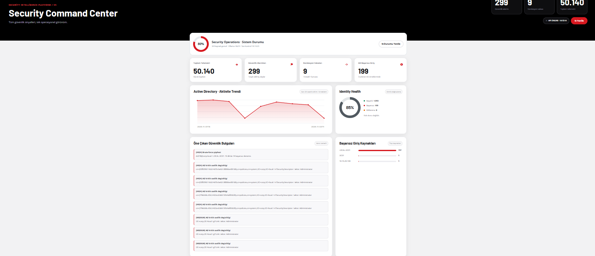

## Projenin amacı

AEGIS SOC'u bir gösterge paneli tasarlamakla sınırlı kalmadan, **ağ güvenliği, Active Directory, uç nokta izleme ve olay analizini bir araya getirmek** için geliştirdim. Önce sanal şirket ağı kurdum; sonra bu ağı güvenlik bölgelerine ayırdım, geçişleri OPNsense kurallarıyla denetledim ve ağda oluşan olayları SOC'a taşıdım. Windows Security, Sysmon, Suricata, DNS ve firewall kayıtlarını tek sistemde inceleyebilir hale getirdim.

Bu projede iki ayrı sorumluluk var: **OPNsense trafiği izin/verme veya engelleme kararıyla yönetiyor; AEGIS SOC ise kayıtları salt-okunur şekilde topluyor, ilişkilendiriyor ve analiste sunuyor.** SOC, kendiliğinden firewall kuralı eklemiyor, kullanıcı hesabı kilitlemiyor veya uç noktalara müdahale etmiyor.

**Dokümantasyon notu:** **[LAB]** gerçek laboratuvar yapılandırması, test çıktısı veya ekran görüntüsüne; **[KOD]** incelenen uygulama kaynak kodundaki davranışa dayanır. Tespit edilen bir örüntü, tek başına doğrulanmış sızma veya başarılı saldırı anlamına gelmez.

### İçindekiler

1. [Laboratuvar bileşenleri](#1-laboratuvar-bileşenleri)
2. [Sanal makine ve ağ kurulumu](#2-sanal-makine-ve-ağ-kurulumu)
3. [OPNsense ve firewall politikaları](#3-opnsense-ve-firewall-politikaları)
4. [DNS, DHCP ve Suricata](#4-dns-dhcp-ve-suricata)
5. [Active Directory ve Windows istemcisi](#5-active-directory-ve-windows-istemcisi)
6. [Collector'lar ve veri akışı](#6-collectorlar-ve-veri-akışı)
7. [AEGIS SOC yazılımı](#7-aegis-soc-yazılımı)
8. [Tespit kuralları ve testler](#8-tespit-kuralları-ve-testler)
9. [Identity ve yetki analizi](#9-identity-ve-yetki-analizi)
10. [Dashboard ekranları](#10-dashboard-ekranları)
11. [Çalıştırma ve doğrulama](#11-çalıştırma-ve-doğrulama)
12. [Güvenlik, kapsam ve sonuç](#12-güvenlik-kapsam-ve-sonuç)
13. [Kaynak kodu ve GitHub düzeni](#13-kaynak-kodu-ve-github-düzeni)

---

## 1. Laboratuvar bileşenleri

[LAB] Sistemi gerçek log üreten ayrı makineler üzerine kurdum. Her bileşenin görevi belli; olay oluşumu ile olayın analiz edilmesi farklı makinelerde gerçekleşiyor.

| Bileşen | Görevi | Laboratuvardaki yeri |
|---|---|---|
| **OPNsense** | Ağ geçidi, PF firewall, segmentasyon, Unbound, Suricata | Ağ sınırı |
| **DC01** | Windows Server 2019, AD DS, `corp.local`, domain DNS | SERVERS |
| **WIN01** | Domain'e katılmış Windows 11 istemci, Security ve Sysmon olayları | USERS |
| **Kali Linux** | Yetkili güvenlik testleri, rsyslog ve ağ collector | SECURITY |
| **AEGIS SOC** | FastAPI/Uvicorn, SQLite, tespit motorları, web paneli | Yönetim bilgisayarı |

[LAB] Sanal makinelerin ağ bağdaştırıcılarını VirtualBox üzerinde ayrı ayrı tanımladım. Her birinin ağdaki rolünü ekran görüntülerinde görmek mümkün:

| OPNsense sanal makinesi | DC01 sanal makinesi |
|---|---|
|  |  |

| WIN01 sanal makinesi | Kali sanal makinesi |
|---|---|
| 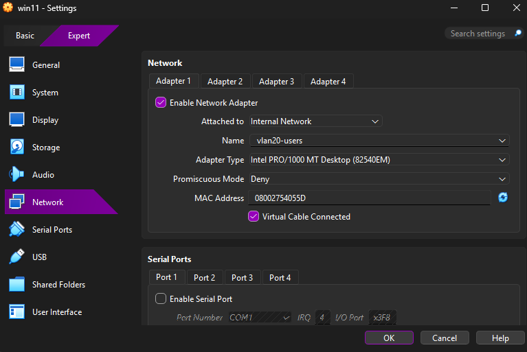 |  |

## 2. Sanal makine ve ağ kurulumu

### 2.1. Neden ayrı subnet'ler?

Başlangıçta bütün makineleri aynı ağda tutmak yerine kullanıcı, sunucu ve güvenlik testi trafiğini ayrıştırdım. Böylece bir istemcinin domain controller'a ihtiyaç duyduğu servislerle Kali'nin test trafiği aynı izin kuralına tabi kalmadı. **Amaç bütün ağları birbirinden tamamen koparmak değil; gerekli bağlantıları açık tutup diğerlerini politika kapsamında denetlemekti.**

[LAB] Kullanılan ağ planı:

| Güvenlik bölgesi | OPNsense arayüzü | IP ağı | Sistem / rol |
|---|---|---|---|
| USERS | `em2` | `10.10.20.0/24` | WIN01; geçmiş kayıtlarda `.100` ve `.101` |
| SERVERS | `em3` | `10.10.30.0/24` | DC01 `10.10.30.10` |
| DMZ | `em4` | `10.10.40.0/24` | Ayrılmış ağ; final laboratuvarda kalıcı sunucu yok |
| SECURITY | `em5` | `10.10.50.0/24` | Kali `10.10.50.100`, OPNsense `10.10.50.1` |
| Yönetim/SOC | Ayrı yönetim bağlantısı | `192.168.1.x` | AEGIS API `192.168.1.111:8088` |

Bu ağların geçitleri OPNsense üzerinde tanımlandı. Alan adını ve yönlendirmeyi çalıştırmak için DC01 ile WIN01 arasında **izin verilen AD/DNS trafiği** korunurken Kali'nin tarama ve bloklist testleri ayrı politika üzerinden izlendi.

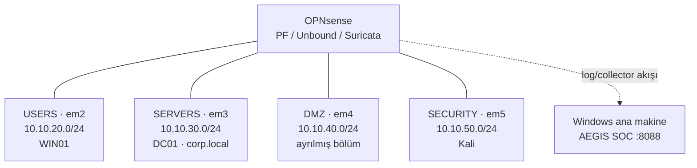

Bu topolojide farklı subnet'ler arasındaki trafik OPNsense üzerinden denetlenir. SOC ana makinesi, bu ağdaki cihazlardan gelen kayıtları kendi ağında kabul eder; yönlendirme ve engelleme kararlarını vermez.


### 2.2. IP, yönlendirme ve DNS kontrolü

[LAB] DC01 tarafında IP/DNS, Kali'de rota tablosu ayrı ayrı kontrol edildi. Kali için `10.10.20.0/24` ve `10.10.30.0/24` ağlarına SECURITY geçidi `10.10.50.1` üzerinden ulaşan rotalar daha önce doğrulandı. Ortamın o anki varsayılan NAT rotası ayrıydı; bu yüzden **test trafiğinin gerçekten OPNsense üzerinden gittiğini** kontrol etmek önemliydi.

| DC01 ağ yapılandırması | Kali yönlendirme çıktısı |
|---|---|
| 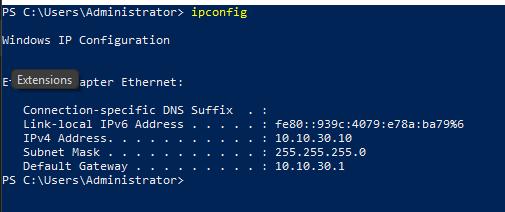 |  |

```powershell
# DC01 / WIN01: ağ ayarlarını sadece görüntüle
ipconfig /all
Resolve-DnsName corp.local -Server 10.10.30.10
```

```bash
# Kali: yönlendirme ve domain DNS sorgusu
ip route
ip route get 10.10.30.10
dig @10.10.30.10 corp.local A +noall +answer
```

## 3. OPNsense ve firewall politikaları

### 3.1. Arayüzlerin atanması

[LAB] OPNsense üzerinde USERS, SERVERS, DMZ ve SECURITY bölgeleri ayrı arayüzlere bağlandı. Bu adlandırma, her firewall kuralının hangi ağ sınırında çalıştığını anlaşılır hale getirdi. Arayüzlerin kurulu olması **tek başına güvenli ağ ayrımı** demek değildir; izin ve engel kurallarının doğru sıralanması da gerekir.

| Arayüz menüsü | OPNsense genel durum |
|---|---|
|  |  |

### 3.2. Firewall kural yaklaşımı

[LAB] Firewall tarafında kaynak bölge, hedef ağ, protokol, port, yön ve `PASS/BLOCK` kararına göre kurallar yazıldı. USERS ve SERVERS arasındaki gerekli AD trafiği ile SECURITY bölgesinden yapılan testler ayrı değerlendirildi. İstenen engeller için bölgeye özel kurallar kullanıldı; kuralın `Live View` kaydı üzerinden gerçekten çalıştığı kontrol edildi.

Ayrıca OPNsense üzerinde IP blocklist politikasını üç ayrı bölgeye uygulayan adlandırılmış kurallar bulunuyor:

| Bölge | Laboratuvarda kullanılan kural adı | Amaç |
|---|---|---|
| USERS (`em2`) | `AEGIS TI - Malicious IP Block` | Kullanıcı ağı çıkışını TI listesiyle denetlemek |
| SERVERS (`em3`) | `AEGIS TI - DC01 Malicious IP Block` | DC01/sunucu çıkışını TI listesiyle denetlemek |
| SECURITY (`em5`) | `AEGIS TI - Kali Malicious IP Block` | Kali test trafiğini TI listesiyle denetlemek |

[LAB] Bu kuralların **tam sıra ve UUID dökümü** GitHub'daki ekran görüntülerinden harfi harfine çıkarılmadığından tabloya hayalî değer eklemedim. Doğru testte kural adını değil, **gerçek `filterlog` kaydı ile kural kimliğini** karşılaştırdım.

| Firewall kural yapılandırması | Firewall Live View |
|---|---|
| 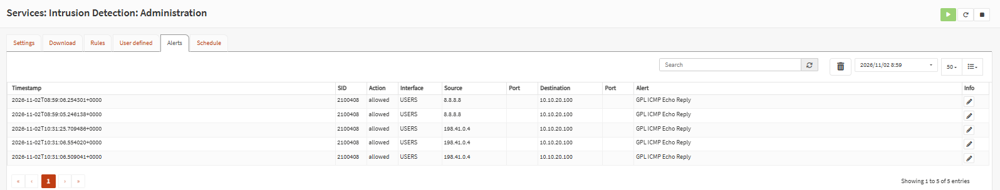 | 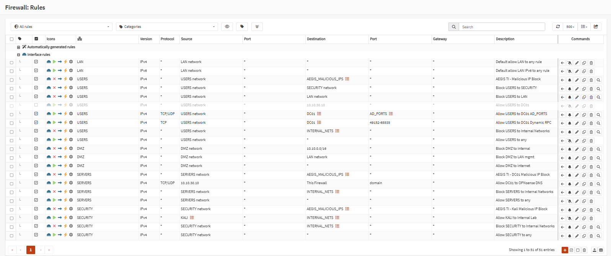 |


### 3.3. IP engellemenin doğrulanması

[LAB] Somut doğrulama örneği, Kali `10.10.50.100` kaynağından `198.51.100.77` test adresine TCP ve ICMP isteklerinin OPNsense üzerinden **BLOCK** edilmesiydi. `198.51.100.77`, RFC 5737 kapsamında ayrılmış dokümantasyon adresidir; bu nedenle gerçek zararlı bir IP olduğu iddia edilmez.

[KOD] AEGIS normal bir `BLOCK` olayını otomatik olarak “TI block” saymıyor. `filterlog` içindeki PF kural kimliği, önceden tanımlanan onaylı kural kaydıyla eşleşirse TI bağlamı veriliyor. Bu, yanlış alarm ve yanlış atıf riskini azaltıyor.

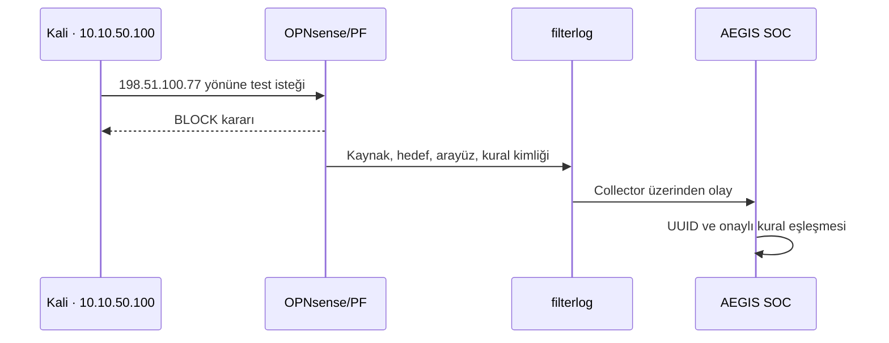

Bu akışta trafiği engelleyen sistem OPNsense'tir. SOC yalnızca kaydı alır, hangi kuralın eşleştiğini inceler ve analiste kanıtı gösterir.

## 4. DNS, DHCP ve Suricata

### 4.1. KEA DHCP kurulumu ve sorun giderme

[LAB] İlk kurulumlarda KEA DHCP'nin `10.10.30.1:67` (`em3`) ve `10.10.40.1:67` (`em4`) adreslerine bağlanmasında hata yaşandı. Aynı servis portuna yönelik çakışma giderildi, `dnsmasq` kapatıldı ve KEA çalışır hale getirildi. Sonrasında DHCP, gateway ve ağ erişimi yeniden denendi.


### 4.2. Active Directory DNS ve Unbound

[LAB] WIN01'in domain çözümlemesinde DC01 `10.10.30.10` kullanıldı. Bu nedenle WIN01'den başlayan bazı DNS sorgularının Unbound/SOC tarafında kaynak olarak DC01 üzerinden görülmesi, kaynağı yorumlarken dikkate alınması gereken bir ayrıntıdır.

[LAB] OPNsense'in **Unbound DNS** tarafında izleme ve blocklist yapılandırması kullanıldı. Engelleme kararının kontrol edildiği yer **Reporting → Unbound DNS → Details** oldu. **`NXDOMAIN` yanıtını tek başına kara liste engeli olarak saymamak** bu projenin önemli veri kalitesi kararlarından biridir.

| Unbound sorgu izleme | Unbound sorgu ayrıntıları |
|---|---|
| 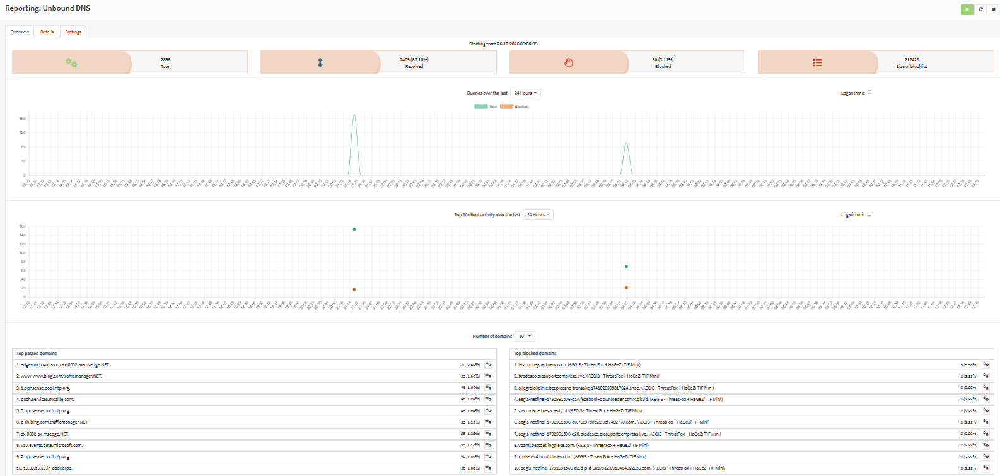 |  |

[KOD] Mevcut DNS collector'ı, Unbound'un açık block karar bilgisini her kayıtta SOC'a taşımıyor. Bu yüzden Dashboard'daki NXDOMAIN artışı, **doğrulanmış blocklist engeli sayısı** olarak sunulmuyor. Bu, projenin belgelenen veri sınırlarından biri.

### 4.3. Suricata IDS kurulumu ve testler

[LAB] OPNsense üzerinde Suricata ile ağ katmanında ikinci bir kayıt kaynağı kuruldu. ET Open ve gözlenen GPL ICMP PING, Nmap tabanlı imzalar ile `KALI SECURITY TEST` imzası kullanıldı. Kali'den DC01'e ICMP, TCP SYN, DNS, SMB, LDAP ve Kerberos testleri yapıldı; Suricata kayıtları ile OPNsense firewall kayıtları karşılaştırıldı.

[KOD] Suricata EVE JSON içinden `alert.signature`, `signature_id`, `severity`, protokol, kaynak/hedef ve akış alanları çıkarılabilir. Severity `1 → critical`, `2 → high`, `3 → medium` olarak eşlenir. Bilinen `KALI SECURITY TEST` imzası özellikle **low** olarak değerlendirilir; yetkili laboratuvar testi gereksiz yere kritik olay diye sunulmaz.

```bash
# Yalnızca izinli 10.10.30.10 laboratuvar hedefinde örnek tarama
nmap -sS -Pn -n -p 53,88,135,389,445 --max-retries 1 10.10.30.10
```


## 5. Active Directory ve Windows istemcisi

### 5.1. DC01 etki alanının kurulması

[LAB] DC01 üzerinde **Windows Server 2019** kuruldu; **Active Directory Domain Services** etkinleştirilerek sunucu domain controller'a yükseltildi. Laboratuvar etki alanı `corp.local` olarak yapılandırıldı. AD ile birlikte domain DNS rolü devreye alındı.

[LAB] Daha sonra WIN01 Windows 11 istemcisi USERS bölgesine yerleştirildi, DNS için DC01'e yönlendirildi ve `corp.local` domain'ine dahil edildi. Domain katılımı, kullanıcı oturumları, güvenlik grupları ve denetim olaylarının gerçek Windows kayıtları üzerinden test edilmesine olanak verdi.

```powershell
# DC01 üzerinde kurulu AD/DNS hizmetlerini görüntüle
Get-Service NTDS,DNS
Get-ADDomain
Get-ADOrganizationalUnit -Filter * | Select-Object Name,DistinguishedName
```

### 5.2. OU ve güvenlik grupları

[LAB] Gerçekçi bir kuruluş örneği oluşturmak için departman temelli OU/grup düzeni hazırlandı: **Finance, HR, IT, Management, Sales**. Yetkili grup üyelikleri ve olağan kullanıcı grupları farklı senaryolarda incelendi.

| AD genel OU yapısı | Finans OU/grup |
|---|---|
|  | 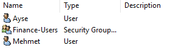 |

| İnsan kaynakları OU/grup | IT OU/grup |
|---|---|
|  |  |

| Yönetim OU/grup | Satış OU/grup |
|---|---|
| 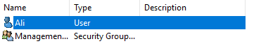 |  |

### 5.3. GPO ve Windows denetim kayıtları

[LAB] Bu yapı üzerinde hesap ve güvenlik grubu yönetim olaylarının Windows Security günlüğüne yazılması için AD denetim ayarları üzerinde çalışıldı. **4720, 4724, 4726, 4728, 4729, 4738** gibi olaylar, yeni kullanıcı ve grup üyeliği değişikliği senaryolarında ele alındı. Dosya paylaşımı erişim reddi için **5145** ve gerektiğinde nesne denetimi/SACL ayarları üzerinde inceleme yapıldı.

[LAB] Önceki denemelerde uygulama kısıtlama politikalarıyla ilgili yan etkiler görüldüğü için GPO'ları güvenlik testleri adına rastgele değiştirmemek, doğrudan log ve ilgili politika sonucunu doğrulamak benimsendi. Ekran görüntüleri kullanıcı/grup düzeninin mevcut durumunu belgeliyor; bütün GPO'ların tam exportu bu pakette bulunmuyor.

## 6. Collector'lar ve veri akışı

### 6.1. Kali network collector

[LAB] Ağ tarafındaki olaylar **Kali** üzerinde toplandı. OPNsense'ten syslog ile gelen filterlog ve Suricata/DNS loglarının alınması için `rsyslog` ve `/var/log/opnsense/` altında ayrılmış dosyalar kullanıldı. Geçmiş kurulum ve testlerde şu bileşenler yer aldı:

| Bileşen | Laboratuvarda kullanılan konum / servis |
|---|---|
| Syslog alıcısı | UDP `514`, `rsyslog` |
| OPNsense firewall logu | `/var/log/opnsense/firewall.log` |
| DNS logu | `/var/log/opnsense/dns.log` |
| Suricata logu | `/var/log/opnsense/suricata.log` |
| Collector | `/opt/ad-opnsense-soc/collector.py` |
| Sistem servisleri | `aegis-collector.service`, `aegis-dns-reader.timer` |

[LAB] OPNsense ve Kali'nin log biçimlerini ayırmak, kolektör tarafında `PASS` ile `BLOCK` kararlarını doğru okumak ve farklı kaynakları `FIREWALL`, `SURICATA`, `DNS` olarak SOC'a göndermek için parser üzerinde düzeltmeler yapıldı.

```bash
# Kali: servis ve son çalışma kayıtlarını görüntüle
systemctl is-active rsyslog aegis-collector.service aegis-dns-reader.timer
sudo journalctl -u aegis-collector.service -n 20 --no-pager
```

### 6.2. Windows Security / Sysmon collector

[LAB] DC01 ve WIN01'den güvenlik olayları Windows üzerinde çalışan collector'larla gönderildi. WIN01'de Sysmon Operational kanalındaki olaylar önce sınırlı ID listesiyle gönderiliyordu. Sonraki güncellemede aktif filtre şu hale getirildi:

```powershell
# WIN01 Sysmon collector'da doğrulanan filtre (kod örneği)
if ($Event.Id -notin @(1,3,8,10,11,13,22,25)) {
    # İlgisiz Sysmon olayını gönderme
}
```

Bu sayede **ID 11/13 için gerçek Windows Startup/Registry olayları** ve diğer desteklenen ID'ler collector üzerinden gönderilebilir hale geldi. Event ID'nin filtrede bulunması, o olayın mutlaka oluştuğu veya alarm üreteceği anlamına gelmiyor.

### 6.3. AEGIS veri işleme hattı

[KOD] Collector'lar olayları `POST /api/events/ingest` adresine gönderir. Ana uygulama kaynağı doğrular, `parser.py` üzerinden normalleştirir, olay zamanını değerlendirir, SHA-256 tabanlı tekilleştirme uygular ve SQLite veritabanına yazar. Ardından Network, Windows Security/AD, Sysmon, MITRE ve Identity analizleri devreye girer.

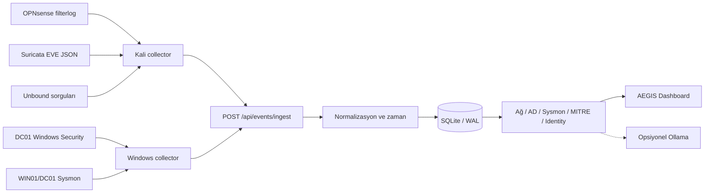

Bu akışta `raw` alanı korunur. Bir alarmı incelerken analist hem çıkarılan anlamlı alanları hem de olayın kaynağını görebilir. **Gözlenen olay ile ondan üretilen yorum birbirinden ayrılır.**

## 7. AEGIS SOC yazılımı

[KOD] Uygulama **FastAPI + Uvicorn** üzerinde çalışır. Python 3.14 ile kurulan laboratuvarda arayüz `app/templates/index.html` üzerinden sunuldu. Kalıcı olay deposu **SQLite WAL**, SHA-256 parmak izi ile tekilleştirme ve varsayılan **50.000 olay tutma sınırı** kullanır.

Başlıca API uçları:

| Uç nokta | İşlev |
|---|---|
| `POST /api/events/ingest` | Collector kayıtlarını kabul etmek |
| `GET /api/events` | Kaynağa, moda ve zamana göre olay listelemek |
| `GET /api/incidents` | İlişkili olayları incelemek |
| `GET /api/network/detections` | Network örüntüsü adaylarını göstermek |
| `GET /api/ad/intelligence` | AD tespit ve denetim görünümü |
| `GET /api/sysmon/investigation` | Süreç, parent/child ve olay incelemesi |
| `/api/mitre/*` | ATT&CK eşleme/analiz ekranları |
| `/api/identity/*` | Kimlik, envanter ve yetki verileri |
| `GET /api/source-health` | Kaynak sağlığı |
| `GET /api/status` | API durum bilgisi |

`/api/events` için `mode=all`, `mode=alerts` ve `mode=blocks` seçenekleri vardır. Kayıt sınırı sorgu başına en fazla **5.000** olarak uygulanır; `offset` ile sayfalama ve `source` ile filtreleme yapılabilir. Olayın kaynak zamanı ile SOC'a alındığı zaman farklı olabileceğinden zaman filtreleri değerlendirilirken bu ayrım önemlidir.

### Erişim ve yapılandırma güvenliği

[KOD] Panel için isteğe bağlı **Basic Auth**, ingest için `X-SOC-Token` ve hassas Identity/Privilege uçları için loopback/yerel erişim sınırları bulunur. Güvenlik başlıkları ve yan veri depolarının ayrılması, mevcut SOC çalışmasının bozulmadan geliştirilmesine yardımcı oldu. Dokümantasyonda parola, token ve gerçek yerel kullanıcı dizini paylaşılmıyor.

### Yerel yapay zekâ desteği

[LAB] Opsiyonel **Ollama** entegrasyonu, yerel `127.0.0.1:11434` servisinde `qwen3:4b-instruct` ile kullanıldı. [KOD] Bu katman olaylara açıklama ve inceleme desteği verir; çıktısı kalite kontrolü gerektirir ve otomatik müdahale kararı üretmez.

## 8. Tespit kuralları ve testler

### 8.1. Ağ güvenliği

[KOD] AEGIS'in Network analizleri, aynı ağ olayını tek başına yüksek riskli kabul etmek yerine birden fazla ipucunu inceler:

| Tespit/yorum | Mantık |
|---|---|
| Dikey port tarama adayı | Aynı kaynak/hedef bağlamında **5 dakika içinde en az 5 port** |
| Yatay tarama adayı | Aynı kaynaktan **en az 5 ayrı hedef** |
| Kaynak-hedef korelasyonu | 5 dakikalık pencerede birlikte görülen olaylar |
| Suricata önceliği | `severity=1/2/3 → critical/high/medium` |
| Bilinen laboratuvar imzası | `KALI SECURITY TEST` düşük riskte kalır |
| Yayın/gürültü trafiği | DC01 `.255` NetBIOS ve bazı UDP/123 engelleri düşük öncelikle ele alınır |

[LAB] Nmap SYN/UDP, DNS A/NXDOMAIN, ICMP, SMB, LDAP, Kerberos ve erişim politikası testlerinde ilgili kayıtlar SOC'a ulaştı. Her Suricata imzasının gerçek bir saldırıyı ispatladığı iddia edilmedi.

### 8.2. Windows Security ve Active Directory

[KOD] AD/Windows Security alanında izlenen olaylardan bazıları:

| Event ID | Örnek güvenlik bağlamı |
|---|---|
| `4624`, `4625` | Başarılı/başarısız oturum açma |
| `4672`, `4719` | Özel ayrıcalık / denetim politikası değişikliği |
| `4720`, `4726`, `4738` | Hesap oluşturma/silme/değiştirme |
| `4724` | Parola sıfırlama girişimi |
| `4728`, `4729`, `4732`, `4756` | Güvenlik grubu üyelik hareketleri |
| `4740` | Hesap kilitlenmesi |
| `4768`, `4769`, `4771`, `4776` | Kerberos ve kimlik doğrulama olayları |
| `1102` | Güvenlik günlüğünün temizlenmesi |
| `5145` | Ayrıntılı dosya paylaşımı erişim denetimi |

[KOD] Kurallarda `brute_force` (10 dakikalık pencere), `success_after_fail`, `password_spray`, `user_enum`, `lockout`, `kerberoast` (RC4 `0x17` işareti), `asrep_roast`, `log_cleared`, `priv_group` ve `new_account` gibi tespit başlıkları bulunur. **MITRE ATT&CK** eşlemesi (ör. `T1110`, `T1558.003`, `T1558.004`, `T1070.001`, `T1098`, `T1136.001`) olayın analist tarafından sınıflandırılmasına yardımcı olur.

### 8.3. Sysmon V3 — 11 kural

[KOD] Sysmon olaylarından türetilen 11 ana tespit aşağıdadır. Gerçek kayıt, kural koşullarını karşılıyorsa alarm üretilir; ham Event ID görülmesi tek başına alarm değildir.

| Kural | Event ID | İncelenen davranış |
|---|---|---|
| `SYSMON-OFFICE-SHELL` | 1 | Office benzeri üst süreçten shell çalıştırma |
| `SYSMON-SCRIPT-SHELL` | 1 | Script host üzerinden shell çalıştırma |
| `SYSMON-ENCODED-POWERSHELL` | 1 | Kodlanmış PowerShell çağrısı |
| `SYSMON-POWERSHELL-EXECUTION` | 1 | İnceleme gerektiren PowerShell ifadesi |
| `SYSMON-UNUSUAL-OUTBOUND-PORT` | 3 | Olağandışı dış hedef portu |
| `SYSMON-REMOTE-THREAD-LSASS` | 8 | LSASS hedefli uzak thread oluşturma işareti |
| `SYSMON-LSASS-ACCESS` | 10 | LSASS hedefli erişim ve yetki maskesi |
| `SYSMON-STARTUP-FILE` | 11 | Başlangıç klasöründe dosya oluşturma |
| `SYSMON-AUTORUN-REGISTRY` | 13 | Run/RunOnce otomatik başlatma anahtarı |
| `SYSMON-SUSPICIOUS-DNS` | 22 | Şüpheli DNS alan adı sorgusu |
| `SYSMON-PROCESS-TAMPERING` | 25 | Süreç manipülasyonu göstergesi |

[LAB] WIN01 üzerinde gerçek Windows işlemleriyle **ilk sekiz saldırı-göstergesi kategorisinden 8 farklı kural** doğrulandı: Office shell, script shell, encoded/dinamik PowerShell, olağandışı port, DNS, Startup dosyası ve Registry Run. Buradaki “Office” testi gerçek Word belgesi açmadan, test amaçlı isimlendirilmiş süreçle yapıldı; bu ayrım korunmuştur.

[LAB] ID `8`, `10` ve `25` için XML ve collector izleme kapsamı açıldı; fakat bunların **LSASS hedefli yüksek riskli davranışları veya gerçek süreç manipülasyonunu canlı üreten testleri** tamamlanmadı. LSASS koruması Windows'ta erişimi engelledi; üçüncü taraf bir test aracı ise Defender tarafından bloklandı. Güvenlik mekanizmaları bu testleri geçmek için devre dışı bırakılmadı.

### 8.4. MITRE motoru ve tespit akışı

[KOD] Olaydan analist yorumuna giden yol, ham kaydın normalize edilmesi, kuralın tetiklenmesi, ATT&CK bağlamının atanması ve incident/sunum katmanına taşınmasından oluşur. V2 analiz katmanı laboratuvarda regresyon ve işleme kontrolleriyle doğrulandı.

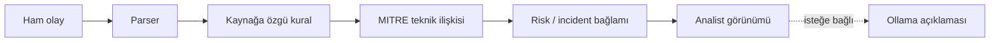

Bir MITRE tekniğinin eşlenmesi, saldırının mutlaka gerçekleştiği anlamına gelmez. AEGIS'in amacı analiste **inceleme gerekçesini ve ham kanıtı** birlikte sunmaktır.

## 9. Identity ve yetki analizi

[LAB] Projeyi yalnızca AD Event ID listesine bırakmadım; kullanıcı ve grup ilişkilerinden bağlam çıkarabilmek için ayrı bir **Identity · AD Intelligence** alanı geliştirildi. Denetim logları, envanter ve yetki bilgileri birlikte ele alındı.

[KOD] Kimlik verisi için `aegis.ad_inventory.v2` şeması ve yetki yan veri tabloları `priv_users`, `priv_groups`, `priv_edges` kullanıldı. Desteklenen kenar türleri `user_memberof`, `user_primarygroup`, `group_memberof`; böylece doğrudan ve iç içe grup ilişkileri ayrılabildi. Kritik gruplarda Domain/Enterprise/Schema Admins, Administrators, Account Operators ve Server Operators gibi yetkili kümeler değerlendirildi.

[LAB] Yapılan envanter dışa aktarma ve import regresyonunda örnek doğrulama çıktısı **20 kullanıcı, 57 grup**, doğrudan ve iç içe üyeliklerdi. Bunlar canlı sistemde değişebilecek bir anlık laboratuvar kaydıdır; repo indirilince aynı sayının çıkacağı garanti edilmez.

| AD Intelligence ana ekranı | Identity kullanıcı listesi |
|---|---|
| 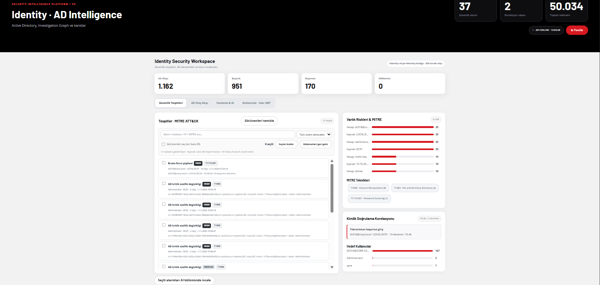 | 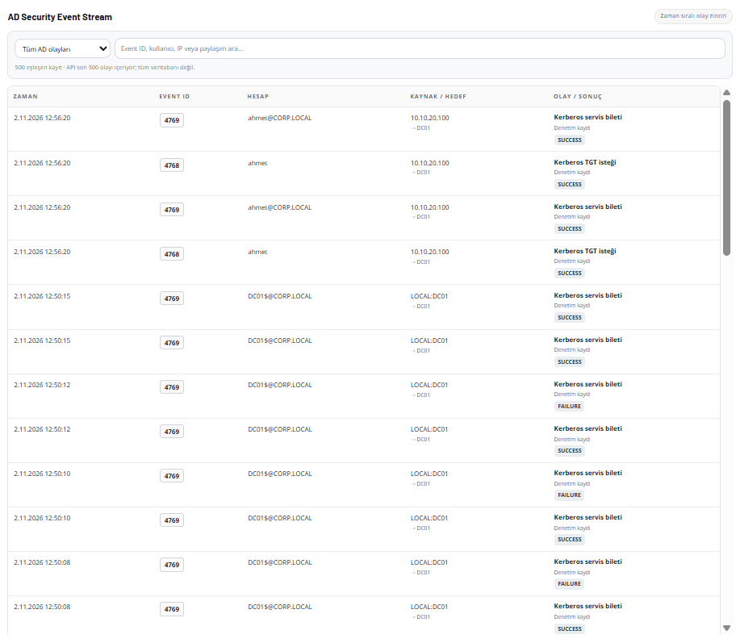 |

| Kimlik güvenlik AI Analiz Ekranı | Yetki üyelikleri |
|---|---|
|  |  |


### Kimlik merkezli incelemenin amacı

Bir kullanıcı olayı değerlendirirken yalnızca **kim oturum açtı?** sorusunu değil; **hangi gruplarda, bu grupların hangisi kritik, olaylardan önce ve sonra hangi hareketler oldu?** sorularını yanıtlamak hedeflendi. User 360, üyelik doğrulaması, risk bağlamı ve davranış zaman çizelgesi bu nedenle aynı çalışma akışının parçalarıdır.

## 10. Dashboard ekranları

[LAB] Dashboard, projeye sonradan eklenen yüzeysel bir arayüz değil; hazırlanan laboratuvarın **gerçek kaynaklardan gelen log ve tespit kanıtını** incelemek için geliştirilen son katmandır.

| Güvenlik komuta merkezi | Tüm olay kayıtları |
|---|---|
|  |  |

| Network olay listesi | Network tespit özeti |
|---|---|
|  |  |

| Endpoint · Sysmon genel bakış | Süreç ağacı ve inceleme |
|---|---|
|  |  |

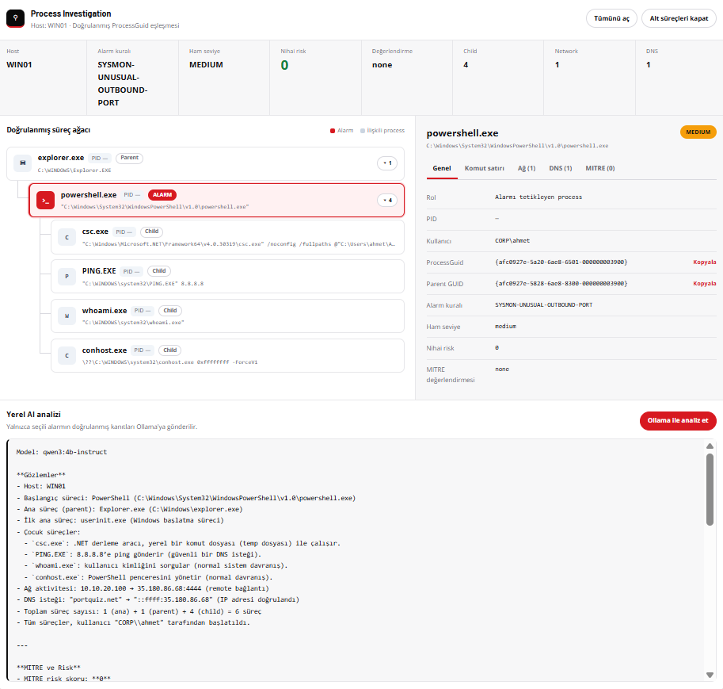

| Kurulum/test terminal kaydı |
|---|
|  |

[LAB] Network bölümünde ayrı bir ekran olarak görülen firewall/Suricata ayrıntısı, ilgili sensörlerden gelen kayda dayanıyor. Ana ekrandaki düşük riskli yayın trafiği ile gerçek tespit adayları aynı kategoriye zorla taşınmıyor.

## 11. Çalıştırma ve doğrulama

### 11.1. AEGIS API

[LAB] Laboratuvarda API, Windows ana makinede `192.168.1.111:8088` üzerinde çalıştırıldı. Aşağıdaki örnek komutlar, **`project/` klasörünün içinde** ve kurulu Python ortamında kullanılmak üzere gösterilmiştir. Bir GitHub dokümantasyon paketi, otomatik olarak çalışan collector servislerini de yüklemez.

```powershell
# GitHub klonunun kökünden proje koduna geç
Set-Location project
py -3.14 -m venv .venv
.\.venv\Scripts\python.exe -m pip install -r requirements.txt

# Hassas değerler yalnızca yerel ortam değişkeni olarak verilmeli.
$env:SOC_DASHBOARD_USER = '<ornek-kullanici>'
$env:SOC_DASHBOARD_PASSWORD = '<yerel-parola>'
$env:SOC_INGEST_TOKEN = '<yerel-ingest-token>'
$env:AEGIS_MITRE_V2 = '1'

.\.venv\Scripts\python.exe -m uvicorn app.main:app --host 0.0.0.0 --port 8088
```

**Not:** `0.0.0.0` bağlama adresidir; laboratuvar dışına erişim açılmamalı. Gerçek erişim kontrolü ve firewall politikası etkinleştirilmeden internete açık şekilde çalıştırılmamalıdır.

### 11.2. Veri kaynaklarının doğrulanması

```powershell
# SOC ana makinesinde, sadece okuma
$base = 'http://127.0.0.1:8088'
Invoke-RestMethod "$base/api/status"
Invoke-RestMethod "$base/api/source-health"
Invoke-RestMethod "$base/api/events?mode=all&source=FIREWALL&limit=25"
Invoke-RestMethod "$base/api/events?mode=all&source=SURICATA&limit=25"
Invoke-RestMethod "$base/api/events?mode=all&source=SYSMON&limit=25"
```

[LAB] `HTTP 200` API'nin cevap verdiğini gösterir; bir veri kaynağının gerçekten güncel kayıt ürettiğini anlamak için olayın zamanı ve ham içeriği ayrıca karşılaştırılır.

### 11.3. Laboratuvar doğrulama matrisi

| Senaryo | Kaynak / beklenen kanıt | Doğrulama türü |
|---|---|---|
| Kali → DC01 Nmap/ICMP | Suricata EVE + firewall log | [LAB] Gerçek ağ olayı |
| Kali → test IP | OPNsense PF `BLOCK` + filterlog | [LAB] Gerçek firewall kararı |
| DNS NXDOMAIN | Unbound sorgu yanıtı / SOC DNS olayı | [LAB] Sorgu testi; blacklist kanıtıyla aynı değil |
| AD hesap/grup değişikliği | Windows Security + Identity timeline | [LAB] Windows kayıtları |
| WIN01 PowerShell / DNS / startup / autorun | Sysmon + SOC alarmı | [LAB] 8 farklı kural canlı doğrulandı |
| ID 8/10/25 LSASS / tampering | Yapılandırma + birim testleri | [LAB] Canlı zararlı davranış doğrulaması yok |

## 12. Güvenlik, kapsam ve sonuç

### Veri ve erişim güvenliği

- **[KOD]** Oturum paneli için opsiyonel Basic Auth ve ingest için `X-SOC-Token` kullanılabilir.
- **[KOD]** Identity/Privilege API'leri yerel erişim sınırlarıyla korunan modüllere ayrılmıştır.
- **[LAB]** Gerçek parolalar, tokenlar, özel anahtarlar, veritabanı yedekleri ve kullanıcı dizinleri GitHub'a eklenmemelidir.
- **[LAB]** Güvenlik ürünleri kapatılarak test başarısı zorlanmadı; LSASS erişimi Windows tarafından, bir süreç manipülasyonu simülatörü de Defender tarafından engellendi.

### Teknik sınırlar

- **AEGIS pasif analiz yapar:** engelleme işi OPNsense/Windows politikalarındadır.
- **DNS blocklist kanıtı:** Unbound'un açık karar alanı mevcut collector'da tam taşınmadığından SOC'ta her NXDOMAIN “doğrulanmış block” değildir.
- **Sysmon kalan üç kural:** ID 8/10/25'in canlı kötü amaçlı davranış testleri tamamlanmadı; izleme ve regresyon testleri ayrıdır.
- **Yeniden kurulum ayrıntıları:** OPNsense'in kesin sürümü, WAN adaptörlerinin tam eşlemesi, tüm PF kural UUID'leri ve aktif feed URL'leri bu belgeye uydurularak eklenmedi. Yeniden kurulumda çalışan cihazdan kontrol edilmelidir.

### Sonuç

Bu çalışmayla **VirtualBox ağ kurulumu → OPNsense segmentasyonu ve firewall politikaları → Active Directory → Kali ve Windows collector'ları → Sysmon/Suricata/Windows Security kayıtları → AEGIS analiz motorları → web dashboard** zincirini tek laboratuvarda bir araya getirdim. Projenin odağında çok sayıda alarm üretmek değil, **hangi olayın hangi kaynaktan geldiğini ve nasıl yorumlandığını göstermek** var.

**AEGIS SOC — Active Directory, ağ güvenliği ve uç nokta telemetrisini bir arada inceleyen, tamamlanmış laboratuvar uygulaması.**


## 13. Kaynak kodu ve GitHub düzeni

Bu repoda proje sunumunu kolaylaştırmak için **tek Türkçe README**, kullanılan ekran görüntülerini barındıran **`images/`**, çalıştırılabilir kaynak kodu ve testleri bir arada tutan **`project/`** bulunur. Eski yedek sürümler, tarayıcı önbellekleri, çalışma logları ve sanal Python ortamı yayımlanmaz.

```text
AEGIS-SOC/
├── README.md
├── images/                       # 39 laboratuvar ekran görüntüsü
├── project/
│   ├── app/
│   │   ├── main.py               # FastAPI API uçları ve uygulama bağlantıları
│   │   ├── parser.py             # Olay normalizasyonu
│   │   ├── storage.py            # SQLite, tekilleştirme ve saklama
│   │   ├── network_detection.py  # Ağ tespitleri
│   │   ├── incident_engine.py    # Ağ olay korelasyonu
│   │   ├── ad_intelligence.py    # AD kayıt analizi
│   │   ├── identity_*.py         # Kimlik, yetki ve User 360 bileşenleri
│   │   ├── sysmon_*.py           # Sysmon tespitleri ve süreç ilişkileri
│   │   ├── aegis_mitre/          # MITRE eşleştirmeleri ve analiz motoru
│   │   └── templates/
│   │       └── index.html        # SOC web arayüzü
│   ├── tests/                    # Kimlik ve Sysmon birim testleri
│   └── requirements.txt          # Python paketleri
└── .gitignore                    # Yedek, sır ve çalışma verisi koruması
```

### Kaynak kodu nasıl çalışır?

**[KOD]** `project/app/main.py`, FastAPI uygulamasının giriş noktasıdır. `/api/events/ingest` collector'ların gönderdiği kayıtları alır; `parser.py` kaydı ayrıştırır, `storage.py` SQLite deposuna ekler. Ağ, AD, Sysmon, MITRE ve Identity modülleri olayları kendi kurallarına göre analiz eder. Arayüz `templates/index.html` üzerinden sunulur.

**[KOD]** Üretim kimlik bilgileri veya gerçek servis tokenları kod içine yazılmamıştır; `SOC_INGEST_TOKEN`, `SOC_DASHBOARD_USER` ve `SOC_DASHBOARD_PASSWORD` gibi ayarlar çalışma anında ortam değişkeni olarak alınır. **Bu değişkenler yapılandırılmadığında dashboard kimlik doğrulaması ve ingest token denetimi zorunlu değildir.** Bu nedenle projeyi internete doğrudan açmak uygun değildir.

**[LAB]** Kali'de çalışan `/opt/ad-opnsense-soc/collector.py` ve Windows tarafındaki yerel collector görevleri sistemlerde ayrı tutuldu. Kullanıcının yüklediği bu proje arşivinde söz konusu collector kaynaklarının tamamı bulunmadığı için **varmış gibi sahte dosyalar eklenmedi**. İlgili veri akışı bu README'de belgelenmiştir.

### Statik kontrol ve test sonucu

Yayıma hazırlanan kaynaklar kod çalıştırılmadan hassas bilgi kalıpları, beklenmeyen dış ağ uçları ve eski yedek kopyalar açısından kontrol edildi. Yayıma alınan kod snapshot'ında gömülü gerçek API anahtarı veya özel anahtar tespit edilmedi. Bu, tüm olası güvenlik açıklarının bulunmuş olduğu anlamına gelmez; kodun canlı internete açık dağıtımı için ayrı güvenlik incelemesi gerekir.

Birim testlerinde, sağlanan kod snapshot'ından **42 Identity/Sysmon testi ve 21 MITRE testi** ayrı ayrı başarıyla sonuçlandı. Bu kontroller sanal makinelerdeki son üretim durumunun uçtan uca test edildiği iddiası değildir.

```powershell
# GitHub kökünde (Windows + Python 3.14)
Set-Location project
py -3.14 -m venv .venv
.\.venv\Scripts\python.exe -m pip install -r requirements.txt

# Yerel ortamda kendi güçlü kimlik bilgilerini tanımla.
# (Değerleri koda, GitHub'a veya ekran görüntülerine ekleme.)
$env:SOC_DASHBOARD_USER = 'ornek-analist'
$env:SOC_DASHBOARD_PASSWORD = '<yerel-guclu-parola>'
$env:SOC_INGEST_TOKEN = '<yerel-rastgele-token>'

.\.venv\Scripts\python.exe -m unittest discover -s tests -v
.\.venv\Scripts\python.exe -m uvicorn app.main:app --host 127.0.0.1 --port 8088
```

