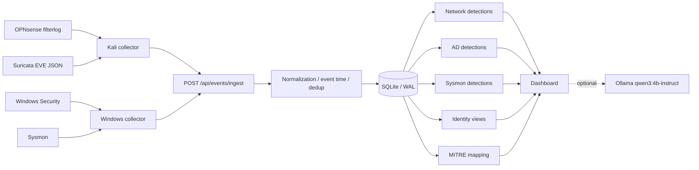

# AEGIS SOC

**Active Directory · OPNsense · Suricata · Sysmon · Identity Analytics · MITRE ATT&CK · Local AI**

> A segmented blue-team lab that starts with **VirtualBox VMs and network zoning**, then follows the full path from **raw telemetry** to **dashboard evidence**, **conservative detections**, and **investigation support**. **AEGIS is a read-only monitoring and analysis platform; it does not automatically block traffic or remediate endpoints.**

       

**[Türkçe README](README.tr.md) · [Build walkthrough](docs/lab-build-walkthrough.md) · [Architecture](docs/architecture.md) · [Detection catalog](docs/detections.md) · [Data flow](docs/data-flow.md) · [Screenshots](docs/screenshots/README.md)**


## Why this project exists

[LAB] AEGIS SOC was built as a personal end-to-end security operations lab to answer a simple question: **when a user, host or attacker-like test performs an action, what evidence is left behind across the firewall, IDS, DNS, Windows Security and Sysmon layers — and how can an analyst review all of it in one place?** [KOD] The project uses a FastAPI + Uvicorn backend, SQLite storage with SHA-256–based deduplication, single-page dashboard views in `app/templates/index.html`, detection modules for network / AD / Sysmon / identity, and optional Ollama-assisted explanations. [LAB] The final environment ran on a Windows host at `192.168.1.111:8088` with a segmented VirtualBox lab behind OPNsense.

## Project story — from empty VMs to a working SOC

### 1) Virtual lab foundation

[LAB] The lab was built on VirtualBox and segmented into multiple security zones instead of running everything on one flat network. The key virtual machines were:

- **OPNsense** — core gateway, segmentation and policy enforcement
- **DC01** — Active Directory domain controller for `corp.local`
- **WIN01** — domain-joined Windows client endpoint
- **Kali** — offensive / validation workstation and network log collection node
- **Windows SOC host** — AEGIS dashboard/API host on `192.168.1.111`

The screenshots below document the VM adapter layout that was actually used during the lab build.

| OPNsense | DC01 | WIN01 | Kali |
|---|---|---|---|
|  |  |  |  |

### 2) Segmentation and addressing

[LAB] The internal lab was intentionally separated into **USERS**, **SERVERS**, **SECURITY** and **DMZ** segments, with the SOC host staying on the management network. The verified/observed addressing used in documentation and tests is:

| Segment | Interface | Network | Main systems | Role |
|---|---|---|---|---|
| USERS | [LAB] `em2` | [LAB] `10.10.20.0/24` | [LAB] WIN01 (`10.10.20.101`, older records also showed `.100`) | User workstation segment |
| SERVERS | [LAB] `em3` | [LAB] `10.10.30.0/24` | [LAB] DC01 `10.10.30.10` | AD / DNS / core server segment |
| DMZ | [LAB] `em4` | [LAB] `10.10.40.0/24` | [LAB] No permanent DMZ workload in final state | Reserved isolated segment |
| SECURITY | [LAB] `em5` | [LAB] `10.10.50.0/24` | [LAB] OPNsense `10.10.50.1`, Kali `10.10.50.100` | Test / monitoring / attack-simulation segment |
| Management | separate | [LAB] `192.168.1.x` | [LAB] SOC host `192.168.1.111` | AEGIS API and dashboard |


[LAB] WIN01 domain DNS resolution was directed through **DC01**, which is important during analysis because **some DNS-related activity appears with DC01 as the visible source** at the SOC layer. That is documented as a design / path nuance, not a bug in the dashboard.


### 3) OPNsense build and policy enforcement

[LAB] OPNsense was the backbone of the lab. After interface assignment and zone addressing, DHCP/DNS services and firewall policies were configured so the networks could function while remaining separated.

Important OPNsense milestones:

1. **Interface assignment and zoned addressing**
2. **DHCP / DNS service checks**
3. **Inter-zone firewall rules**
4. **Threat-intelligence IP block rules**
5. **Unbound DNS monitoring / blocklist verification**
6. **Log forwarding for SOC visibility**

| Interface view | Services / status | Rule view |
|---|---|---|
|  |  |  |

| Overview | Firewall Live View | Firewall detail |
|---|---|---|
|  |  |  |

| Unbound monitoring | Unbound details | Final dashboard |
|---|---|---|
|  |  |  |

[KOD] On the SOC side, firewall evidence is parsed from OPNsense `filterlog`. [KOD] AEGIS does **not** blindly label every `BLOCK` action as threat intelligence; it cross-checks the underlying PF rule identity with an approved mapping. [LAB] A confirmed validation case was **Kali `10.10.50.100` -> `198.51.100.77`** where TCP and ICMP traffic were blocked on the SECURITY side. [KOD] The dashboard also keeps **verified blocklist blocks** separate from mere **NXDOMAIN bursts**.

### 4) Active Directory and organizational model

[LAB] A dedicated AD domain `corp.local` was deployed on **DC01**. The purpose was not only to authenticate users but also to generate realistic identity events: account creation, membership changes, lockouts, password events, and privileged group evidence.

The organizational structure included OUs/groups such as:

- **Finance-Users**
- **HR-Users**
- **IT-Users**
- **Management-Users**
- **Sales-Users**
- Built-in admin-sensitive groups such as **Domain Admins**, **Enterprise Admins**, **Schema Admins**, **Administrators**

| OU structure | Finance | HR |
|---|---|---|
|  |  |  |

| IT | Management | Sales |
|---|---|---|
|  |  |  |

[KOD] AEGIS later expanded this into **Identity · AD Intelligence**, where inventory, privilege membership, user-centric risk context and behavior timelines are modeled in sidecar SQLite stores. [LAB] Multiple read-only phases were validated: inventory extraction, privilege evidence import, User 360 endpoints, risk context and behavior timeline.

### 5) Windows telemetry and Sysmon

[LAB] Windows Security and Sysmon were major telemetry sources. [KOD] AEGIS currently supports and uses Sysmon Event IDs `1, 3, 8, 10, 11, 12, 13, 22, 25`, with validation in the lab focusing especially on **process execution, suspicious PowerShell, DNS, startup file creation and autorun registry changes**.

| Endpoint overview | Process investigation | Analysis panel |
|---|---|---|
|  |  |  |

[LAB] Real WIN01 validation produced observable dashboard detections for:

- `SYSMON-SUSPICIOUS-DNS`
- `SYSMON-AUTORUN-REGISTRY`
- `SYSMON-STARTUP-FILE`
- `SYSMON-OFFICE-SHELL`
- `SYSMON-SCRIPT-SHELL`
- `SYSMON-POWERSHELL-EXECUTION`
- `SYSMON-ENCODED-POWERSHELL`

[KOD] The Sysmon collector was also adjusted so Event IDs `8`, `10`, `11`, `13`, `22` and `25` can reach the backend when enabled in the source configuration.

### 6) Identity intelligence build-out

[LAB] One of the biggest later improvements in the project was the **Identity** section. Instead of stopping at raw AD events, the lab added a read-only privilege model and analyst views such as **user profile, group membership evidence, critical group alignment, risk context and timeline**.

| AD Intelligence | Identity users | Security workspace |
|---|---|---|
|  |  |  |

| Privilege memberships | User360 profile | Risk analysis |
|---|---|---|
|  |  |  |

| User360 summary | Identity detail view |
|---|---|
|  |  |

[KOD] Identity capabilities now include:

- Inventory schema `aegis.ad_inventory.v2`
- Privilege sidecar tables such as `priv_users`, `priv_groups`, `priv_edges`
- Critical group detection for **Domain/Enterprise/Schema Admins**, **Administrators**, **Account Operators**, **Server Operators** (EN/TR naming awareness)
- Authenticated privilege API, lab-host restrictions and loopback protections
- User 360, risk context and behavior timeline views

### 7) Collectors, ingestion and correlation

[LAB] The lab used multiple collectors. Windows-hosted collectors pushed **Windows Security** and **Sysmon** data. Network-side collection on Kali forwarded **OPNsense filterlog**, **Suricata EVE JSON**, and related log feeds into the SOC.

[KOD] Ingestion flows through `POST /api/events/ingest`, then:

1. **Normalization** (`parser.py`)
2. **Timestamp handling**
3. **SHA-256–based deduplication**
4. **SQLite persistence** (WAL mode, bounded event retention)
5. **Detection engine(s)**
6. **Dashboard views and optional local AI assistance**



[KOD] The optional AI layer is **assistive only**. It does not replace evidence, and output is intended to be quality-checked by the analyst.

### 8) What the dashboard shows today

| Security command center | All logs |
|---|---|
|  |  |

| Network detail | Network logs | Network detection summary |
|---|---|---|
|  |  |  |

| CLI validation output |
|---|
|  |

[KOD] Main analyst-facing coverage includes:

- `/api/events`, `/api/incidents`, `/api/network/detections`
- `/api/ad/intelligence`
- `/api/sysmon/*`
- `/api/mitre/*`
- `/api/identity/*`
- `/api/source-health`, `/api/status`

### 9) Detection coverage summary

#### Network / firewall / IDS

[KOD]
- Vertical port scan candidate (>=5 ports / 5 minutes)
- Horizontal scan candidate (>=5 hosts)
- Same source/destination five-minute correlation
- Suricata severity mapping `1/2/3 -> critical/high/medium`
- Lab signatures such as `KALI SECURITY TEST` intentionally downgraded to low
- DC01 `.255` NetBIOS broadcast treated as low-risk noise

#### Active Directory / Windows Security

[KOD]
- Supported event IDs include `4624, 4625, 4672, 4719, 4720, 4724, 4726, 4728, 4729, 4732, 4738, 4740, 4756, 4768, 4769, 4771, 4776, 1102, 5145`
- Rules include `brute_force`, `success_after_fail`, `password_spray`, `user_enum`, `lockout`, `kerberoast`, `asrep_roast`, `log_cleared`, `priv_group`, `new_account`

#### Sysmon

[KOD]
- Office -> shell
- Script host -> shell
- Encoded PowerShell
- Suspicious PowerShell execution
- Suspicious DNS / `.onion`
- Startup file creation
- Autorun registry modification
- LSASS access / remote thread / tampering–related coverage where enabled
- Process tree investigation support

#### Identity

[KOD]
- Inventory import and validation
- Privilege sidecar
- User 360
- Verified group membership evidence
- Risk context
- Behavior timeline

### 10) Validation highlights from the lab

[LAB]
- OPNsense firewall blocking from Kali to test IP was observed and confirmed.
- Identity privilege evidence import and User 360 views were validated.
- WIN01 Sysmon tests produced live dashboard alerts for startup/autorun/PowerShell/DNS style rules.
- DC01 AD group membership add/remove events produced identity detections and timeline entries.
- Network source visibility showed the expected nuance that some client DNS traffic appears sourced from DC01.

## Quick start (existing code repository)

[KOD] The documentation bundle does not contain the full application source. Use these commands only inside a real clone of the working repository.

```powershell
py -3.14 -m venv .venv
.\.venv\Scripts\Activate.ps1
pip install -r requirements.txt

$env:SOC_DASHBOARD_USER = "<lab-user>"
$env:SOC_DASHBOARD_PASSWORD = "<lab-password>"
$env:SOC_INGEST_TOKEN = "<lab-token>"
$env:AEGIS_MITRE_V2 = "1"
$env:SOC_OLLAMA_MODEL = "qwen3:4b-instruct"

uvicorn app.main:app --host 0.0.0.0 --port 8088 --log-level info --access-log
```

## Security notes

- [KOD] Identity privilege endpoints have loopback / same-host protections in the validated lab flow.
- [KOD] Ingest uses `X-SOC-Token`; dashboard auth is optional Basic Auth.
- [KOD] SQLite stores telemetry locally and uses bounded retention.
- [LAB] This repository should never publish real tokens, passwords, local backup databases or sensitive identity exports.

## Known limitations

- [KOD] AEGIS is **read-only**; enforcement remains in OPNsense, Windows policy, AppLocker, GPO or OS controls.
- [KOD] Unbound DNS blocklist decisions are not yet fully carried into SOC as first-class “verified DNS block” evidence by the current collector.
- [LAB] WIN01 appeared with both `.100` and `.101` in historical outputs; current lease should be confirmed before reproducing exact screenshots.
- [LAB] Exact OPNsense version, full interface/WAN mapping, full firewall rule export and final feed list should be documented from current config exports before claiming them as immutable facts.

## Repository map

- `README.md` / `README.tr.md` — front-page documentation
- `docs/lab-build-walkthrough.md` — start-to-finish build story
- `docs/architecture.md` — component and logical architecture
- `docs/opnsense-setup.md` — OPNsense-focused build notes
- `docs/active-directory-setup.md` — AD-focused notes
- `docs/blocklists.md` — IP and DNS blocking approach
- `docs/detections.md` — detection catalog
- `docs/data-flow.md` — telemetry and processing flow
- `docs/screenshots/README.md` — full image inventory

## License / acknowledgments

<!-- TODO: add license once selected. -->

[LAB] This project was developed as a personal lab to practice SOC analysis, network security segmentation, Windows logging, detection engineering and evidence-driven documentation.
