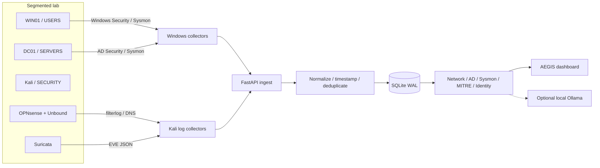

# AEGIS SOC

**Active Directory · OPNsense · Suricata · Sysmon · MITRE ATT&CK · Local AI**

> A hands-on security operations laboratory: from network and identity telemetry to explainable detection, investigation, and evidence-led triage. **AEGIS monitors and analyzes; it does not automatically block traffic or remediate hosts.**

     

**[Türkçe README](README.tr.md) · [Architecture](docs/architecture.md) · [Detection catalog](docs/detections.md) · [Data flow](docs/data-flow.md) · [Screenshots](docs/screenshots/README.md)**


## Why I built it

[LAB] I built AEGIS to understand what actually happens **between a suspicious action, the telemetry that captures it, and the analyst who investigates it**. The project connects a segmented Active Directory network, OPNsense firewall logs, Suricata alerts, Unbound DNS activity, Windows Security events, and Sysmon process evidence. [KOD] A FastAPI backend normalizes and stores those records, applies conservative detection logic, correlates selected activity, and presents the evidence through a web dashboard. AI-assisted interpretation is optional; the recorded evidence remains the source of truth.

## System at a glance



[LAB] Windows and network sensors are deployed on distinct VMs; the SOC API runs on the management workstation. [KOD] Event ingestion, normalization, SQLite retention and analysis are in the Python application. The firewall is responsible for policy enforcement; **AEGIS is not a firewall controller**.

## What is implemented

| Area | Capability and evidence |
|---|---|
| **Network investigations** | [KOD] Source-aware event parsing, five-minute vertical and horizontal scan candidates, noise suppression, firewall / Suricata evidence, incident risk and confidence context. |
| **Firewall intelligence** | [LAB] OPNsense policy blocks were observed on SECURITY/em5; [KOD] threat-intelligence-labelled blocks are not assumed from action alone—the rule identifier must match an approved record. |
| **DNS intelligence** | [LAB] Unbound query monitoring, DNS test traffic and blocklist operation; [KOD] NXDOMAIN bursts are not counted as confirmed blocklist decisions. |
| **Active Directory** | [KOD] Windows Security event analysis, account / group changes, Kerberos-related patterns, privileged activity, and User 360 context. |
| **Endpoint & Sysmon** | [KOD] 11 conservative primary detection rules covering process, DNS, network, autorun, LSASS-targeting and tampering indicators. [LAB] Eight distinct rules produced observable real WIN01-to-SOC lab alerts. |
| **ATT&CK** | [KOD] Rule-to-technique mapping and a separate MITRE analysis module; [LAB] V2 validation was performed in the lab. |
| **Identity intelligence** | [KOD] Inventory and privilege sidecars, user / group / nested membership relationships, risk context and behavior timeline. |
| **Local AI** | [KOD] Optional Ollama-based explanation with evidence-conscious prompts; [LAB] the configured model was `qwen3:4b-instruct`. |


## Lab topology

| Segment | Interface | Network | Known systems / purpose |
|---|---|---|---|
| USERS | [LAB] `em2` | [LAB] `10.10.20.0/24` | [LAB] WIN01 reported as `.100` and `.101` in different records; confirm current lease before reproducing |
| SERVERS | [LAB] `em3` | [LAB] `10.10.30.0/24` | [LAB] DC01: `10.10.30.10`, Windows Server 2019, `corp.local` |
| DMZ | [LAB] `em4` | [LAB] `10.10.40.0/24` | [LAB] Logical segment configured; no additional DMZ server deployed in the final lab |
| SECURITY | [LAB] `em5` | [LAB] `10.10.50.0/24`* | [LAB] OPNsense `.1`, Kali `.100` |
| Management / SOC | [LAB] separate workstation network | [LAB] `192.168.1.x` | [LAB] SOC host `192.168.1.111:8088` |

\* [LAB] SECURITY prefix is consistent with the reported address plan; the interface's current mask should be reconfirmed before recreating the lab. WAN adapter placement and the complete rule inventory are not stated as facts without a configuration export.


## Five-minute quick start (existing lab or local review)

[KOD] The backend uses FastAPI/Uvicorn, Pydantic and SQLite; the HTML dashboard is served by `app/templates/index.html`. [LAB] The original lab ran on Windows with Python 3.14. These commands are for **a clone containing the actual application code**, not for a documentation-only ZIP. Secrets must be provided locally, never committed.

```powershell
# On your own lab workstation, from the repository root:
py -3.14 -m venv .venv
.\.venv\Scripts\python.exe -m pip install -r requirements.txt

# Optional: protect the dashboard and ingest API with your own local secrets.
# $env:SOC_DASHBOARD_USER = '<local-user>'
# $env:SOC_DASHBOARD_PASSWORD = '<set-locally>'
# $env:SOC_INGEST_TOKEN = '<set-locally>'

$env:AEGIS_MITRE_V2 = '1'
.\.venv\Scripts\python.exe -m uvicorn app.main:app --host 127.0.0.1 --port 8088
```

[KOD] Open `http://127.0.0.1:8088/` and query `http://127.0.0.1:8088/api/status`. [LAB] For the networked lab the backend was bound to the trusted management workstation address; **do not expose this laboratory service to the public Internet**. Collectors need their own approved connectivity and, when enabled, `X-SOC-Token`.

### Minimum verification

```powershell
Invoke-RestMethod http://127.0.0.1:8088/api/status
Invoke-RestMethod 'http://127.0.0.1:8088/api/events?mode=all&limit=10'
Invoke-RestMethod http://127.0.0.1:8088/api/source-health
```

[KOD] `/api/events` supports `source`, `mode`, `limit`, `offset`, and timezone-aware time filters. These checks show service responses, **not proof that every source is currently sending new events**. Use the event timestamps and source health view before declaring an end-to-end success. See [Data flow](docs/data-flow.md).

## Validation: actions and expected evidence

| Lab action | Expected evidence | Outcome / qualification |
|---|---|---|
| Kali Nmap against approved DC01 lab ports | [LAB] Suricata EVE alerts and OPNsense filterlog; [KOD] potential scan finding | [LAB] Traffic, signatures and logs were observed; findings indicate candidates, not proven compromise |
| Kali → `198.51.100.77` (RFC 5737 TEST-NET-2) | [LAB] SECURITY `em5`, ingress, TCP/ICMP `BLOCK` | [LAB] Verified against OPNsense Live View; [KOD] SOC uses PF rule-ID mapping for TI attribution |
| Test DNS queries and synthetic `.invalid` names | [LAB] Unbound queries; [KOD] separate NXDOMAIN analysis | [LAB] Query events observed; **blocklist decision field is not currently forwarded** |
| WIN01: encoded PowerShell, script host, Office-named test process | [KOD] Sysmon Event 1 rules | [LAB] Corresponding dashboard detections observed; Office-named process was a lab simulation, not an Office exploit |
| WIN01: Startup file and Registry Run test | [KOD] Sysmon Event 11 / 13 rules | [LAB] Both generated dashboard alerts |
| WIN01: `.invalid` query and unusual external port | [KOD] Sysmon Event 22 / 3 | [LAB] Both generated dashboard alerts |
| Event 8 / 10 / 25 (LSASS / tampering) | [KOD] Detection rules and unit-test coverage | [LAB] Collection configuration prepared; **live malicious-behavior validation was not performed** |


## Security and evidence boundaries

- [KOD] AEGIS is a **read-only detection and analysis application**; actual allow/block decisions are made by OPNsense rules, independently of the SOC dashboard.
- [KOD] Optional HTTP Basic Auth protects analyst endpoints; optional `X-SOC-Token` protects ingestion. Neither replaces TLS, network isolation or production identity management.
- [KOD] Event fingerprints use SHA-256; SQLite uses WAL; default event retention is bounded to 50,000 records. These mechanisms do not constitute tamper-proof forensic storage.
- [KOD] Identity/privilege API isolation is designed around loopback restrictions. [LAB] Local-only mode and separate identity data isolation were exercised in lab tests.
- [LAB] Examples, test subjects and RFC 5737 addresses are used only in an authorized laboratory. Sensitive local paths, credentials and real organization data must not be published.

## Known limitations

1. [KOD] **Confirmed Unbound blocklist decisions are not exposed in SOC counts** because the existing DNS collector does not forward the required Unbound decision field; NXDOMAIN alone is not a confirmed block.
2. [LAB] The DMZ has no deployed endpoint; this is not an unmonitored production enclave.
3. [LAB] The current complete OPNsense policy export, versions, exact feed URLs / schedules, and complete Sysmon configuration provenance have not been supplied for independent reproduction.
4. [LAB] The repository snapshot used to prepare these docs was supplied separately; the public repository endpoint was not independently readable during documentation preparation. Re-check installed dependencies and current branch before publishing.
5. [LAB] Sysmon LSASS-targeting and process-tampering live alerts were left untriggered to avoid weakening endpoint protection; successful unit tests are not a substitute for live attack validation.

## Documentation

| Guide | Contents |
|---|---|
| [Architecture](docs/architecture.md) | Logical/physical design, identity model, trust boundaries |
| [OPNsense setup](docs/opnsense-setup.md) | Segments, remote syslog, firewall and Suricata evidence |
| [Active Directory setup](docs/active-directory-setup.md) | DC01, OUs, audit events, GPO/Sysmon validation |
| [IP and DNS blocklists](docs/blocklists.md) | PF rule verification, Unbound and decision-path limitations |
| [Detections](docs/detections.md) | Rule catalog, thresholds, ATT&CK, validation status |
| [Data flow](docs/data-flow.md) | Ingest contract, timestamps, storage, threat attribution |
| [Screenshots](docs/screenshots/README.md) | Curated evidence gallery and publication checklist |
| [Publication checklist](docs/publication-checklist.md) | GitHub safety checks, dependencies, verified vs TODO details |

## Roadmap and project status

[LAB] **Project milestone: completed as a working educational SOC lab and portfolio case study.** The roadmap below captures **optional future improvements**, not claims that present features are missing: source-verifiable DNS block decision forwarding; exportable versioned infrastructure snapshots; replayable lab fixtures; and deeper controlled testing of the three high-impact Sysmon detections.

## License, credits and provenance

[LAB] Lab integration and dashboard work are original portfolio work assembled using Active Directory, OPNsense, Suricata, Sysmon and FastAPI. [KOD] Detailed algorithmic claims were checked against the available Python source snapshots; [LAB] operational behavior and screenshots originate from reported lab observations. `LICENSE`: **<!-- TODO: verify the actual license file before stating a license -->**. Product names and logos remain the property of their respective owners.

**Legend:** `[KOD]` = verified in supplied code snapshot; `[LAB]` = reported or demonstrated in the laboratory. Neither tag alone implies independent production certification.

### Outstanding evidence for exact reproduction

<!-- TODO: provide OPNsense release, current WAN mapping and exact interface netmasks -->
<!-- TODO: provide exported firewall rule table, Suricata mode/ruleset and feed update schedule -->
<!-- TODO: provide DHCP/DNS service export, complete GPO inventory and Sysmon XML provenance -->
<!-- TODO: confirm repository LICENSE, requirements.txt and current default Git branch -->
