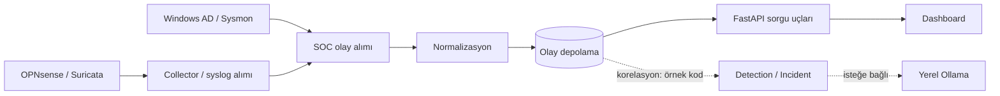

# AEGIS SOC

**Türkçe, yerel öncelikli güvenlik operasyonları (SOC) laboratuvarı**  
**Belge sürümü:** 0.2 — 24 Ekim 2026 · **Yayın statüsü:** Dokümantasyon önizlemesi; kaynak kodu ve gerçek veriler pakete dahil değildir.

> **Kanıt sınırı:** Bu depo paketindeki açıklamalar, geçmiş oturumlardan temin edilen bir `app/main.py` ve `app/templates/index.html` *anlık görüntüsü*, PowerShell kaynak/route listeleri ve SOC API olay çıktıları üzerinden hazırlanmıştır. **24 Ekim 2026 tarihli AST tabanlı proje envanteriyle rota ve modül adları güncellendi; kod gövdeleri ve çalışan servis bu incelemeye dahil değildir.** Buradaki Markdown belgeleri, uygulama kaynak kodunun yerine geçmez.

## Proje nedir?

AEGIS SOC; OPNsense güvenlik duvarı, Suricata IDS, Windows Active Directory olayları ve Sysmon telemetrisini ortak bir olay havuzunda değerlendirerek güvenlik analistine kayıtları sorgulama, anomali/tespitleri inceleme ve ilişkili olayların kanıtlarını görme imkânı sağlamayı hedefleyen bir geliştirme ve test projesidir. Bazı akışlarda yerel Ollama üzerinden yapay zekâ destekli analiz için kod bulunur. Yapay zekâ yorumu tek başına saldırı kanıtı sayılmaz.

**Kapsam:** Laboratuvar / araştırma / geliştirme. Üretim ortamında kullanılmaya hazır bir ticari SIEM veya EDR ürünü olarak sunulmaz.

## Bu projeyle neler yapılabiliyor?

- Suricata, Firewall, Sysmon ve AD kaynaklı olayları `GET /api/events` üzerinden ortak kayıt biçimiyle incelemek. Bu kaynakların 24.10.2026 tarihli 1.000 kayıtlık örneklemde göründüğü doğrulandı.
- Suricata tarafından üretilmiş imza bilgilerini ve olay ağ alanlarını göstermek; aynı akıştan yinelenen alarmlar ayrı saldırılar olarak sayılmamalıdır.
- AD kimlik doğrulama ve hesap yönetimi sinyallerini analiz etmeye yönelik arayüz/route'ları kullanmak; her kuralın güncel testi hâlâ ayrı değerlendirilmelidir.
- Sysmon process/network/DNS ilişkileri için daha önce yüklenmiş kod örneğindeki Process Tree ve inceleme ekranlarını kullanmak; sürüm eşleşmesi yeniden kontrol edilmelidir.
- Suricata/Firewall olaylarından kanıt temelli vaka özeti oluşturmak; seçilmiş vaka için isteğe bağlı yerel dil modeli yorumundan yararlanmak (örnek kaynak sürümünde).

## Özellik durumu — ilk kanıt matrisi

| Özellik | Amaç | Mevcut durum | Doğrulama bilgisi |
|---|---|---|---|
| Merkezi olay alımı | Farklı kaynakları tek API'de toplamak | **DOĞRULANDI (laboratuvar çıktısı)** | 24.10.2026 API yanıtında 4 kaynak görüldü |
| Suricata alarm ayrıştırma | İmza ve ağ alanlarını göstermek | **DOĞRULANDI (örnek olay)** | ICMP imzası, flow_id, action, src/dst gözlemlendi |
| Firewall olayları | PASS/BLOCK kayıtları | **DOĞRULANDI (olay alımı)** | Son 1.000 olayın 230'u FIREWALL |
| Sysmon olay alımı | Windows uç nokta telemetrisi | **DOĞRULANDI (olay alımı)** | Son 1.000 olayın 25'i SYSMON |
| Active Directory olay alımı | Kimlik ve hesap olayları | **DOĞRULANDI (olay alımı)** | Son 1.000 olayın 20'si AD |
| Kalıcı depolama ve tekrar kontrolü | Olay saklama/dedup | **KISMEN UYGULANDI** | `app/storage.py` ve `fingerprint`, `insert` fonksiyonları envanterde var; şema/kod gövdesi doğrulanmadı |
| Vaka korelasyonu | İlişkili sinyalleri grupla | **KISMEN UYGULANDI** | `build_incidents` route entegrasyonu mevcut; tam kural testi yok |
| AD tespit kuralları | Hesap yönetimi ve başarısız girişleri belirlemek | **KISMEN UYGULANDI** | Önceki deney çıktıları var; güncel kuralların tam matrisi yok |
| Sysmon Process Tree | İşlem ebeveyn/çocuk ilişkisi | **UYGULANDI — TEST EDİLMEDİ** | Eski `main.py` ve HTML'de route/görünüm kodu var |
| Investigation Graph | Kimlik olaylarını ilişkilendirerek göstermek | **UYGULANDI — TEST EDİLMEDİ** | HTML anlık görüntüsünde SVG graph mantığı mevcut |
| MITRE ATT&CK V2 | Tespiti teknik/taktik bağlamıyla sunmak | **KISMEN UYGULANDI** | `app/aegis_mitre/`, `mitre_worker.py`, MITRE API rotaları görüldü; eski 21/21 test çıktısı güncel sürüm için tekrarlanmadı |
| Network Detection V2 | Ağ davranış tespitleri | **UYGULANDI — TEST EDİLMEDİ** | `app/network_detection.py`, `detect_network_patterns` ve API rotası statik envanterde mevcut; davranış doğrulanmadı |
| Yerel Ollama AI | Analist için ilave yorum | **KISMEN UYGULANDI** | Eski API kaynak kodu var; güncel model/erişim teyitsiz |
| Raporlama | Kanıt ve inceleme çıktısı | **KISMEN UYGULANDI** | `/api/ad/report` route kodu var; kapsam doğrulanmadı |
| Vaka yönetimi / RBAC | Atama, durum, yetki kontrolü | **DURUMU BELİRSİZ** | Kapsamlı kaynak/yetki incelemesi yapılmadı |

**Durum anahtarı:** `DOĞRULANDI` · `UYGULANDI — TEST EDİLMEDİ` · `KISMEN UYGULANDI` · `PLANLANDI` · `ESKİ / KULLANILMIYOR` · `DURUMU BELİRSİZ`. **DOĞRULANDI**, yalnızca tabloda belirtilen *kanıt kapsamını* ifade eder; üretim hazırlığı değildir.

**24 Ekim 2026 envanteri:** 67 dosya, 59 Python dosyası ve yedeklerle birlikte 150 rota kaydı; bunların **25 tanesi aktif `app/main.py` dosyasında**. Bkz. [Güncel envanter özeti](docs/ENVANTER_DOGRULAMA_2026-10-24.md).

## Teknoloji altyapısı

| Katman | Gözlemlenen / raporlanan teknoloji | Kanıt durumu |
|---|---|---|
| API | Python + FastAPI + Pydantic | `main.py` anlık görüntüsünde görüldü |
| Arayüz | HTML, CSS, JavaScript | `index.html` anlık görüntüsünde görüldü |
| Olay saklama | `app.storage`, SQLite (önceki çalışma notları) | Gerçek şema ve dosya yolu doğrulanmalı |
| Ağ güvenliği | OPNsense, Suricata, Syslog | Laboratuvar olay çıktılarıyla destekli |
| Uç nokta / kimlik | Sysmon, Windows AD / Security | Laboratuvar olay çıktılarıyla destekli |
| MITRE | `mitre_engine`, `aegis_mitre` isimleri | Geçmiş tarama çıktılarında; sürüm doğrulaması gerekli |
| Yerel AI | Ollama, Qwen3 | Önceki kaynak kodunda `qwen3:1.7b` varsayılanı |

Sürümler ve gerçek bağımlılıklar `requirements.txt`, kurulum ortamı ve ilgili kaynaklardan teyit edilmelidir.

## Mimariye genel bakış



Şema genel yaklaşımı gösterir; **bütün kaynakların tam taşıma biçimi ve her bağlantının güncel çalışması teyit edilmemiştir.** Ayrıntılar: [Mimari](docs/MIMARI.md), [Veri Akışı](docs/VERI_AKISI.md).

## Kurulum ve çalıştırma

Gerçek proje, yerel Windows bilgisayarında ayrı bir dizinde bulunuyor. Buradaki paket uygulamanın kendisini içermez. Kurulum için kaynak kod ve bağımlılık dosyaları gerekir. **Doğrulanmamış başlatma komutu burada verilmez.** Bunun yerine [Kurulum ve Çalıştırma](docs/KURULUM_VE_CALISTIRMA.md) içindeki güvenli keşif/doğrulama sürecini izleyin.

Uygulama çalışıyorsa, önce yalnızca okumaya yönelik sorguyla sağlık durumunu kontrol edin:

```powershell
Invoke-RestMethod 'http://127.0.0.1:8088/api/status'
Invoke-RestMethod 'http://127.0.0.1:8088/api/events?limit=5&mode=all'
```

> `GET /api/status` kaynağın yakın zamanda aktif olduğunu değil, kaynak türünden kayıt bulunup bulunmadığını gösterebilir (incelenen eski kod sürümünde). `GET /api/health` endpoint'ini var saymayın.

## Dokümantasyon

| Bölüm | Bağlantı |
|---|---|
| Güncel kanıtlar ve belirsizlikler | [PROJE_DURUMU](docs/PROJE_DURUMU.md) |
| Modüller ve mimari diyagramları | [MIMARI](docs/MIMARI.md) |
| Olay yaşam döngüsü | [VERI_AKISI](docs/VERI_AKISI.md) |
| Tespit ve yanlış pozitif analizi | [DETECTION_ENGINEERING](docs/DETECTION_ENGINEERING.md) |
| AI sınırları | [YAPAY_ZEKA_ANALIZI](docs/YAPAY_ZEKA_ANALIZI.md) |
| Veri saklama | [VERITABANI](docs/VERITABANI.md) |
| HTTP rotaları | [API_REFERANSI](docs/API_REFERANSI.md) |
| Güncel statik envanter | [ENVANTER_DOGRULAMA](docs/ENVANTER_DOGRULAMA_2026-10-24.md) |
| Yayın rehberi | [GITHUB_YAYIN_REHBERI](GITHUB_YAYIN_REHBERI.md) |
| Güvenlik ve yayın kontrolü | [GUVENLIK](docs/GUVENLIK.md) |
| Test sonuçları | [TESTLER](docs/TESTLER.md) |
| Ekranlar | [KULLANIM_KILAVUZU](docs/KULLANIM_KILAVUZU.md) |
| Tasarım iyileştirme fikirleri | [TASARIM_IYILESTIRME](docs/TASARIM_IYILESTIRME.md) |
| Geçmiş | [GELISTIRME_GECMISI](docs/GELISTIRME_GECMISI.md) |
| Sonraki adımlar | [YOL_HARITASI](docs/YOL_HARITASI.md) |

## GitHub'a yayımlamadan önce

1. Statik dosya envanteri alındı; şimdi tam kaynak sürümü, çalışan giriş noktası ve bağımlılıklar gözden geçirilmeli.
2. Parola/token/.env/gerçek log/kişisel veri/özel altyapı içeren dosyaları ve **Git geçmişini** denetleyin.
3. `SOC_INGEST_TOKEN` doğrulamasını, erişim sınırlarını ve API hata davranışlarını test edin.
4. Testleri yeniden çalıştırın; her tespiti özgül test senaryosuna bağlayın.
5. Lisansı kendiniz seçin; bu pakete lisans atanmadı.
6. Gerçek, maskelenmiş ekran görüntülerini yalnızca kullanıcı onayıyla ekleyin.

Güvenlik ayrıntıları için [SECURITY.md](SECURITY.md).
