<h1 align="center">AEGIS SOC</h1>

<p align="center"><strong>Active Directory · OPNsense · Suricata · Sysmon · MITRE ATT&CK · Identity Intelligence</strong></p>

<p align="center"><em>Sanal ağ kurulumundan merkezi olay analizine uzanan uçtan uca SOC laboratuvarı.</em></p>

<p align="center">
  
  
  
  
  
  
  
</p>

<p align="center">
  
  <br><sub><b>AEGIS Security Command Center.</b> Tüm kaynakların tek ekranda özeti: telemetri, alarm, vaka, Active Directory giriş trendi ve kaynak sağlığı.</sub>
</p>

## Projenin amacı

AEGIS SOC'u yalnızca bir gösterge paneli olarak değil, **ağ güvenliği, Active Directory, uç nokta izleme ve olay analizini tek zincirde birleştiren bir laboratuvar** olarak geliştirdim. Önce sanal bir şirket ağı kurdum, bu ağı güvenlik bölgelerine ayırdım, geçişleri OPNsense kurallarıyla denetledim ve ağda oluşan olayları SOC'a taşıdım. Windows Security, Sysmon, Suricata, DNS ve firewall kayıtları tek sistemde incelenebiliyor.

Projede iki ayrı sorumluluk var: **OPNsense trafiği izin verme veya engelleme kararıyla yönetir; AEGIS SOC ise kayıtları salt-okunur şekilde toplar, ilişkilendirir ve analiste sunar.** SOC kendiliğinden firewall kuralı eklemez, kullanıcı hesabı kilitlemez, uç noktalara müdahale etmez.

> **Okuma notu.** **[LAB]** gerçek laboratuvar yapılandırmasına, test çıktısına veya ekran görüntüsüne; **[KOD]** bu depodaki uygulama kaynak kodundaki davranışa dayanır. Dashboard'daki sayılar, ekran görüntüsünün alındığı andaki örneklemi gösterir. Bir tespit tek başına doğrulanmış sızma veya başarılı saldırı anlamına gelmez.

### Bir bakışta

| | |
|---|---|
| **Laboratuvar** | OPNsense, Windows Server (DC01), Windows 11 (WIN01), Kali Linux; hepsi VirtualBox üzerinde |
| **Ağ** | 4 güvenlik bölgesi (USERS, SERVERS, DMZ, SECURITY) + WAN + yönetim LAN'ı |
| **Engelleme** | 2 katman: PF üzerinde IP blocklist (Spamhaus DROP) ve Unbound üzerinde DNS blocklist (HaGeZi TIF Mini) |
| **Telemetri** | 5 kaynak: FIREWALL, SURICATA, DNS, WIN_SECURITY, SYSMON |
| **Tespit** | Network, AD (20 olay ID'si), 11 Sysmon kuralı, 49 MITRE tekniği, Identity yetki analizi |
| **Doğrulama** | 42 Identity/Sysmon birim testi ve 21 MITRE birim testi geçti; 5 adımlık Kali saldırı simülasyonu |
| **Görsel kanıt** | 39 ayrı laboratuvar ekran görüntüsü, 6 Mermaid mimari şeması |

### İçindekiler

1. [Mimariye genel bakış](#1-mimariye-genel-bakış)
2. [Laboratuvar altyapısı](#2-laboratuvar-altyapısı)
3. [OPNsense: firewall, blocklist ve Suricata](#3-opnsense-firewall-blocklist-ve-suricata)
4. [Active Directory](#4-active-directory)
5. [Collector'lar ve veri akışı](#5-collectorlar-ve-veri-akışı)
6. [AEGIS SOC yazılımı](#6-aegis-soc-yazılımı)
7. [Tespit katmanları](#7-tespit-katmanları)
8. [Dashboard turu](#8-dashboard-turu)
9. [Saldırı simülasyonları ve doğrulama](#9-saldırı-simülasyonları-ve-doğrulama)
10. [Çalıştırma ve test](#10-çalıştırma-ve-test)
11. [Güvenlik, kapsam ve bilinen sınırlar](#11-güvenlik-kapsam-ve-bilinen-sınırlar)
12. [Depo düzeni](#12-depo-düzeni)
13. [Ek: ekran görüntüsü dizini](#ek-ekran-görüntüsü-dizini)

---

## 1. Mimariye genel bakış

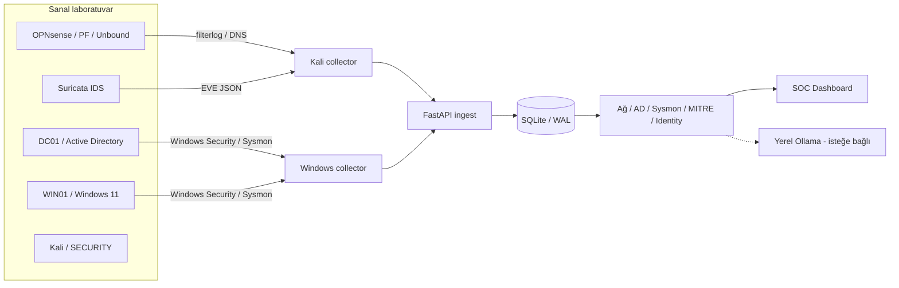

Bu şemada olay üretimi ile analiz işlemleri birbirinden ayrılır. Firewall trafiğe müdahale eder; AEGIS ise farklı sistemlerden gelen kayıtları analiz ederek analiste gösterir.

Olayı üreten sistemler ile olayı analiz eden sistem bilerek ayrı makinelerde durur. Kali ve Windows tarafındaki toplayıcılar olayları AEGIS SOC'a gönderir; SOC bunları normalleştirir, saklar, kurallardan geçirir ve analiste kanıtıyla birlikte sunar.

| Bileşen | Görevi | Bölge |
|---|---|---|
| **OPNsense** (`fw01.corp.local`) | Ağ geçidi, PF firewall, segmentasyon, Unbound DNS, Suricata IDS, KEA DHCPv4 | Ağ sınırı |
| **DC01** | Windows Server 2019, AD DS, `corp.local`, domain DNS | SERVERS |
| **WIN01** | Domain'e katılmış Windows 11, Security ve Sysmon olayları | USERS |
| **Kali Linux** | Yetkili güvenlik testleri, rsyslog ve ağ collector'ı | SECURITY |
| **AEGIS SOC** | FastAPI/Uvicorn, SQLite, tespit motorları, web paneli | Windows ana makine |

---

## 2. Laboratuvar altyapısı

### 2.1. Sanal makineler ve ağ bağdaştırıcıları

[LAB] Dört sanal makine VirtualBox üzerinde çalışıyor. Bölgeler ayrı VirtualBox **Internal Network**'lerine bağlı; OPNsense bu ağların her biri için ayrı bir arayüze sahip.

| Windows 11 (WIN01) | Windows Server (DC01) |
|---|---|
|  | 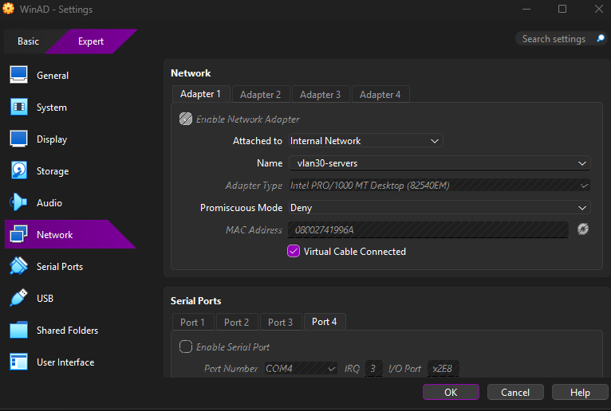 |
| **USERS:** `vlan20-users`, Internal Network | **SERVERS:** `vlan30-servers`, Internal Network |

| OPNsense | Kali Linux |
|---|---|
| 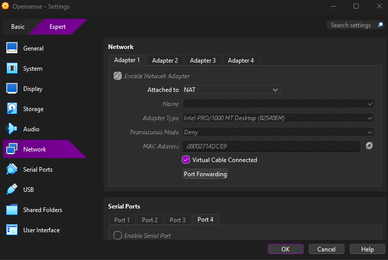 | 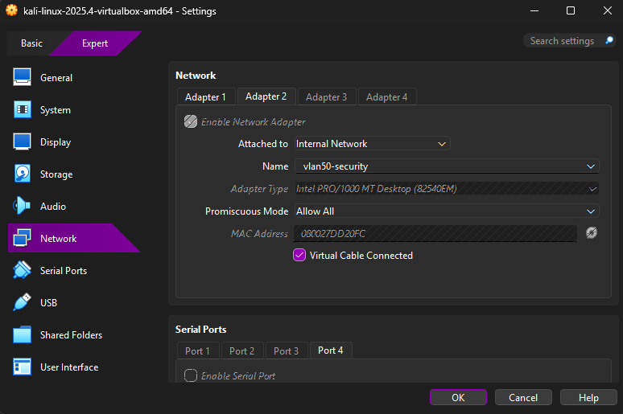 |
| **WAN:** ilk adaptör NAT; diğerleri iç ağlara ayrıldı | **SECURITY:** `vlan50-security`; Promiscuous Mode `Allow All` |


> **Not.** `vlan20/30/50` adları VirtualBox Internal Network adlarıdır. 802.1Q VLAN etiketlemesi kullanılmadı; her bölge OPNsense üzerinde ayrı bir arayüze bağlıdır.

### 2.2. Ağ planı ve topoloji

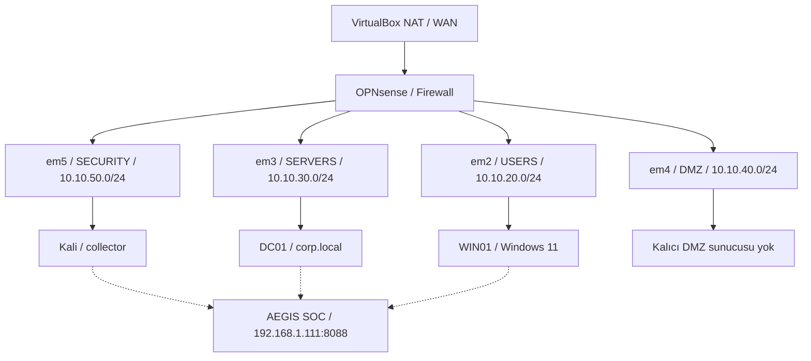

Ağ sınırları OPNsense üzerindeki ayrı arayüzlerde tanımlıdır. İç ağlar aynı fiziksel ana bilgisayarda çalışsa da trafiğin geçişi VirtualBox ağ eşlemesi, yönlendirme ve firewall kurallarına bağlıdır.

| Bölge | OPNsense arayüzü | Ağ | OPNsense geçidi | Sistem |
|---|---|---|---|---|
| WAN | NAT | `10.0.2.15/24` | `10.0.2.2` | İnternet çıkışı |
| LAN | yönetim | `192.168.56.10/24` | – | OPNsense Web GUI erişimi |
| USERS | `em2` | `10.10.20.0/24` | `10.10.20.1` | WIN01 `10.10.20.100` |
| SERVERS | `em3` | `10.10.30.0/24` | `10.10.30.1` | DC01 `10.10.30.10` |
| DMZ | `em4` | `10.10.40.0/24` | `10.10.40.1` | Ayrılmış bölge, kalıcı sunucu yok |
| SECURITY | `em5` | `10.10.50.0/24` | `10.10.50.1` | Kali `10.10.50.100` |
| Yönetim/SOC | Windows ana makine | `192.168.1.x` | – | AEGIS API `192.168.1.111:8088` |

**Neden ayrı bölgeler?** Başlangıçta bütün makineleri aynı ağda tutmak yerine kullanıcı, sunucu ve güvenlik testi trafiğini ayırdım. Böylece bir istemcinin domain controller'a ihtiyaç duyduğu servislerle Kali'nin test trafiği aynı izin kuralına tabi kalmadı. Amaç ağları tamamen koparmak değil; gerekli bağlantıları açık tutup gerisini politika ile denetlemekti.

### 2.3. IP ve yönlendirme doğrulaması

[LAB] DC01'in IP ve geçit ayarı ile Kali'nin arayüzleri ayrı ayrı kontrol edildi. Test trafiğinin gerçekten OPNsense üzerinden gittiğini doğrulamak önemliydi, çünkü Kali'nin ilk adaptörü ayrıca NAT'a bağlı.

<table>
  <tr>
    <td width="50%" align="center"><br><sub><b>DC01</b> · <code>10.10.30.10/24</code>, geçit <code>10.10.30.1</code></sub></td>
    <td width="50%" align="center">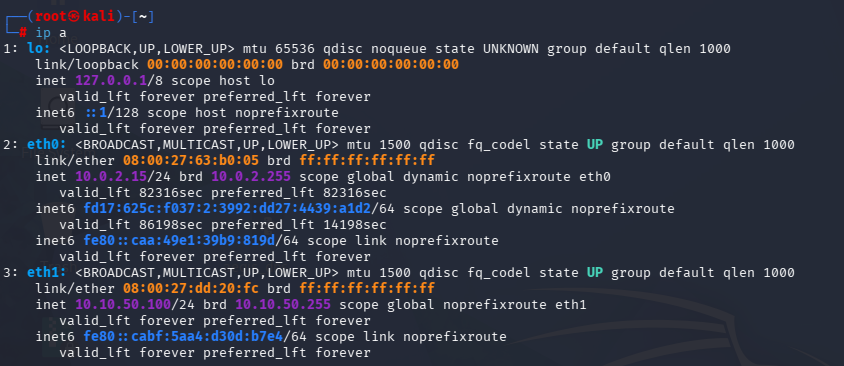<br><sub><b>Kali</b> · <code>eth0</code> NAT <code>10.0.2.15/24</code>, <code>eth1</code> SECURITY <code>10.10.50.100/24</code></sub></td>
  </tr>
</table>

```powershell
# DC01 / WIN01: sadece görüntüle
ipconfig /all
Resolve-DnsName corp.local -Server 10.10.30.10
```

```bash
# Kali: arayüzler, rota ve domain DNS sorgusu
ip a
ip route get 10.10.30.10
dig @10.10.30.10 corp.local A +noall +answer
```

---

## 3. OPNsense: firewall, blocklist ve Suricata

### 3.1. Sistem ve arayüzler

[LAB] OPNsense `26.7.8-amd64` (FreeBSD 15.1-RELEASE-p1) sanal makinede 2 vCPU, 2 GB RAM ve 21 GB disk ile çalışıyor. Çalışan servisler: Configd, Cron, Hostwatch, Intrusion Detection, KEA DHCPv4, Ntpd, Packet Filter, Syslog-ng, System routing, Unbound, Users and Groups, Web GUI.

<table>
  <tr>
    <td width="22%" align="center" valign="top">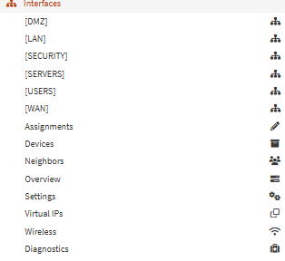<br><sub><b>Arayüz menüsü.</b> DMZ, LAN, SECURITY, SERVERS, USERS, WAN</sub></td>
    <td width="78%" align="center" valign="top"><br><sub><b>OPNsense panosu (testten önce).</b> Arayüz IP'leri, servis durumu, SECURITY arayüzünde henüz trafik yok.</sub></td>
  </tr>
</table>

### 3.2. Firewall politikası

[LAB] Kurallar kaynak bölge, hedef, protokol, port ve `PASS/BLOCK` kararına göre yazıldı. Her arayüzde kural sırası aynı mantığı izler: **önce tehdit istihbaratı engeli, sonra bölgeye özel engeller, sonra gerekli izinler, en sonda genel izin.** Kurallar sırayla değerlendirildiği için bu sıra bölgeler arası güvenliği belirler.

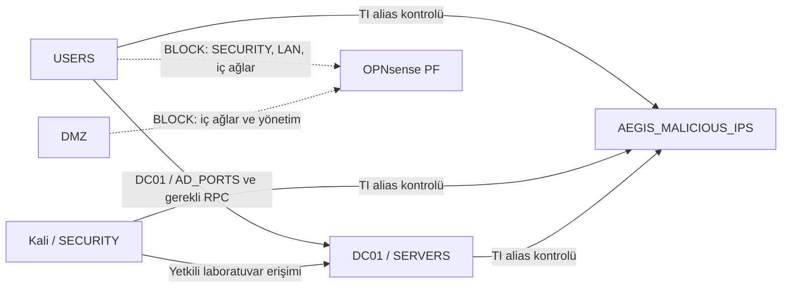

Bu çizim kural ekranındaki politika mantığını özetler, gerçek bir paket akışı simülasyonu değildir. Hangi trafiğin geçeceği kural sırasına ve paket özelliklerine bağlıdır; tüm kombinasyonlar ayrıca test edilmiş sayılmaz.

<p align="center">
  
  <br><sub><b>OPNsense → Firewall: Rules.</b> Gerçek kural listesi: USERS, DMZ, SERVERS ve SECURITY; ekranda toplam 51 kayıt gösteriliyor. Bu ekran Live View değil, kural yönetim ekranıdır.</sub>
</p>

| Arayüz | Sıra | Kural | Karar |
|---|---|---|---|
| **USERS** | 1 | AEGIS TI - Malicious IP Block (hedef `AEGIS_MALICIOUS_IPS`) | Engel |
| | 2 | Block USERS to SECURITY | Engel |
| | 3 | Block USERS to LAN | Engel |
| | – | Allow USERS to DC01 (genel) | Devre dışı |
| | 4 | Allow USERS to DC01 `AD_PORTS` (TCP/UDP) | İzin |
| | 5 | Allow USERS to DC01 Dynamic RPC (TCP 49152–65535) | İzin |
| | 6 | Block USERS to Internal Networks (`INTERNAL_NETS`) | Engel |
| | 7 | Allow USERS to any | İzin |
| **SERVERS** | 1 | AEGIS TI - DC01 Malicious IP Block | Engel |
| | 2 | Allow DC01 to OPNsense DNS (TCP/UDP, port `domain`) | İzin |
| | 3 | Block SERVERS to Internal Networks | Engel |
| | 4 | Allow SERVERS to any | İzin |
| **SECURITY** | 1 | AEGIS TI - Kali Malicious IP Block | Engel |
| | 2 | Allow KALI to Internal Lab (`KALI` → `INTERNAL_NETS`) | İzin |
| | 3 | Block SECURITY to Internal Networks | Engel |
| | 4 | Allow SECURITY to any | İzin |
| **DMZ** | 1 | Block DMZ to internal (`10.10.0.0/16`) | Engel |
| | 2 | Block DMZ to LAN mgmt | Engel |
| | 3 | Allow DMZ to internet | İzin |
| **LAN** | – | Default allow LAN to any (IPv4 ve IPv6) | İzin |

**Alias'lar.** Kurallar okunabilir kalsın diye hedefler alias ile tanımlandı:

| Alias | Tür | İçerik |
|---|---|---|
| `AD_PORTS` | Port(s) | Active Directory portları (88, 135, 389, 445, 464, 636, 3268 …) |
| `AEGIS_MALICIOUS_IPS` | URL Table (JSON) | Spamhaus DROP, 1753 kayıt, son güncelleme 01.11.2026 |
| `DC01` | Host | `10.10.30.10` |
| `INTERNAL_NETS` | Network | Laboratuvarın 4 iç ağı |
| `KALI` | Host | `10.10.50.100`, “Authorized Kali Security Test” |

<p align="center">
  
  <br><sub><b>OPNsense → Firewall: Aliases.</b> <code>AD_PORTS</code>, <code>AEGIS_MALICIOUS_IPS</code>, <code>DC01</code>, <code>INTERNAL_NETS</code> ve <code>KALI</code> gibi nesneler. Bu ekran firewall log detayı değildir.</sub>
</p>

### 3.3. IP ve DNS blocklist

OPNsense'te iki ayrı engelleme katmanı çalışıyor: biri **IP düzeyinde** (PF firewall), diğeri **alan adı düzeyinde** (Unbound DNS).

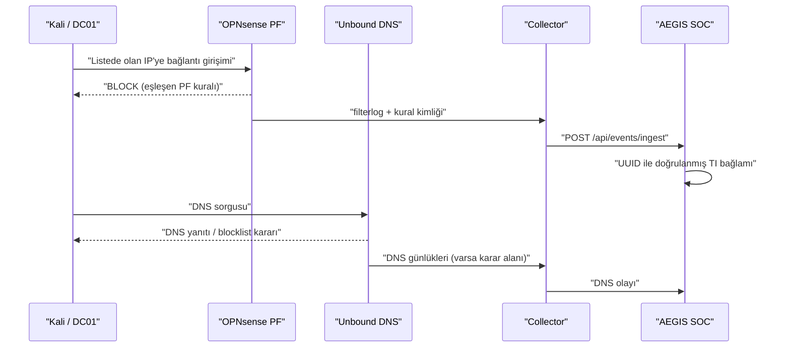

PF üzerindeki IP engeli ile Unbound üzerindeki DNS kararı iki ayrı mekanizmadır. SOC, salt `BLOCK` veya `NXDOMAIN` sözcüğünü tek başına tehdit istihbaratı doğrulaması olarak kullanmaz.

| Katman | Kaynak | OPNsense bileşeni | Uygulandığı yer | Doğrulama yeri |
|---|---|---|---|---|
| **IP** | Spamhaus DROP (URL Table, JSON) | Firewall → Aliases + 3 BLOCK kuralı | USERS, SERVERS, SECURITY kural listelerinin en üstü | Firewall Live View, filterlog PF kural UUID'si |
| **DNS** | HaGeZi TIF Mini + lab domain'i `bad.lab.test` | Services → Unbound DNS → Blocklists | Unbound'a giden tüm sorgular | Reporting → Unbound DNS → Details |

**IP katmanı.** Her bölgede ayrı bir BLOCK kuralı (`AEGIS TI - Malicious IP Block`, `... DC01 ...`, `... Kali ...`) alias'a başvurur ve kural listesinin en üstünde durur; yani bir istemci, diğer izin kurallarına ulaşmadan önce zararlı listedeki bir IP'ye giderken engellenir. **[KOD]** AEGIS bir BLOCK olayını otomatik olarak “TI block” saymaz: `filterlog` içindeki PF kural UUID'si onaylı kural kaydıyla eşleşirse TI bağlamı verilir. Bu, yanlış atıf riskini azaltır.

**DNS katmanı.** Unbound'da iki kayıt var: lab testi için `bad.lab.test` ve dış kaynaklı HaGeZi TIF Mini listesi. Unbound raporuna göre 26.10.2026'dan beri **2896 sorgunun 90'ı (%3,11) engellendi**; blocklist **212.423 kayıt** içeriyor. WIN01'in DNS sorguları DC01 üzerinden yönlendirildiği için SOC'ta bu sorguların kaynağı DC01 görünebilir.

<table>
  <tr>
    <td width="50%" valign="top">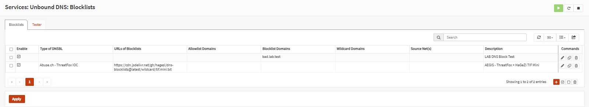<br><sub><b>Services → Unbound DNS → Blocklists.</b> HaGeZi TIF Mini kaydı ve lab test domain'i <code>bad.lab.test</code>.</sub></td>
    <td width="50%" valign="top"><br><sub><b>Reporting → Unbound DNS.</b> Toplam sorgu, çözümlenen, engellenen ve blocklist boyutu; en çok engellenen alan adları.</sub></td>
  </tr>
</table>

SOC tarafında aynı iki katman ayrı kartlarda gösterilir. **Ekranda DNS BLOCK ile NXDOMAIN ayrı kartlarda gösterilir:** `NXDOMAIN` yanıtı tek başına blocklist engeli kabul edilmez. Bu ekran görüntüsü o anki örneklemidir; collector'ın her Unbound blocklist kararını eksiksiz taşıdığı varsayılmaz.

<p align="center">
  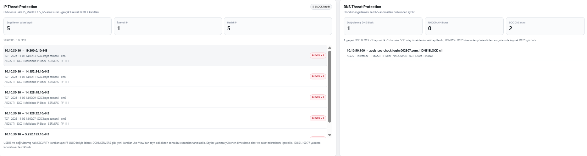
  <br><sub><b>IP Threat Protection / DNS Threat Protection.</b> Solda DC01'den (<code>em3</code>) çıkan 5 BLOCK kaydı, kural <code>AEGIS TI - DC01 Malicious IP Block</code> ve PF kural kimliği. Sağda doğrulanmış 1 DNS block (<code>10.10.50.100 → aegis-soc-check.login.002307.com</code>) ve NXDOMAIN burst sayacı.</sub>
</p>

### 3.4. Suricata IDS

[LAB] Suricata ayarlar ekranında **IDS modunda** (PCAP live) görünüyor ve yalnızca **SECURITY** ve **USERS** arayüzlerini izliyor. Uyarılar syslog'a ve EVE biçiminde gönderiliyor, log haftalık döndürülüyor ve 4 dosya saklanıyor. IDS modunda olduğu için trafiği engellemez; `allowed` işareti firewall PASS anlamına gelmez.

<table>
  <tr>
    <td width="50%" valign="top">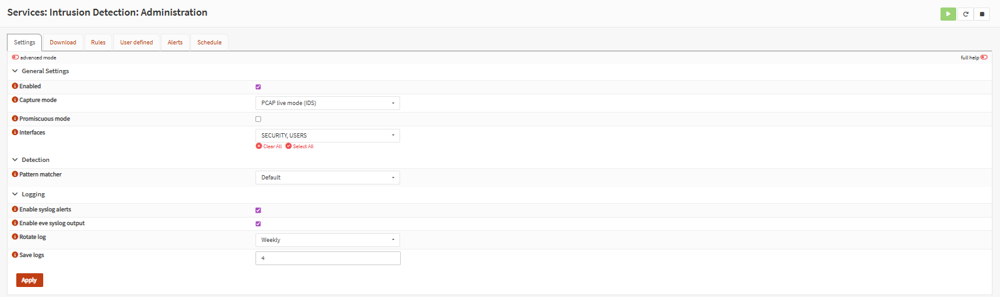<br><sub><b>Suricata ayarları.</b> PCAP live mode (IDS), arayüzler SECURITY ve USERS, syslog ve EVE çıktısı açık.</sub></td>
    <td width="50%" valign="top"><br><sub><b>Suricata uyarıları.</b> USERS arayüzünde WIN01'e dönen <code>GPL ICMP Echo Reply</code> (SID 2100408) kayıtları.</sub></td>
  </tr>
</table>

> **Kapsam notu.** SERVERS ve DMZ arayüzleri Suricata tarafından izlenmiyor. Kali → DC01 testleri, trafik SECURITY arayüzünden geçtiği için yine de görülüyor. **[KOD]** Suricata `severity` 1/2/3 değerleri `critical/high/medium` olarak eşlenir; bilinen `KALI SECURITY TEST` imzası özellikle `low` kalır, yetkili laboratuvar testi gereksiz yere kritik olay gibi sunulmaz.

### 3.5. DHCP ve DNS notları

[LAB] İlk kurulumda KEA DHCP'nin `10.10.30.1:67` (em3) ve `10.10.40.1:67` (em4) adreslerine bağlanmasında hata alındı. Aynı servis portuna yönelik çakışma giderildi, `dnsmasq` kapatıldı ve KEA çalışır hale getirildi; ardından DHCP, geçit ve ağ erişimi yeniden denendi. Domain çözümlemesinde WIN01, DNS olarak DC01'i (`10.10.30.10`) kullanır; DC01'in OPNsense Unbound'a giden sorgusuna ise SERVERS kuralları (`Allow DC01 to OPNsense DNS`) izin verir.

---

## 4. Active Directory

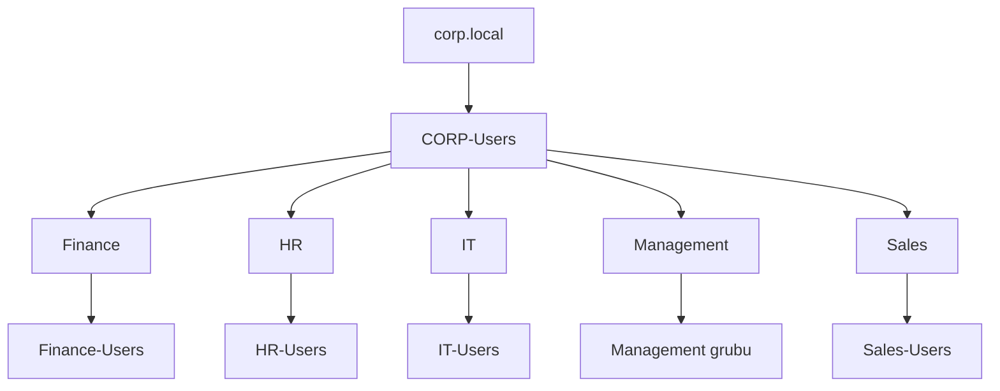

OU'lar kullanıcı ve nesneleri bölümlere ayırmak için, güvenlik grupları ise erişim ve yetki yönetimi için kullanılır. Aşağıdaki gerçek ADUC görüntüleri bu yapının laboratuvardaki karşılığını gösterir.

### 4.1. Etki alanı

[LAB] DC01 üzerinde Windows Server 2019 kuruldu, Active Directory Domain Services etkinleştirilerek sunucu domain controller'a yükseltildi ve etki alanı **`corp.local`** olarak yapılandırıldı. AD ile birlikte domain DNS rolü devreye alındı. WIN01 (Windows 11) USERS bölgesine yerleştirildi, DNS için DC01'e yönlendirildi ve domain'e katıldı. Böylece oturum açma, güvenlik grupları ve denetim olayları gerçek Windows kayıtları üzerinden test edilebildi.

```powershell
# DC01: AD/DNS hizmetleri ve OU'lar (sadece görüntüle)
Get-Service NTDS,DNS
Get-ADDomain
Get-ADOrganizationalUnit -Filter * | Select-Object Name,DistinguishedName
```

### 4.2. OU, grup ve kullanıcılar

Departman temelli bir kuruluş yapısı hazırlandı: `CORP-Users` OU'su altında beş alt OU ve her birinde bir güvenlik grubu.

| OU | Güvenlik grubu | Kullanıcılar |
|---|---|---|
| Finance | `Finance-Users` | Ayse, Mehmet |
| HR | `HR-Users` | Elif, Zeynep |
| IT | `IT-Users` | Can, Mahir KAY |
| Management | Management grubu | Ali |
| Sales | `Sales-Users` | Burak, Mehmet |

<p align="center"><br><sub><b>Active Directory Users and Computers.</b> CORP-Users altındaki beş OU.</sub></p>

| Finance | HR |
|---|---|
|  | 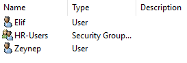 |
| **Finance:** Ayse, Mehmet, Finance-Users | **HR:** Elif, Zeynep, HR-Users |

| IT | Management |
|---|---|
| 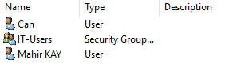 |  |
| **IT:** Can, Mahir KAY, IT-Users | **Management:** Ali ve yönetim grubu |

<p align="center">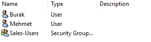<br><sub><b>Sales:</b> Burak, Mehmet ve Sales-Users grubu.</sub></p>


### 4.3. GPO ve denetim kayıtları

[LAB] Hesap ve güvenlik grubu yönetim olaylarının Windows Security günlüğüne yazılması için AD denetim ayarları üzerinde çalışıldı. `4720`, `4724`, `4726`, `4728`, `4729`, `4738` gibi olaylar yeni kullanıcı ve grup üyeliği değişikliği senaryolarında ele alındı; dosya paylaşımı erişim reddi için `5145` ve gerektiğinde nesne denetimi/SACL ayarları incelendi. GPO'ları güvenlik testleri için rastgele değiştirmek yerine, ilgili politikanın sonucu doğrudan log üzerinden doğrulandı. Bu depo GPO'ların tam dışa aktarımını içermez.

---

## 5. Collector'lar ve veri akışı

### 5.1. Kali network collector

[LAB] Ağ olayları Kali üzerinde toplandı. OPNsense'ten syslog ile gelen firewall, Suricata ve DNS kayıtları `rsyslog` ile `/var/log/opnsense/` altında ayrı dosyalara yazıldı.

| Bileşen | Konum / servis |
|---|---|
| Syslog alıcısı | UDP 514, `rsyslog` |
| Firewall logu | `/var/log/opnsense/firewall.log` |
| DNS logu | `/var/log/opnsense/dns.log` |
| Suricata logu | `/var/log/opnsense/suricata.log` |
| Collector | `/opt/ad-opnsense-soc/collector.py` |
| Servisler | `aegis-collector.service`, `aegis-dns-reader.service` ve `.timer` |

```bash
# Kali: servisler ve son çalışma kayıtları
systemctl is-active rsyslog aegis-collector.service aegis-dns-reader.timer
sudo journalctl -u aegis-collector.service -n 20 --no-pager
```

### 5.2. Windows Security ve Sysmon collector

[LAB] DC01 ve WIN01'den güvenlik olayları Windows üzerinde çalışan collector'larla gönderilir. WIN01'de Sysmon Operational kanalı için aktif filtre:

```powershell
# WIN01 Sysmon collector'da doğrulanan filtre
if ($Event.Id -notin @(1,3,8,10,11,13,22,25)) {
    # İlgisiz Sysmon olayını gönderme
}
```

Bir Event ID'nin filtrede bulunması, o olayın mutlaka oluştuğu veya alarm üreteceği anlamına gelmez.

### 5.3. Veri işleme hattı

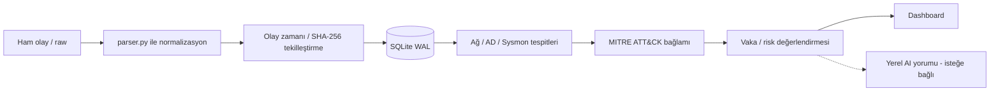

Ham olaylar saklanır ve tespit sonucu onunla birlikte sunulur. ATT&CK eşleştirmesi veya AI yorumu olayın kendisi yerine geçmez; analistin kararını destekleyen ayrı bir katmandır.

**[KOD]** Collector'lar olayları `POST /api/events/ingest` adresine gönderir. Uygulama kaynağı doğrular, `parser.py` ile normalleştirir, olay zamanını değerlendirir, SHA-256 tabanlı tekilleştirme uygular ve SQLite'a yazar. `raw` alan korunur: analist hem çıkarılan alanları hem de olayın ham halini görür, gözlenen olay ile ondan üretilen yorum birbirinden ayrılır.

---

## 6. AEGIS SOC yazılımı

**[KOD]** Uygulama FastAPI + Uvicorn üzerinde çalışır; arayüz `project/app/templates/index.html` içindedir. Kalıcı depo SQLite (WAL), SHA-256 parmak izi ile tekilleştirme ve varsayılan 50.000 olay tutma sınırı kullanır.

| Uç nokta | İşlev |
|---|---|
| `POST /api/events/ingest` | Collector kayıtlarını kabul eder |
| `GET /api/events` | Kaynağa, moda (`all`, `alerts`, `blocks`) ve zamana göre olay listeler; sorgu başına en çok 5.000 |
| `GET /api/incidents` · `POST /api/incidents/analyze` | İlişkili olaylar ve vaka analizi |
| `GET /api/network/detections` | Network örüntüsü adayları |
| `GET /api/ad/intelligence` · `/api/ad/overview` · `/api/ad/report` | AD tespit ve denetim görünümü |
| `GET /api/win/security` | Windows Security olayları |
| `GET /api/sysmon/investigation` · `POST /api/sysmon/correlation` | Süreç, parent/child ve olay incelemesi |
| `GET /api/mitre/summary` · `/api/mitre/detections` | ATT&CK eşleme ve analiz |
| `/api/identity/privileges`, `/risk`, `/behavior` | Kimlik, yetki, risk bağlamı ve davranış zaman çizelgesi |
| `GET /api/source-health` · `/api/status` · `/api/summary` | Kaynak sağlığı ve durum |
| `GET /api/ai/status` · `POST /api/ai/analyze` | Yerel Ollama desteği |

Olayın kaynak zamanı ile SOC'a alındığı zaman farklı olabilir; zaman filtreleri değerlendirilirken bu ayrım önemlidir.

**Erişim güvenliği.** **[KOD]** Panel için isteğe bağlı Basic Auth (`SOC_DASHBOARD_USER`, `SOC_DASHBOARD_PASSWORD`), ingest için `X-SOC-Token` (`SOC_INGEST_TOKEN`) kullanılabilir; Identity/Privilege uçları yalnızca yerel (loopback) erişime açıktır.

**Yerel yapay zekâ.** [LAB] Opsiyonel Ollama entegrasyonu `127.0.0.1:11434` üzerinde `qwen3:4b-instruct` ile kullanıldı. **[KOD]** Yalnızca seçili alarmın doğrulanmış kanıtı modele gönderilir, dış API anahtarı gerekmez, çıktı kalite kontrolünden geçer ve **otomatik müdahale kararı üretmez.**

---

## 7. Tespit katmanları

### 7.1. Network

**[KOD]** Network analizi, tek bir olayı yüksek riskli saymak yerine birden fazla ipucunu birlikte inceler.

| Tespit | Mantık |
|---|---|
| Dikey port tarama adayı | Aynı kaynak/hedef bağlamında 5 dakika içinde en az 5 port |
| Yatay tarama adayı | Aynı kaynaktan en az 5 ayrı hedef |
| Kaynak–hedef korelasyonu | 5 dakikalık pencerede birlikte görülen olaylar |
| Suricata önceliği | `severity` 1/2/3 → critical/high/medium |
| Bilinen lab imzası | `KALI SECURITY TEST` düşük riskte kalır |
| Yayın/gürültü trafiği | DC01 `.255` NetBIOS ve bazı UDP/123 engelleri düşük öncelikli |
| Tehdit istihbaratı | IP: PF kural UUID eşleşmesi; DNS: doğrulanmış block ≠ NXDOMAIN |

### 7.2. Windows Security ve Active Directory

**[KOD]** İzlenen olaylar: `4624` `4625` `4672` `4719` `4720` `4724` `4726` `4728` `4729` `4732` `4738` `4740` `4756` `4768` `4769` `4771` `4776` `1102` `5136` `5145`.

| Event ID | Güvenlik bağlamı |
|---|---|
| 4624, 4625 | Başarılı / başarısız oturum açma |
| 4672, 4719 | Özel ayrıcalık / denetim politikası değişikliği |
| 4720, 4726, 4738 | Hesap oluşturma / silme / değiştirme |
| 4724 | Parola sıfırlama girişimi |
| 4728, 4729, 4732, 4756 | Güvenlik grubu üyelik hareketleri |
| 4740 | Hesap kilitlenmesi |
| 4768, 4769, 4771, 4776 | Kerberos ve kimlik doğrulama |
| 1102 | Güvenlik günlüğünün temizlenmesi |
| 5136, 5145 | Dizin nesnesi değişikliği · ayrıntılı dosya paylaşımı erişimi |

Kural başlıkları: `brute_force` (10 dakikalık pencere), `success_after_fail`, `password_spray`, `user_enum`, `lockout`, `kerberoast` (RC4 `0x17` işareti), `asrep_roast`, `log_cleared`, `priv_group`, `new_account`. MITRE eşlemesi (ör. T1110, T1558.003, T1558.004, T1070.001, T1098, T1136.001) analistin sınıflandırmasına yardımcı olur.

### 7.3. Sysmon: 11 kural

**[KOD]** Gerçek kayıt kural koşulunu karşılıyorsa alarm üretilir; ham bir Event ID görülmesi tek başına alarm değildir.

| Kural | Event ID | İncelenen davranış |
|---|---|---|
| `SYSMON-OFFICE-SHELL` | 1 | Office benzeri üst süreçten shell çalıştırma |
| `SYSMON-SCRIPT-SHELL` | 1 | Script host üzerinden shell çalıştırma |
| `SYSMON-ENCODED-POWERSHELL` | 1 | Kodlanmış PowerShell çağrısı |
| `SYSMON-POWERSHELL-EXECUTION` | 1 | İnceleme gerektiren PowerShell ifadesi |
| `SYSMON-UNUSUAL-OUTBOUND-PORT` | 3 | Olağandışı dış hedef portu |
| `SYSMON-REMOTE-THREAD-LSASS` | 8 | LSASS hedefli uzak thread işareti |
| `SYSMON-LSASS-ACCESS` | 10 | LSASS hedefli erişim ve yetki maskesi |
| `SYSMON-STARTUP-FILE` | 11 | Başlangıç klasöründe dosya oluşturma |
| `SYSMON-AUTORUN-REGISTRY` | 13 | Run/RunOnce otomatik başlatma anahtarı |
| `SYSMON-SUSPICIOUS-DNS` | 22 | Şüpheli DNS alan adı sorgusu |
| `SYSMON-PROCESS-TAMPERING` | 25 | Süreç manipülasyonu göstergesi |

[LAB] WIN01'de gerçek Windows işlemleriyle sekiz farklı kural doğrulandı: Office shell, script shell, encoded/dinamik PowerShell, olağandışı port, DNS, Startup dosyası ve Registry Run. “Office” testi gerçek bir Word belgesi açılmadan, test amaçlı adlandırılmış süreçle yapıldı. ID 8, 10 ve 25 için XML ve collector kapsamı açıldı, ancak LSASS hedefli yüksek riskli davranış veya gerçek süreç manipülasyonu üreten canlı testler tamamlanmadı: LSASS koruması erişimi engelledi, üçüncü taraf bir test aracı Defender tarafından bloklandı. **Test başarısı için güvenlik mekanizmaları devre dışı bırakılmadı.**

### 7.4. MITRE ve Identity

**[KOD]** MITRE motoru (`app/aegis_mitre`) 49 ATT&CK tekniğine başvuran kurallar içerir; olaydan analist yorumuna giden yol ham kaydın normalleştirilmesi, kuralın tetiklenmesi, ATT&CK bağlamının atanması ve vaka/sunum katmanına taşınmasıdır. **Bir tekniğin eşlenmesi saldırının gerçekleştiği anlamına gelmez**; amaç, analiste inceleme gerekçesini ve ham kanıtı birlikte sunmaktır.

Identity katmanı yalnızca olay ID'lerine bakmaz: `aegis.ad_inventory.v2` envanter şeması ile `priv_users`, `priv_groups`, `priv_edges` yetki tabloları kullanılır; kenar türleri `user_memberof`, `user_primarygroup`, `group_memberof` olduğu için doğrudan ve iç içe (nested) üyelikler ayrılabilir. Kritik gruplar arasında Domain/Enterprise/Schema Admins, Administrators, Account Operators ve Server Operators bulunur.

---

## 8. Dashboard turu

[LAB] Dashboard sonradan eklenmiş bir yüzey değil; gerçek kaynaklardan gelen log ve tespit kanıtını incelemek için geliştirilen son katmandır. Sekmeler: **Overview**, **Endpoint · Sysmon**, **Identity · AD & Graph**, **Network Security**, **All Logs**.

### 8.1. Genel görünüm

<p align="center">
  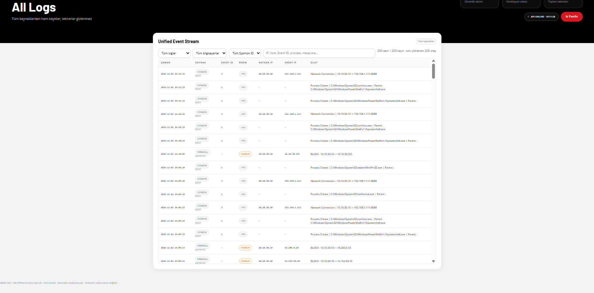
  <br><sub><b>All Logs.</b> Bütün kaynaklardan ham kayıtlar tek akışta; kaynak, bilgisayar ve Sysmon ID filtreleri. DC01'in SOC'a gönderdiği bağlantılar (<code>10.10.30.10 → 192.168.1.111:8088</code>) kendi telemetri gürültüsüdür.</sub>
</p>

### 8.2. Network Security

Network sayfası firewall, Suricata ve DNS kayıtlarını bir arada gösterir. Üstteki sayaçlar yüklenen örnekleme aittir: **270 olay (257 firewall, 11 Suricata, 2 DNS)**, 250 BLOCK, 3 farklı IDS imzası.

<p align="center">
  
  <br><sub><b>Network Security.</b> Saldırı zinciri görselleştirmesi: Kali <code>10.10.50.100</code> → OPNsense → DC01 <code>10.10.30.10</code> (18 kayıt); WIN01 ile bağlantı yok (0 kayıt). Sağda kanıta dayalı AI analist paneli.</sub>
</p>

<p align="center">
  
  <br><sub><b>Firewall · Suricata · MITRE.</b> DC01'in dış IP'lere engellenen bağlantıları, <code>10.10.30.255:137</code> NetBIOS yayını (×240), Kali'den gelen <code>GPL ICMP PING</code> ve <code>ET SCAN NMAP -sS</code> imzaları ve T1595 ön eşleştirmesi.</sub>
</p>

<p align="center">
  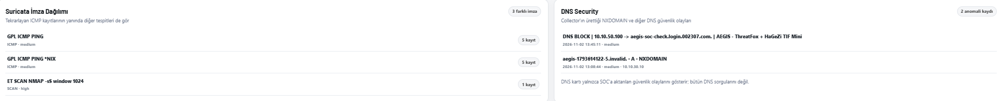
  <br><sub><b>İmza dağılımı ve DNS güvenliği.</b> Üç farklı Suricata imzası; DNS kartında doğrulanmış blocklist kaydı ve ayrı bir NXDOMAIN kaydı.</sub>
</p>

<table>
  <tr>
    <td width="50%" valign="top">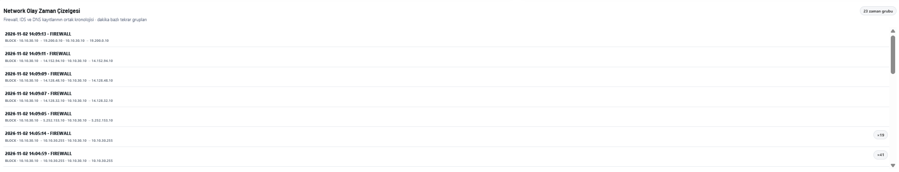<br><sub><b>Olay zaman çizelgesi.</b> Firewall, IDS ve DNS kayıtları dakika bazlı gruplanır (23 zaman grubu).</sub></td>
    <td width="50%" valign="top">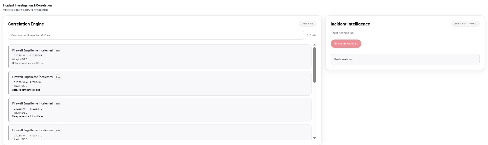<br><sub><b>Incident Investigation.</b> Korelasyon motorunun 9 vaka grubu ve vaka bazlı AI analizi.</sub></td>
  </tr>
</table>

### 8.3. Endpoint · Sysmon

<p align="center">
  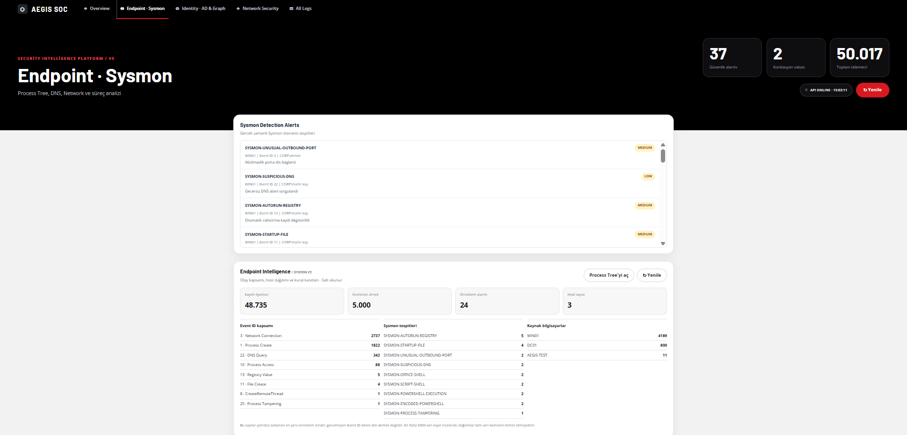
  <br><sub><b>Endpoint Intelligence.</b> 48.735 Sysmon kaydı, en çok görülen Event ID'ler (3, 1, 22, 10), kural bazlı alarm dağılımı ve kaynak bilgisayarlar (WIN01, DC01, AEGIS-TEST). Sayılar son 5.000 kayıtlık örnekleme dayanır.</sub>
</p>

Alarmdan süreç ağacına inilir: ProcessGuid eşleşmesiyle parent/child ilişkisi, komut satırı, ağ, DNS ve MITRE kayıtları aynı ekranda görünür.

<table>
  <tr>
    <td width="50%" valign="top">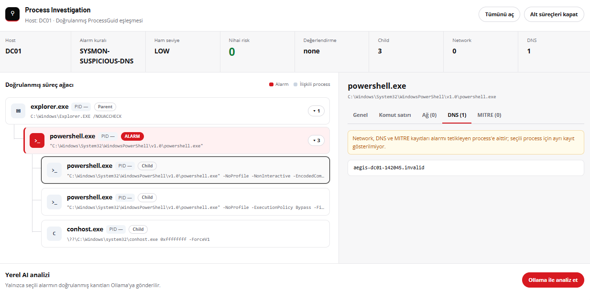<br><sub><b>DC01 · SYSMON-SUSPICIOUS-DNS.</b> <code>explorer.exe → powershell.exe</code> ağacı ve geçersiz <code>.invalid</code> alan adı sorgusu.</sub></td>
    <td width="50%" valign="top"><br><sub><b>WIN01 · SYSMON-UNUSUAL-OUTBOUND-PORT.</b> Süreç ağacı, ağ bağlantısı ve yerel Ollama'nın yalnızca doğrulanmış kanıta dayalı yorumu.</sub></td>
  </tr>
</table>

### 8.4. Identity · AD Intelligence

<p align="center">
  
  <br><sub><b>Identity Security Workspace.</b> 1.162 AD olayı (951 başarılı, 170 başarısız); brute-force şüphesi (T1110.001) ve AD kritik özellik değişikliği (T1098) tespitleri, varlık riskleri ve MITRE teknikleri.</sub>
</p>

<table>
  <tr>
    <td width="50%" valign="top"><br><sub><b>AD Security Event Stream.</b> Kerberos TGT (4768) ve servis bileti (4769) olayları, hesap, kaynak/hedef ve sonuç.</sub></td>
    <td width="50%" valign="top">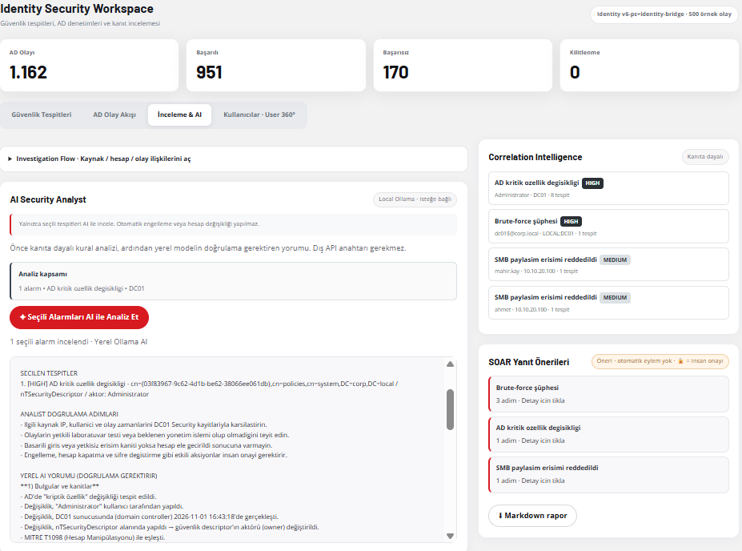<br><sub><b>İnceleme ve AI.</b> Korelasyon bağlamı, yerel AI analisti ve “öneri · otomatik eylem yok · insan onayı” ibaresiyle SOAR yanıt önerileri.</sub></td>
  </tr>
</table>

<table>
  <tr>
    <td width="50%" valign="top">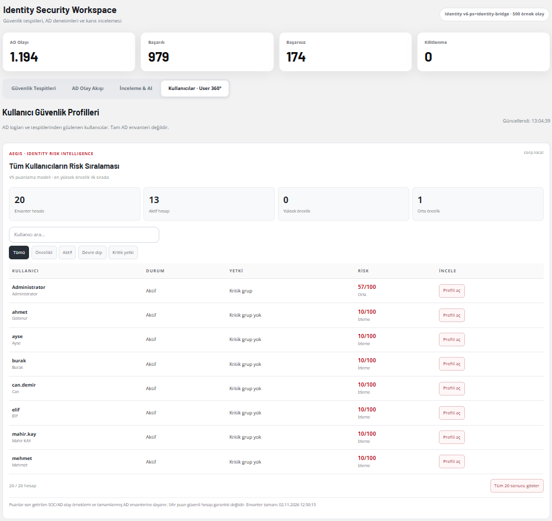<br><sub><b>Kullanıcı risk sıralaması.</b> 20 envanter hesabı, 13 aktif; Administrator kritik grup nedeniyle 57/100, diğerleri 10/100.</sub></td>
    <td width="50%" valign="top">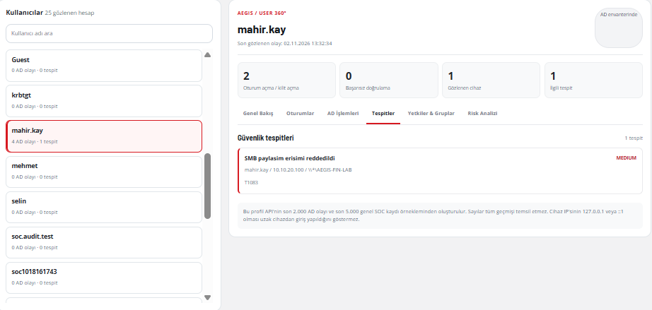<br><sub><b>User 360.</b> <code>mahir.kay</code> için oturumlar, cihaz ve <code>\\*\AEGIS-FIN-LAB</code> paylaşımına reddedilen erişim (T1083).</sub></td>
  </tr>
</table>

<p align="center">
  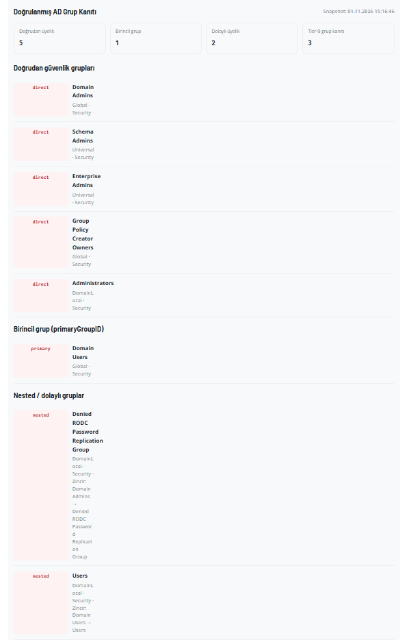
  <br><sub><b>Doğrulanmış AD grup kanıtı.</b> Doğrudan üyelikler (Domain Admins, Enterprise Admins, Schema Admins, Group Policy Creator Owners, Administrators), birincil grup ve nested zincirler.</sub>
</p>

---

## 9. Saldırı simülasyonları ve doğrulama

Kali'deki yetkili test komutu beş adımdan oluşur ve her adım farklı bir sensörün kaydını üretir.

<p align="center">
  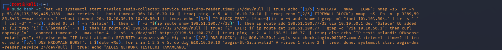
  <br><sub><b>Kali test komutu.</b> Beş adım tek satırda; sonunda <code>aegis-dns-reader</code> servisi başlatılır.</sub>
</p>

| # | Test | Komut özeti | Beklenen | Görülen kanıt | Durum |
|---|---|---|---|---|---|
| 1 | Suricata | `nmap -sS -Pn -n -p 53,88,135,389,445,3389` → DC01 + `ping -c 5` | Suricata + firewall kaydı | `ET SCAN NMAP -sS window 1024`, `GPL ICMP PING`, `GPL ICMP PING *NIX` (Network sayfası) | Doğrulandı |
| 2 | Firewall BLOCK | `nmap -sS -p 3389,5985,8443` → DC01 ve OPNsense | BLOCK kayıtları | Firewall panelinde BLOCK kayıtları | Doğrulandı |
| 3 | IP block | `198.51.100.77` (RFC 5737) için geçici rota + `curl`/`ping` | PF kuralıyla BLOCK | Önceki testte `em5` giriş yönünde BLOCK; bu depodaki IP Threat Protection görüntüsü DC01/`em3` engellerini gösterir | Kısmen belgelendi |
| 4 | DNS block | `dig @10.10.50.1 aegis-soc-check.login.002307.com` | Doğrulanmış DNS BLOCK | `DNS BLOCK ×1`, politika `AEGIS - ThreatFox + HaGeZi TIF Mini` | Doğrulandı |
| 5 | NXDOMAIN | `dig @10.10.30.10 aegis-<t>-<i>.invalid` ×5 | NXDOMAIN kayıtları | SOC'ta NXDOMAIN kaydı görüldü; burst sayacı 0 | Kayıt görüldü, burst eşiği aşılmadı |

198.51.100.77, RFC 5737 kapsamında dokümantasyon için ayrılmış bir adrestir; gerçek bir zararlı IP olduğu iddia edilmez.

**Testten önce ve sonra.** Aynı OPNsense panosu testten sonra SECURITY arayüzünde yaklaşık 640 KB gelen trafik gösteriyor.

<table>
  <tr>
    <td width="50%" valign="top"><br><sub><b>Önce.</b> SECURITY arayüzü: 0 KB.</sub></td>
    <td width="50%" valign="top">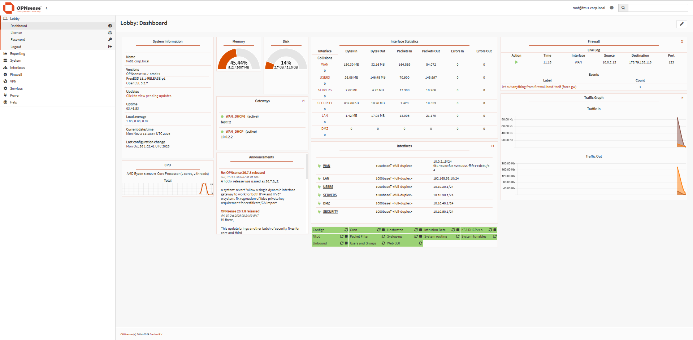<br><sub><b>Sonra.</b> SECURITY arayüzü: 639,66 KB, çalışma süresi 03:48.</sub></td>
  </tr>
</table>

### Doğrulama matrisi

| Senaryo | Kaynak / beklenen kanıt | Doğrulama türü |
|---|---|---|
| Kali → DC01 Nmap/ICMP | Suricata EVE + firewall log | [LAB] Gerçek ağ olayı |
| DC01 → listedeki dış IP'ler | PF BLOCK + `filterlog` + kural UUID | [LAB] Gerçek firewall kararı |
| Kali → test IP | PF BLOCK + `filterlog` | [LAB] Önceki doğrulama |
| DNS blocklist | Unbound kararı + SOC DNS BLOCK | [LAB] Gerçek blocklist kararı |
| DNS NXDOMAIN | Unbound yanıtı / SOC DNS olayı | [LAB] Blocklist kanıtıyla aynı değil |
| AD hesap/grup değişikliği | Windows Security + Identity timeline | [LAB] Windows kayıtları |
| WIN01 PowerShell / DNS / startup / autorun | Sysmon + SOC alarmı | [LAB] 8 farklı kural canlı doğrulandı |
| ID 8/10/25 LSASS / tampering | Yapılandırma + birim testleri | [LAB] Canlı zararlı davranış doğrulaması yok |

---

## 10. Çalıştırma ve test

Aşağıdaki komutlar `project/` klasöründe ve Windows + Python 3.14 ortamında kullanılmak üzere yazıldı (testler Python 3.12'de de geçiyor). Collector servisleri bu depoyla otomatik kurulmaz.

```powershell
Set-Location project
py -3.14 -m venv .venv
.\.venv\Scripts\python.exe -m pip install -r requirements.txt

# Hassas değerleri yalnızca yerel ortam değişkeni olarak ver
$env:SOC_DASHBOARD_USER     = '<ornek-kullanici>'
$env:SOC_DASHBOARD_PASSWORD = '<yerel-guclu-parola>'
$env:SOC_INGEST_TOKEN       = '<yerel-rastgele-token>'
$env:AEGIS_MITRE_V2         = '1'

.\.venv\Scripts\python.exe -m uvicorn app.main:app --host 127.0.0.1 --port 8088
```

> `127.0.0.1` yalnızca yerel erişime açar. Laboratuvardaki collector'ların bağlanabilmesi için `0.0.0.0` gerekir; bu durumda erişimi firewall ile laboratuvar ağıyla sınırlayın ve internete açmayın.

```powershell
# Birim testleri
.\.venv\Scripts\python.exe -m unittest discover -s tests -v          # 42 Identity/Sysmon testi
Set-Location app
..\.venv\Scripts\python.exe -m unittest aegis_mitre.test_engine -v   # 21 MITRE testi
```

```powershell
# Veri kaynaklarını doğrula (sadece okuma)
$base = 'http://127.0.0.1:8088'
Invoke-RestMethod "$base/api/status"
Invoke-RestMethod "$base/api/source-health"
Invoke-RestMethod "$base/api/events?mode=all&source=FIREWALL&limit=25"
Invoke-RestMethod "$base/api/events?mode=all&source=SURICATA&limit=25"
Invoke-RestMethod "$base/api/events?mode=all&source=SYSMON&limit=25"
```

HTTP 200 yalnızca API'nin cevap verdiğini gösterir; bir kaynağın gerçekten güncel kayıt ürettiğini anlamak için olayın zamanı ve ham içeriği ayrıca karşılaştırılmalıdır.

---

## 11. Güvenlik, kapsam ve bilinen sınırlar


**Teknik sınırlar**

- AEGIS pasif analiz yapar; engelleme OPNsense ve Windows politikalarındadır.
- Dashboard sayıları yüklenen örnekleme aittir (ör. son 500 AD olayı, son 5.000 Sysmon kaydı); tüm veritabanını temsil etmez.
- Suricata IDS modunda çalışır ve yalnızca SECURITY , USERS VE SERVER arayüzlerini izler.
- NXDOMAIN yanıtı tek başına blocklist engeli sayılmaz; NXDOMAIN, karar alanı veya bağımsız doğrulama olmadan kesin blocklist engeli sayılmaz; collector kapsamı dikkate alınır.
- Sysmon ID 8, 10 ve 25 kuralları için canlı kötü amaçlı davranış testi tamamlanmadı; izleme ve birim testleri ayrıdır.
- Kali ve Windows collector kaynakları (`collector.py`, `aegis-collector.service`, `aegis-dns-reader`, Windows görevleri) bu depoda yer almaz; veri akışı bu belgede açıklanmıştır.
- Firewall politika matrisi kural listesinden türetilmiştir; her hücre ayrıca test edilmemiştir.


---

## 12. Depo düzeni

```text
AEGIS-SOC/
├── README.md
├── images/                       # laboratuvar ekran görüntüleri
├── project/
│   ├── app/
│   │   ├── main.py               # FastAPI uygulaması ve API uçları
│   │   ├── parser.py             # olay normalizasyonu
│   │   ├── storage.py            # SQLite, tekilleştirme, saklama
│   │   ├── network_detection.py  # ağ tespitleri
│   │   ├── incident_engine.py    # olay korelasyonu
│   │   ├── ad_intelligence.py    # AD kayıt analizi
│   │   ├── identity_*.py         # kimlik, yetki, risk, davranış, User 360
│   │   ├── sysmon_*.py           # Sysmon tespitleri ve süreç ilişkileri
│   │   ├── aegis_mitre/          # MITRE eşleştirme ve analiz motoru
│   │   └── templates/index.html  # SOC web arayüzü
│   ├── tests/                    # Identity ve Sysmon birim testleri
│   └── requirements.txt
└── .gitignore
```

---

## Ek: ekran görüntüsü dizini

<details>
<summary>Görsel dosyaları ve ilgili bölümler (39 ekran görüntüsü)</summary>

| Dosya | İçerik | Bölüm |
|---|---|---|
| `lab-vbox-win01.png` · `lab-vbox-dc01.png` · `lab-vbox-opnsense.png` · `lab-vbox-kali.png` | WIN01, DC01, OPNsense ve Kali VirtualBox ağ ayarları | 2.1 |
| `lab-dc01-ipconfig.png` · `lab-kali-ip-addr.png` | DC01 ve Kali IP çıktıları | 2.3 |
| `lab-kali-test-command.png` | Kali 5 adımlı test komutu | 9 |
| `opnsense-interfaces-menu.png` · `opnsense-dashboard-before-tests.png` | Arayüz menüsü, pano (önce) | 3.1 |
| `opnsense-dashboard-after-tests.png` | Pano (sonra) | 9 |
| `opnsense-firewall-rules.png` · `opnsense-firewall-aliases.png` | Kural listesi, alias'lar | 3.2 |
| `opnsense-unbound-blocklists.png` · `opnsense-unbound-reporting.png` | DNS blocklist ayarı ve raporu | 3.3 |
| `opnsense-suricata-settings.png` · `opnsense-suricata-alerts.png` | Suricata ayarları ve uyarıları | 3.4 |
| `ad-ou-structure.png` · `ad-ou-finance.png` · `ad-ou-hr.png` · `ad-ou-it.png` · `ad-ou-management.png` · `ad-ou-sales.png` | OU yapısı ve OU'lar (tek tek) | 4.2 |
| `aegis-command-center.png` · `aegis-all-logs.png` | Komuta merkezi, tüm loglar | Giriş, 8.1 |
| `aegis-network-overview.png` · `aegis-network-panels.png` · `aegis-network-signatures-dns.png` | Network Security sayfası | 8.2 |
| `aegis-ip-dns-threat-protection.png` | IP/DNS tehdit koruması | 3.3 |
| `aegis-network-timeline.png` · `aegis-incident-correlation.png` | Zaman çizelgesi, vaka korelasyonu | 8.2 |
| `aegis-sysmon-endpoint.png` · `aegis-sysmon-process-tree-dc01.png` · `aegis-sysmon-process-tree-win01-ai.png` | Endpoint · Sysmon | 8.3 |
| `aegis-identity-detections.png` · `aegis-identity-event-stream.png` · `aegis-identity-investigation-ai.png` | Identity tespit, olay akışı, inceleme | 8.4 |
| `aegis-identity-risk-ranking.png` · `aegis-identity-user360.png` · `aegis-identity-group-evidence.png` | Risk sıralaması, User 360, grup kanıtı | 8.4 |

</details>
