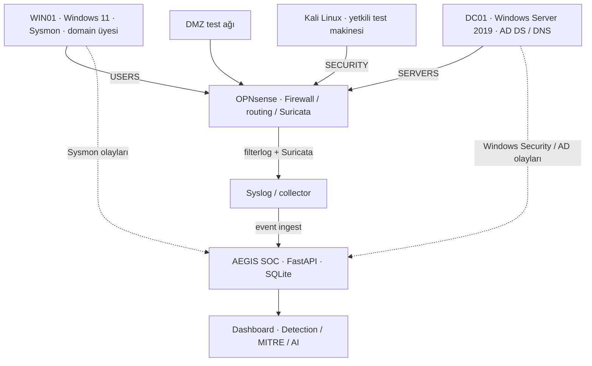
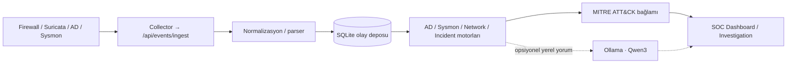

# AEGIS SOC — Active Directory, OPNsense & Suricata Security Lab

**Segmentlere ayrılmış kurumsal ağ • Active Directory güvenliği • IDS/IPS gözlemlenebilirliği • Detection Engineering • Yerel SOC ve AI analizi**

> **Proje durumu (24 Ekim 2026):** Geliştirme ve doğrulama laboratuvarı. Bu depo başlangıçta dokümantasyon odaklı hazırlanmıştır; çalışır uygulamanın tüm kaynak kodları henüz yayımlanmamıştır. Belgelenen çalışmalar gerçek laboratuvar oturumlarına dayanır; bazı güvenlik kontrollerinin en son konfigürasyonu ve bazı tespit senaryoları hâlâ yeniden doğrulanmalıdır.

## Projenin hikâyesi

AEGIS SOC yalnızca log gösteren bir web paneli değildir. Projede **sanal bir kurum altyapısı** tasarlanmış, farklı güvenlik bölgelerine ayrılmış, Windows Server üzerinde **Active Directory domain** kurulmuş, Windows 11 istemcisi bu domaine alınmış, **OPNsense ile ağ erişimi sınırlandırılmış**, **Suricata ile ağ trafiği izlenmiş**, Windows Security/Sysmon kayıtları merkezi bir SOC'a taşınmış ve kontrollü Kali testleriyle bu zincirin çalıştığı sınanmıştır.

Amaç; bir güvenlik analistinin hem **koruyucu kontrolleri** (GPO, hesap kısıtları, firewall kuralları, segmentasyon) hem de **tespit ve inceleme katmanını** (IDS, log toplama, korelasyon, MITRE, kanıt temelli raporlama) tek laboratuvarda deneyebilmesidir.

### Uçtan uca neler yaptık?

1. **OPNsense ile dört laboratuvar ağı oluşturarak bölümleri ayırdık.** Kullanıcılar, sunucular, DMZ ve güvenlik/test makineleri farklı alt ağlarda konumlandırıldı.
2. **Firewall erişimlerini ihtiyaca göre sıkılaştırdık.** USERS ağının domain hizmetleriyle çalışabilmesi korunurken DMZ/SECURITY gibi diğer iç ağlara erişimi sınırlandı; izin verilen ve engellenen trafik test edildi.
3. **Windows Server 2019 üzerinde `corp.local` domain ortamını kurduk.** `DC01` domain controller olarak yapılandırıldı; DNS, kimlik doğrulama ve etki alanı işlevleri test edildi.
4. **Windows 11 `WIN01` istemcisini domaine aldık.** Domain hesabıyla oturum açma, güvenli kanal, `gpupdate`, DC'ye DNS ve SMB erişimi test edildi.
5. **AD güvenlik politikaları ve denetim kayıtlarına odaklandık.** GPO ile Windows güvenlik duvarı profilleri, hesap/grup olaylarının denetlenmesi, kullanıcıların oturum açabileceği iş istasyonu kısıtları ve erişim izinleri üzerinde çalışıldı.
6. **Suricata IDS/IPS yapılandırması ve kurallarıyla test trafiğini görünür hale getirdik.** Standart GPL/ET imzaları ve laboratuvar için özel `KALI SECURITY TEST` alarmları işlendi; bunun gerçek bir engelleme kanıtı olmadığı ayrıca belirtildi.
7. **Firewall + Suricata + AD + Sysmon loglarını merkezi SOC'a taşıdık.** FastAPI, normalizasyon, depolama ve dashboard üzerinden olaylar izlendi.
8. **Kali Linux ile kontrollü güvenlik testleri yaptık.** TCP/UDP, DNS, SMB, RDP, Kerberos, LDAP ve ICMP senaryolarından telemetri toplandı; MITRE ve ağ tespit modülleri geliştirildi.

## Laboratuvar topolojisi

> Bu şema **mantıksal ağ yapısını ve log akışını** gösterir; tüm bağlantıların birebir kablolama/route haritası değildir. Windows olaylarının aktarım yöntemi kolektör/sürüm bazında değişebilir.

| OPNsense arayüzü | Bölge | Laboratuvar alt ağı | Rol |
|---|---|---|---|
| `em2` | USERS | `10.10.20.0/24` | Domain üyesi istemciler, WIN01 |
| `em3` | SERVERS | `10.10.30.0/24` | DC01, Active Directory / DNS |
| `em4` | DMZ | `10.10.40.0/24` | Ayrı tutulan servis/test segmenti |
| `em5` | SECURITY / KALI | `10.10.50.0/24` | Kontrollü test makinesi Kali |

*Adresler özel RFC1918 laboratuvar örnekleridir; gerçek şirket veya internete açık sistemlerin topolojisini temsil etmez.*

## 1. Ağ güvenliği ve OPNsense sıkılaştırması

Ağ tasarımındaki temel hedef **her iç ağın birbirine sınırsız erişmemesi** idi. Domain'in gerektirdiği trafiğe izin verilerek servis sürekliliği korunurken diğer bölgelere erişim kurallarla sınırlandı.

- **USERS → DC01:** DNS/AD erişimi, Kerberos ve gerekli SMB/RPC iletişimi için kurallar düzenlendi; domain'in çalışması test edildi. Tek tek güncel kural sırası ve port listesi yayımlanmadan önce OPNsense konfigürasyonuyla karşılaştırılmalıdır.
- **USERS → DMZ / SECURITY:** Kısıtlamalar uygulandı; geçmiş laboratuvar testlerinde bu bölgelere erişim girişimlerinin başarısız olduğu gözlemlendi.
- **USERS → internet:** Test edilen web erişimi devam ederken iç segment ayrımı korundu.
- **Firewall görünürlüğü:** OPNsense `filterlog` kayıtlarındaki `PASS` / `BLOCK` kararları SOC'a ulaştı; örneğin WIN01 → DC01 UDP/123 ve SERVERS broadcast UDP/138 için `BLOCK` kayıtları gözlemlendi.
- **DNS/DHCP operasyonu:** AD DNS ve GPO işleyişi test edildi; daha önce yaşanan DHCP servis/port çakışması giderildi. Bu çalışma güvenlik sınırlarının yanında altyapı sorunlarını çözmeyi de kapsıyordu.

**Örnek başarılı kontroller:** WIN01 domain secure channel doğrulaması, `gpupdate`, DC01 SMB/445 erişimi ve internet/443 testi; DMZ ve SECURITY bölgesine beklenmedik istemci erişimi başarısızlığı. **Not:** `BLOCK` logu tek başına tüm segmentasyon politikasının eksiksiz olduğu anlamına gelmez.

[Ağ segmentasyonu ve firewall çalışmaları](docs/OPNSENSE_SURICATA.md)

## 2. Active Directory kurulumu ve güvenlik sıkılaştırması

**Domain:** `corp.local` · **DC01:** Windows Server 2019 · **WIN01:** Windows 11 domain istemcisi.

- `DC01` kurulup **AD DS domain controller** olarak yükseltildi; `WIN01` domaine katıldı ve domain hesabıyla oturum açma test edildi.
- **OU/grup/kullanıcı organizasyonu** üzerinde çalışıldı. Önceki kontrolde `CORP-Users` içindeki **dokuz test hesabının `LogonWorkstations=WIN01`** kısıtı doğrulandı. Bu, hesapların oturum açabileceği bilgisayarları sınırlandırmayı amaçlar; tüm olası erişim vektörlerini engellediği iddia edilmez.
- **`Workstation-Security-Policy` GPO** kapsamında Windows Defender Firewall'un **Domain, Private ve Public** profillerinin açık olması yapılandırıldı. Defender gerçek zamanlı korumasının kalıcı etkinlik durumu ayrıca teyit gerektirir.
- **GPO güvenlik denetimi (Advanced Audit Policy):** Hesap ve grup yönetimi olaylarını gözlemleyebilmek için denetim üzerinde çalışıldı; 4720 (kullanıcı oluşturma), 4728 (gruba ekleme), 4738 (hesap değişikliği), 4724 (parola sıfırlama girişimi) ve 4726 (silme) olaylarını yakalamaya dönük SOC kuralları geliştirildi/test edildi. **4729 (gruptan çıkarma) doğrulaması** tamamlanmış kabul edilmemelidir.
- **Kimlik doğrulama kanıtları:** Kerberos 4768/4769, başarısız doğrulama 4776, 4625/4771 ve NTLMv2/SMB oturum testleri incelendi. Test oturumlarında AES-256 Kerberos bileti ve NTLMv2 kullanımı gözlemlendi; bu bulgular domain genelinde eski protokollerin tamamen devre dışı olduğunu kanıtlamaz.
- **Dosya paylaşımı yetkilendirmesi:** `Finance-Users` için NTFS izinleri incelendi; önceki testte kalıntı `BUILTIN\\Users` izni görüldüğü için erişim sıkılaştırması **tamamlandı** olarak işaretlenmedi. `5145` / `4656` **Access Denied** denetimi ve SACL/GPO kontrolleri sonraki doğrulama işidir.

[AD kurulumu, GPO, hesap politikaları ve açık kalan doğrulamalar](docs/ACTIVE_DIRECTORY_SIKILASTIRMA.md)

## 3. Suricata IDS/IPS, kural çalışmaları ve Kali testleri

Suricata, OPNsense üzerinde test trafiğinin bir alarm sinyaline dönüştürülmesi için kullanıldı. ET Open/GPL kural çalışmaları ve laboratuvara özel test imzaları üzerinde çalışıldı.

| Senaryo | Gözlenen durum | Yorum |
|---|---|---|
| Kali → DC01 ICMP | `GPL ICMP PING` (SID `2100384`) ve `GPL ICMP PING *NIX` (SID `2100366`) | **Doğrulandı**: 24 Ekim olaylarında iki imza aynı akışta görüldü |
| Kali → Windows servisleri | `KALI SECURITY TEST` alarmları (ör. SMB/445, RDP/3389, Kerberos/88, DNS/53) | **Doğrulandı**: özel laboratuvar imzası SOC'a ulaştı |
| OPNsense `filterlog` | `PASS` ve `BLOCK` telemetrisi | **Doğrulandı**: SOC kayıtları işlendi |
| Suricata IPS engellemesi | IDS imzaları alarm üretti | **Ayrıca kanıt gerekiyor**: `action: allowed` bir paket engellemesi değildir |
| Nmap/ET SCAN özel tespiti | Kural/algılama davranışı denendi | **Doğrulanmadı**: ICMP alarmı tek başına Nmap algılaması sayılmaz |

Kali laboratuvarında TCP SYN/UDP, DNS A-NXDOMAIN, SMB, RDP, Kerberos, LDAP, ICMP ve çoklu tarama dahil **10 senaryonun telemetrisi** 10 Ekim testlerinde SOC'a ulaşmıştı. 24 Ekim'deki **32 testlik koşumun tamamı** için senaryo → benzersiz olay → tespit eşleşmesi hâlâ çıkarılmadı; "32/32 saldırı yakalandı" denmez.

[Suricata, firewall logları ve test kanıtları](docs/OPNSENSE_SURICATA.md)

## 4. Merkezi SOC: veri alımı, analiz ve dashboard

Bu, bileşenlerin **hedeflenen/önceki sürümlerde gözlenen işlevsel zinciridir**. MITRE worker zamanlaması, tüm korelasyonlar ve AI çalışabilirliği için son sürümde bağımsız test gereklidir.

- **Log kaynakları:** OPNsense `filterlog`, Suricata JSON alert, DC01 Security/AD ve WIN01 Sysmon.
- **Collector:** Kali'de rsyslog UDP/514 ve Python collector üzerinden firewall/IDS olaylarının `/api/events/ingest` akışına aktarılması geçmiş oturumlarda doğrulandı.
- **SOC uygulaması:** Python, FastAPI, Pydantic, SQLite; `app/parser.py`, `app/storage.py`, `app/incident_engine.py` ve ilgili tespit modülleri.
- **İnceleme ekranları:** Olay akışı, kaynak/önem seviyesi filtreleri, AD Intelligence, Sysmon Process Tree, Investigation Graph, korelasyon vakaları, rapor ve yerel AI bağlantıları için sürüm bazında kod/arayüz kanıtı var.
- **MITRE V2:** 18 Ekim'de **21/21 birim testi**, tek seferlik worker koşumunda **176 Sysmon olayı / 25 tespit** raporlandı. Bu istatistikler bugünkü worker'ın sürekli çalıştığını kanıtlamaz.

### 24 Ekim 2026 — örnek olay görünürlüğü

`GET /api/events?limit=1000` sorgusundan alınan **son 1.000 kayıt**:

| Kaynak | Kayıt |
|---|---:|
| Suricata | 725 |
| Firewall | 230 |
| Sysmon | 25 |
| Active Directory | 20 |

Bu sayılar **toplam proje alarm sayısı veya 32 testteki başarı oranı değildir**; yalnızca sorgunun getirdiği 1.000 kayıtlık kesittir.

### Ana teknolojiler

`OPNsense` · `Suricata IDS` · `Windows Server 2019` · `Active Directory Domain Services` · `Group Policy (GPO)` · `Windows 11` · `Sysmon` · `Kali Linux` · `Python` · `FastAPI` · `SQLite` · `PowerShell` · `MITRE ATT&CK` · `Ollama / Qwen3` · `HTML / CSS / JavaScript`

## Test ve doğrulama özeti

| Kontrol | Durum | Kanıt / sınır |
|---|---|---|
| DC01 domain kurulumu + WIN01 domain join | **Doğrulandı** | Domain hesabıyla oturum, secure channel, GPO güncelleme |
| USERS ↔ gerekli AD servisleri | **Doğrulandı (laboratuvar senaryosu)** | DNS, SMB, domain iletişimi |
| USERS → DMZ ve SECURITY sınırı | **Doğrulandı (test edilen erişimler)** | İlgili bağlantı denemeleri engellendi |
| OPNsense PASS/BLOCK → SOC | **Doğrulandı** | Firewall olay kayıtları |
| Suricata özel/ICMP alarmı → SOC | **Doğrulandı** | İmza, source/destination, flow_id |
| WIN01 Sysmon → SOC | **Doğrulandı** | Event 1/3/22 örnekleri; süreklilik ayrıca izlenmeli |
| DC01 kimlik doğrulama → SOC | **Doğrulandı** | 4776 ve Kerberos olayları |
| 9 AD hesabının WIN01 iş istasyonu kısıtı | **Doğrulandı (hesap özellikleri)** | `LogonWorkstations` denetimi |
| AD 4729 gruptan çıkarma kuralı | **Doğrulama bekliyor** | Uçtan uca test kaydı yok |
| SMB dosya erişimi 5145/4656 Access Denied | **Doğrulama bekliyor** | Audit + SACL/ACL bütünlüğü gerekir |
| Suricata IPS ile gerçek engelleme | **Doğrulama bekliyor** | Mevcut IDS alarmları tek başına kanıt değil |
| 32/32 Kali testi: tespit eşleşmesi | **Doğrulama bekliyor** | Test betiği / senaryo bazlı kanıt eşlemesi eksik |

## Depo yapısı ve dokümantasyon

Bu GitHub deposu şu aşamada **dokümantasyon ve proje envanteri** içermektedir. Gerçek kod, yapılandırma dosyaları ve ekran görüntüleri güvenlik incelemesinden sonra eklenecektir. Kaynak kod varmış gibi kurulum garantisi verilmez.

| Doküman | İçerik |
|---|---|
| [Laboratuvar kurulumu ve güvenlik çalışmaları](docs/LAB_KURULUMU_VE_SIKILASTIRMA.md) | Ağ + domain + uç nokta + SOC'un kronolojik kurulumu |
| [OPNsense / Suricata ayrıntıları](docs/OPNSENSE_SURICATA.md) | Segmentasyon, firewall kararları, IDS kuralları ve testler |
| [Active Directory güvenliği](docs/ACTIVE_DIRECTORY_SIKILASTIRMA.md) | Domain join, OU/hesap kısıtları, GPO, denetim ve ACL |
| [Mimari](docs/MIMARI.md) | Modüller ve veri akışları |
| [API referansı](docs/API_REFERANSI.md) | FastAPI endpoint'leri ve doğrulama sınırları |
| [Detection Engineering](docs/DETECTION_ENGINEERING.md) | Tespit mantığı, kanıt ve false-positive değerlendirmesi |
| [Testler](docs/TESTLER.md) | 10/32 test senaryoları, V2 ve örnek telemetri |
| [Proje durumu](docs/PROJE_DURUMU.md) | Doğrulanan, eksik ve planlanan bileşenler |
| [Yayın güvenliği](docs/GUVENLIK.md) | GitHub'a çıkmadan önce güvenlik kontrol listesi |

## Sonraki işler

- Tam OPNsense kural export'u ile **kural sırasını ve segmentasyonun kapsamını** belgeleme (gizli ayarları temizleyerek).
- AD **5145/4656 Access Denied** kayıtlarını, GPO Audit Detailed File Share/File System ve gerekiyorsa SACL ile uçtan uca doğrulama; `Finance-Users` izinlerindeki kalıntı geniş yetkileri giderip yeniden test etme.
- AD **4729** ve başarısız giriş / brute-force korelasyonu dahil kuralları yeniden sınama.
- Suricata **IDS alarmı** ile gerçek **IPS bloklama** sonuçlarını ayrı ölçme; ağ taraması imzalarını senaryo bazında doğrulama.
- **32 kontrollü Kali testinin** her biri için event, flow, signature, MITRE ve sonuç matrisi hazırlama.
- Gizli bilgileri temizlenmiş **gerçek ekran görüntülerini**, uygulama kodunu ve otomatik testleri depoya ekleme.

## Güvenlik ve kapsam

Bu proje **izole/yetkili laboratuvar** üzerinde hazırlanmıştır. Gerçek IP'ler, kullanıcı kimlikleri, parola/token dosyaları, tam AD export'ları, SQLite olay veritabanları, ham güvenlik logları ve yedekler açık repoya yüklenmemelidir. Yayımlanan örnekler yalnızca test ortamını temsil eder. Lisans seçimi proje sahibine bırakılmıştır.

**Geliştirme odağı:** *Ağı segmentlere ayırmak → Active Directory'yi güvenli kurmak → görünürlüğü sağlamak → saldırı simülasyonlarıyla doğrulamak → merkezi SOC'ta kanıta dayalı tespit üretmek.*
