# AEGIS SOC

**Active Directory · OPNsense · Suricata · Sysmon · Identity Intelligence · MITRE ATT&CK · Yerel AI**

> Sanal makinelerle kurulan, ağ segmentasyonu yapılan, log toplayan, tespit üreten ve analiste tek ekranda görünürlük sağlayan uçtan uca SOC laboratuvarı. **AEGIS salt-okunur izleme ve analiz platformudur; otomatik engelleme veya müdahale yapmaz.**

      

**[English](README.md) · [Kurulum hikâyesi](docs/lab-build-walkthrough.md) · [Mimari](docs/architecture.md) · [Tespitler](docs/detections.md) · [Veri akışı](docs/data-flow.md) · [Görseller](docs/screenshots/README.md)**

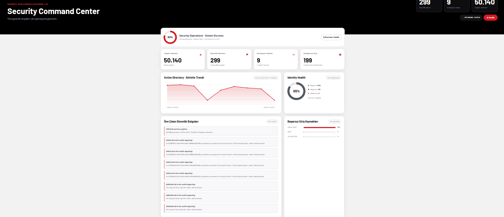

## Proje neyi amaçlıyor?

[LAB] Bu proje, bir olayın sadece tek bir log kaynağında değil; **firewall, IDS, DNS, Windows Security, Sysmon ve identity bağlamında** nasıl iz bıraktığını göstermek için kuruldu. [KOD] FastAPI + Uvicorn ile çalışan backend gelen olayları normalize ediyor, SQLite içinde saklıyor, SHA-256 tabanlı tekilleştirme uyguluyor, sonra network / AD / Sysmon / identity tespit motorlarıyla analiste anlamlı hale getiriyor. [LAB] Son durumda SOC, Windows ana makinede `192.168.1.111:8088` üzerinde çalışıyordu.

## Baştan sona lab kurulumu — kısa değil, gerçekten tam özet

### 1) Sanal makineler kuruldu

[LAB] Laboratuvar tek bir makinede her şeyi karışık kurmak yerine ayrı roller halinde tasarlandı:

- **OPNsense**: ağ geçidi, segmentasyon, firewall ve DNS/Unbound tarafı
- **DC01**: `corp.local` domain controller
- **WIN01**: domain’e dahil kullanıcı istemcisi
- **Kali**: test, saldırı simülasyonu ve ağ tarafı collector noktası
- **Windows SOC host**: AEGIS API + dashboard

Aşağıdaki VirtualBox ekran görüntüleri gerçekten kullanılan makine ağ ayarlarını gösterir:

| OPNsense | DC01 | WIN01 | Kali |
|---|---|---|---|
| 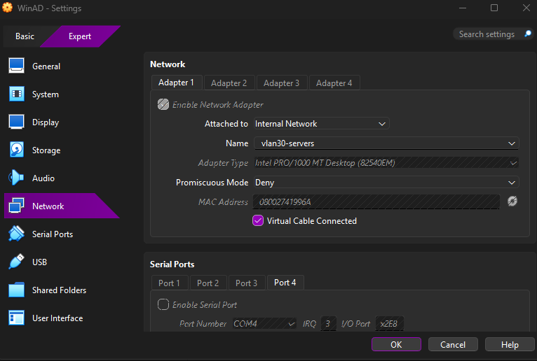 | 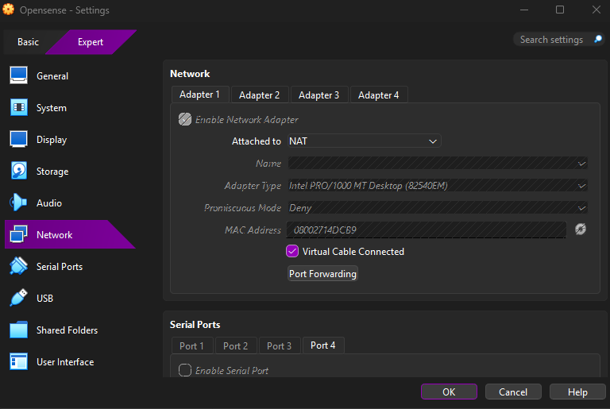 | 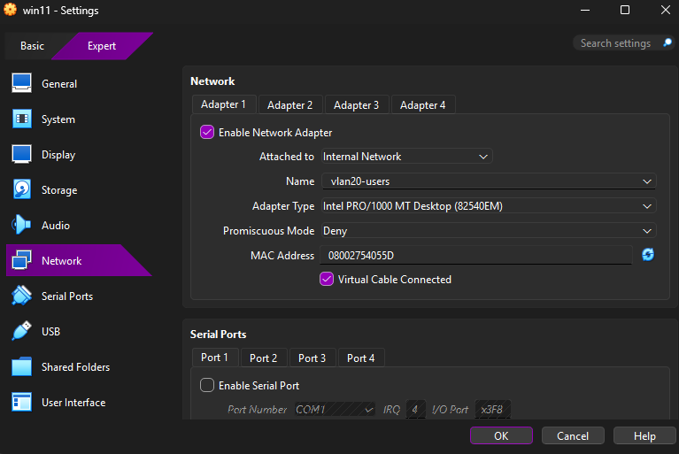 | 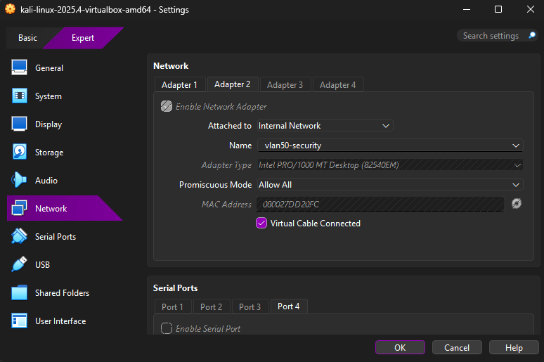 |

### 2) Ağ subnet’lere bölündü

[LAB] OPNsense üzerinden düz bir ağ yerine ayrı zonelar tanımlandı. Böylece hem kural yazmak hem de olayları anlamlandırmak kolaylaştı.

| Bölge | Arayüz | Ağ | Sistem | Amaç |
|---|---|---|---|---|
| USERS | [LAB] `em2` | [LAB] `10.10.20.0/24` | [LAB] WIN01 (`10.10.20.101`, bazı eski kayıtlarda `.100`) | Kullanıcı ağı |
| SERVERS | [LAB] `em3` | [LAB] `10.10.30.0/24` | [LAB] DC01 `10.10.30.10` | Domain / sunucu ağı |
| DMZ | [LAB] `em4` | [LAB] `10.10.40.0/24` | [LAB] Final durumda kalıcı servis yok | İzole ağ |
| SECURITY | [LAB] `em5` | [LAB] `10.10.50.0/24` | [LAB] OPNsense `10.10.50.1`, Kali `10.10.50.100` | Test / izleme ağı |
| Yönetim | ayrı ağ | [LAB] `192.168.1.x` | [LAB] SOC host `192.168.1.111` | Dashboard/API |

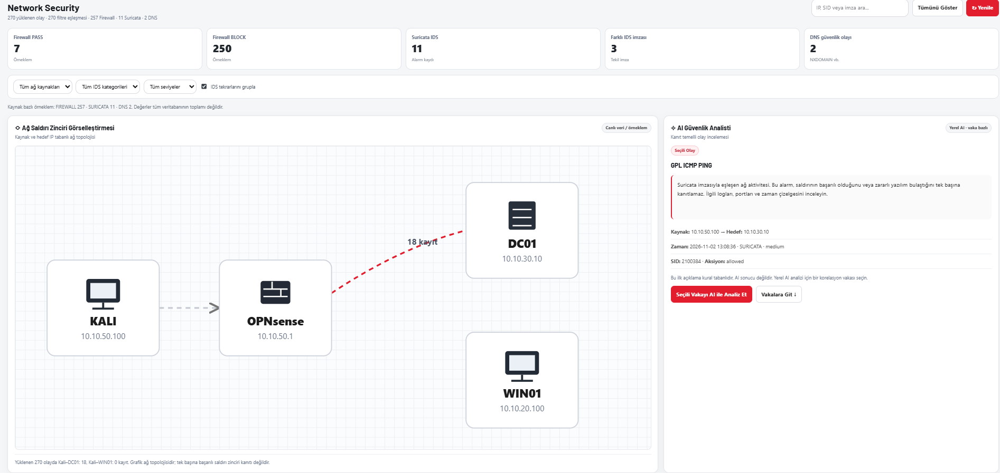

WIN01 DNS istekleri DC01 üzerinden gittiği için bazı DNS loglarında kaynak olarak DC01 görünmesi normaldir; bu dokümantasyonda özellikle belirtilmiştir.

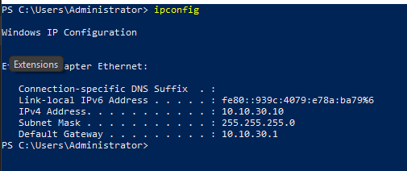

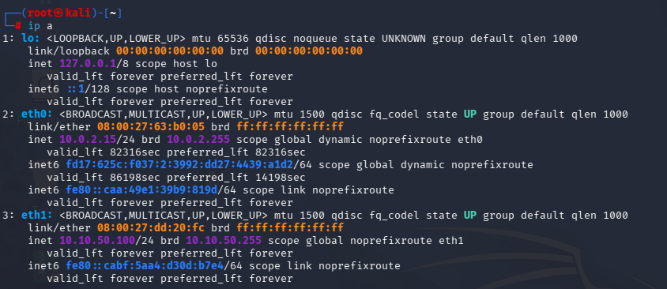

### 3) OPNsense tarafı kuruldu ve kurallar yazıldı

[LAB] OPNsense tarafında önce arayüz eşlemeleri ve IP’ler tanımlandı, ardından DHCP/DNS tarafı kontrol edildi, daha sonra aralarındaki geçişler için firewall kuralları yazıldı. En kritik amaçlardan biri ağların birbirine kontrolsüz erişmemesiydi.

| Arayüzler | Servis durumu | Kural görünümü |
|---|---|---|
|  | 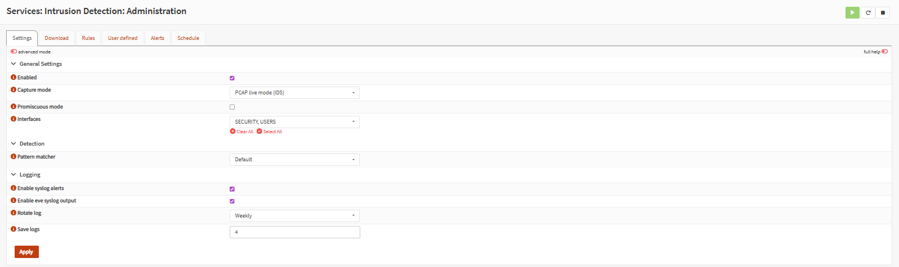 | 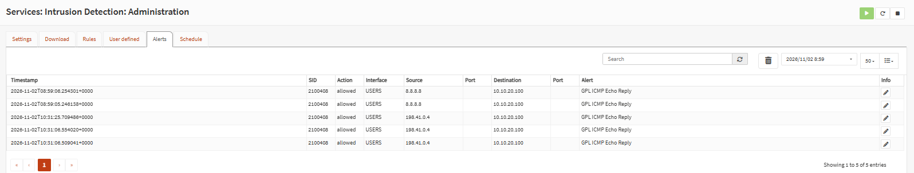 |

| Genel görünüm | Firewall Live View | Firewall log detay |
|---|---|---|
| 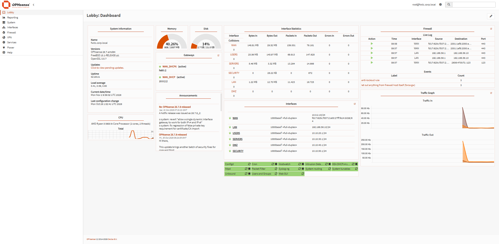 |  | 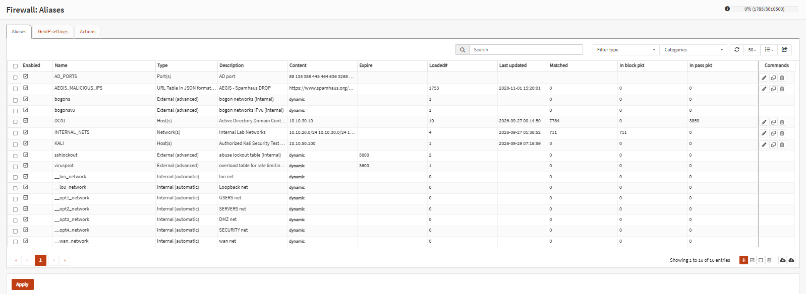 |

| Unbound izleme | Unbound detay | Final OPNsense dashboard |
|---|---|---|
|  |  | 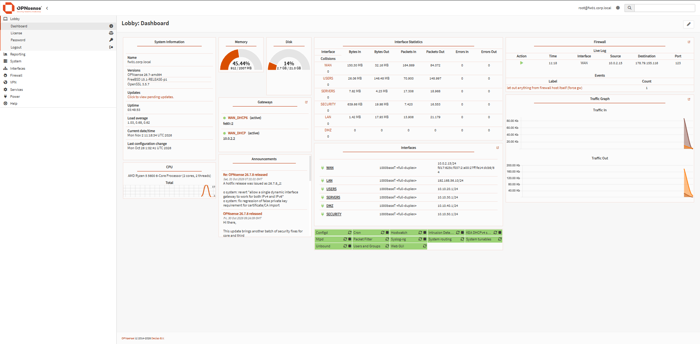 |

[KOD] AEGIS tarafında firewall `BLOCK` logları körlemesine “zararlı IP block” diye işaretlenmez. Kural UUID’si ile onaylı kural eşleştirilirse o zaman blocklist/TI bağlamı verilir. [LAB] Doğrulanan örneklerden biri Kali `10.10.50.100` adresinden `198.51.100.77` test IP’sine çıkan ve OPNsense tarafından engellenen trafikti.

### 4) Active Directory kuruldu

[LAB] DC01 üzerinde `corp.local` domain’i ayağa kaldırıldı. Sonra kullanıcılar, OU’lar ve gruplar oluşturuldu. Amaç sadece domain çalışsın değil; **grup üyeliği değişiklikleri, yeni kullanıcı, yetkili grup, parola ve oturum olayları** gibi SOC açısından anlamlı kayıtlar üretmekti.

Kurulan yapı içinde şunlar vardı:

- **Finance-Users**
- **HR-Users**
- **IT-Users**
- **Management-Users**
- **Sales-Users**
- built-in yetkili gruplar: **Domain Admins, Enterprise Admins, Schema Admins, Administrators**

| OU yapısı | Finance | HR |
|---|---|---|
| 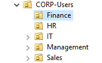 | 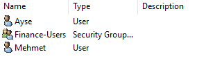 | 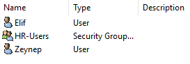 |

| IT | Management | Sales |
|---|---|---|
| 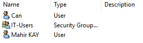 | 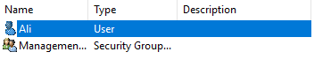 | 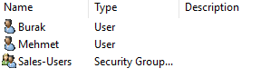 |

### 5) Collector yapısı kuruldu

[LAB] Windows tarafında Windows Security ve Sysmon kayıtları collector ile SOC’a gönderildi. Ağ tarafında Kali üzerinden OPNsense filterlog, Suricata EVE JSON ve ilgili ağ logları SOC ingest noktasına aktarıldı.

[KOD] Veri akışı şu şekilde işler:

1. Collector -> `POST /api/events/ingest`
2. `parser.py` ile normalize etme
3. Olay zamanını işleme
4. SHA-256 ile tekilleştirme
5. SQLite (WAL) içine kaydetme
6. Tespit motorları
7. Dashboard + opsiyonel Ollama

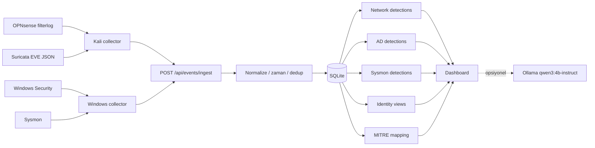

### 6) Sysmon tarafı geliştirildi

[LAB] Sysmon tarafında önce temel kurallar çalıştırıldı, sonra collector ve config düzenlenerek daha geniş kapsama geçildi. Özellikle Event ID `11` ve `13` (startup file / autorun registry) için canlı testler yapıldı. WIN01’de canlı alarmlar dashboard’a başarıyla düştü.

| Genel görünüm | Process investigation | Analiz paneli |
|---|---|---|
|  | 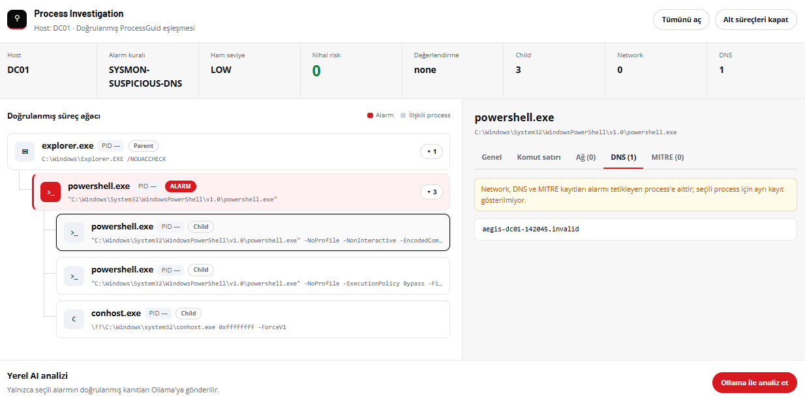 |  |

Canlı doğrulanan kurallar arasında şunlar vardı:

- `SYSMON-SUSPICIOUS-DNS`
- `SYSMON-AUTORUN-REGISTRY`
- `SYSMON-STARTUP-FILE`
- `SYSMON-OFFICE-SHELL`
- `SYSMON-SCRIPT-SHELL`
- `SYSMON-POWERSHELL-EXECUTION`
- `SYSMON-ENCODED-POWERSHELL`

### 7) Identity · AD Intelligence bölümü büyütüldü

[LAB] Projenin en güçlü yanlarından biri ham AD olayından daha ileri gidip **identity bağlamı** eklemesiydi. Bu bölümde envanter, yetki ilişkileri, kritik grup eşleşmesi, User 360, risk bağlamı ve davranış zaman çizelgesi üretildi.

| AD Intelligence | Kullanıcı listesi | Security workspace |
|---|---|---|
| 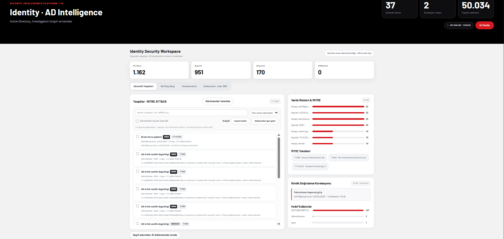 | 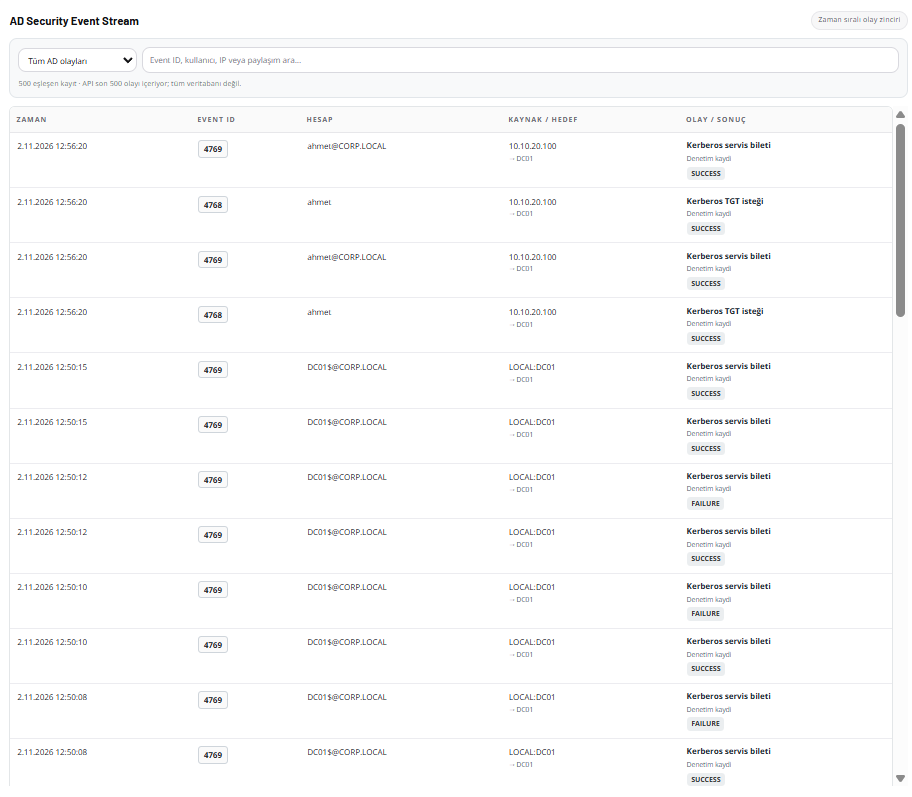 | 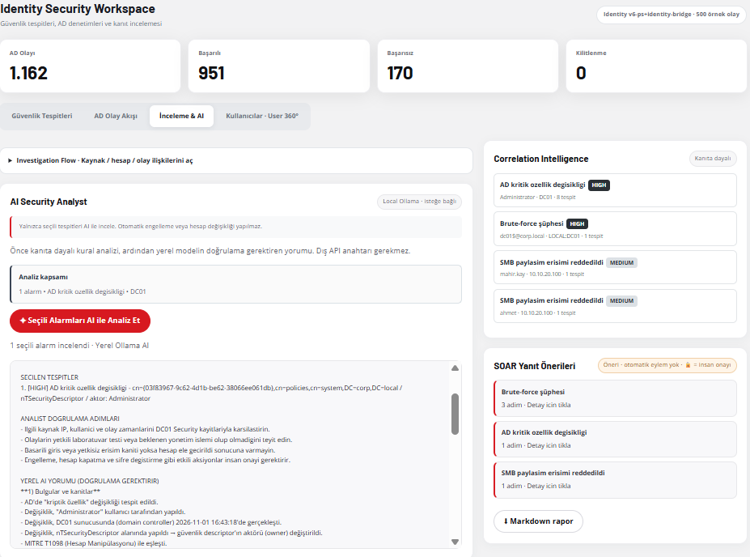 |

| Yetki üyelikleri | User360 profil | Risk analizi |
|---|---|---|
| 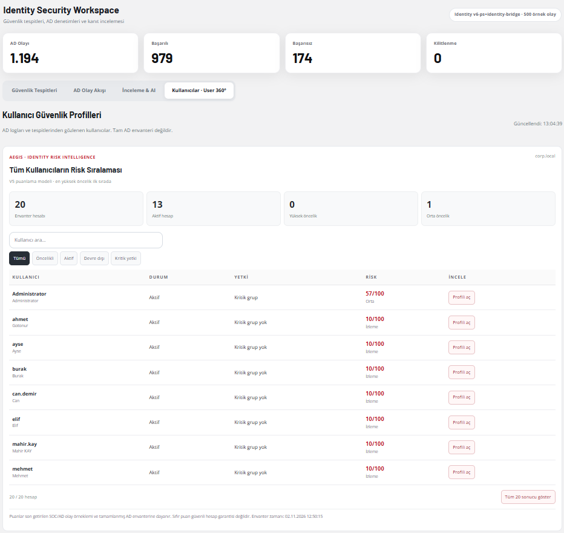 | 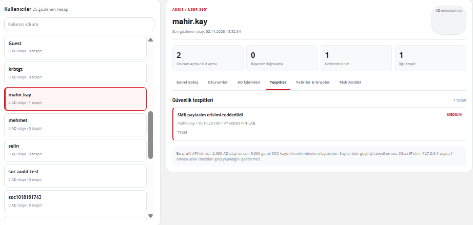 | 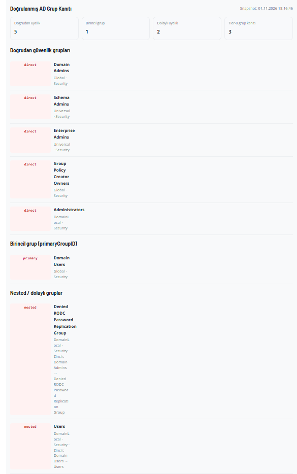 |

| User360 özet | Kimlik detay ekranı |
|---|---|
| 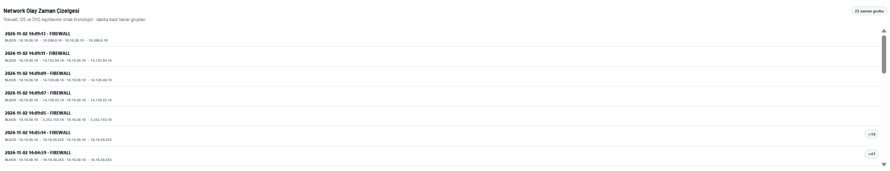 | 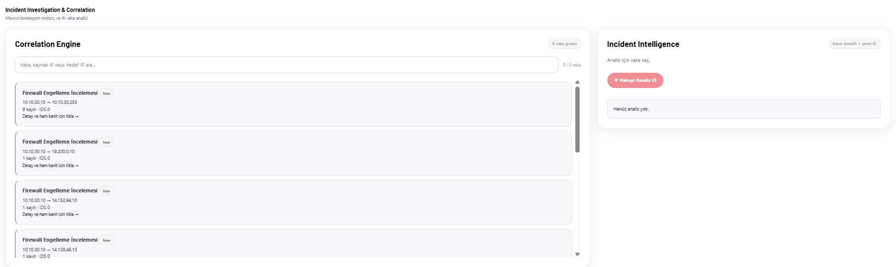 |

[KOD] Bu kısımda artık:

- AD inventory sidecar
- privilege sidecar
- kritik grup tespiti
- authenticated privilege API
- User 360
- risk context
- behavior timeline

çalışır durumda.

### 8) Dashboard’da bugün neler var?

| Security Command Center | All Logs |
|---|---|
|  | 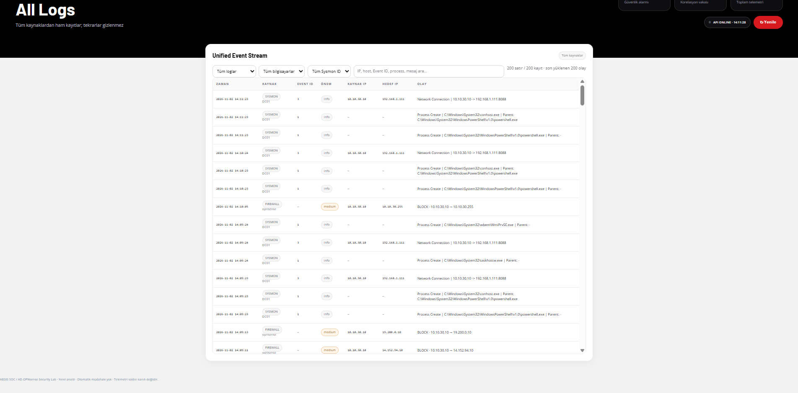 |

| Network detail | Network logs | Network summary |
|---|---|---|
| 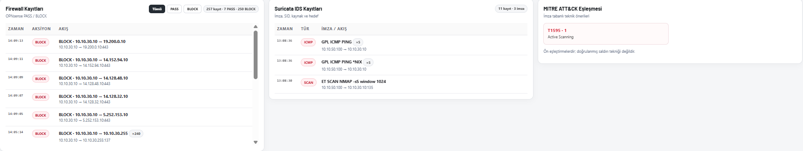 | 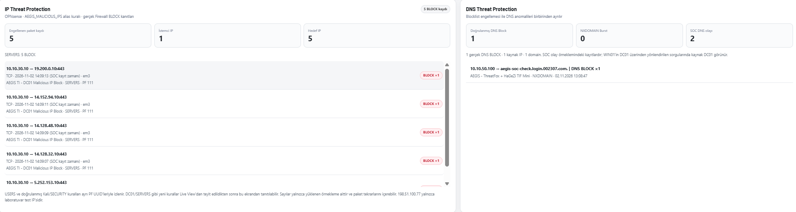 | 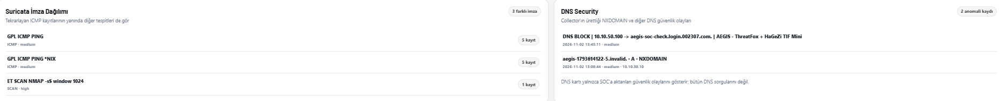 |

| CLI validation çıktısı |
|---|
| 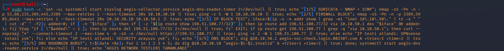 |

### 9) Güncel tespit kapsamı

#### Network

[KOD]
- dikey port tarama adayı
- yatay tarama adayı
- 5 dakikalık korelasyon
- Suricata severity eşleme
- lab imzalarını düşük riskte tutma
- broadcast / gürültü ayıklama

#### AD / Windows Security

[KOD]
- `4624, 4625, 4672, 4719, 4720, 4724, 4726, 4728, 4729, 4732, 4738, 4740, 4756, 4768, 4769, 4771, 4776, 1102, 5145`
- `brute_force`, `success_after_fail`, `password_spray`, `user_enum`, `lockout`, `kerberoast`, `asrep_roast`, `log_cleared`, `priv_group`, `new_account`

#### Sysmon

[KOD]
- Office -> shell
- Script host -> shell
- encoded PowerShell
- suspicious PowerShell execution
- suspicious DNS / `.onion`
- startup file creation
- autorun registry modification
- LSASS / process access / remote thread / tampering kapsama alanı

#### Identity

[KOD]
- inventory import
- privilege model
- verified membership evidence
- User 360
- risk context
- behavior timeline

### 10) Kısa doğrulama özeti

[LAB]
- OPNsense block testleri dashboard’a düştü.
- AD grup üyeliği değişiklikleri identity tarafında görüldü.
- WIN01 Sysmon kuralları canlı alarm üretti.
- User 360 ve risk bağlamı doğrulandı.
- DNS akışında kaynak bilgisayar yorumu dikkatli şekilde ele alındı.

## Hızlı başlangıç (gerçek repo içinde)

```powershell
py -3.14 -m venv .venv
.\.venv\Scripts\Activate.ps1
pip install -r requirements.txt

$env:SOC_DASHBOARD_USER = "<lab-user>"
$env:SOC_DASHBOARD_PASSWORD = "<lab-password>"
$env:SOC_INGEST_TOKEN = "<lab-token>"
$env:AEGIS_MITRE_V2 = "1"
$env:SOC_OLLAMA_MODEL = "qwen3:4b-instruct"

uvicorn app.main:app --host 0.0.0.0 --port 8088 --log-level info --access-log
```

## Bilinen kısıtlar

- [KOD] AEGIS otomatik müdahale yapmaz; sadece izler, ilişkilendirir ve gösterir.
- [KOD] Unbound blocklist kararı mevcut collector ile henüz tam “verified DNS block” olarak taşınmıyor.
- [LAB] WIN01 bazı eski kayıtlarda `.100`, bazı kayıtlarda `.101` olarak geçti; yeniden kurulumda güncel lease kontrol edilmelidir.
- [LAB] OPNsense’in tam sürümü, tüm WAN eşlemeleri ve tam kural exportu ayrıca güncel config’ten çıkarılmalıdır.

## Repo içeriği

- `README.md` / `README.tr.md`
- `docs/lab-build-walkthrough.md`
- `docs/architecture.md`
- `docs/opnsense-setup.md`
- `docs/active-directory-setup.md`
- `docs/blocklists.md`
- `docs/detections.md`
- `docs/data-flow.md`
- `docs/screenshots/README.md`

## Lisans / not

<!-- TODO: lisans seçildiğinde buraya ekle. -->

[LAB] Bu proje kişisel SOC laboratuvarı olarak geliştirildi; amaç hem teknik doğrulama hem de portföy düzeyinde somut güvenlik mühendisliği çıktısı ortaya koymaktı.
