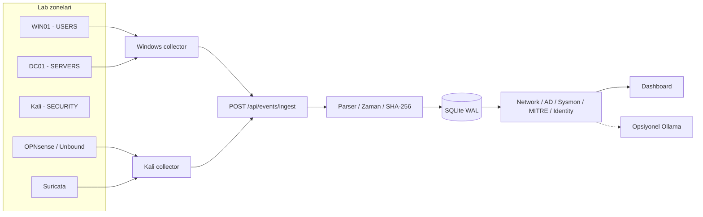

# AEGIS SOC

**Active Directory · OPNsense · Suricata · Sysmon · MITRE ATT&CK · Yerel Yapay Zekâ**

> Bir güvenlik olayının uç noktada veya ağda oluşmasından, logların toplanıp ilişkilendirilmesine ve analistin incelemesine kadar uzanan uçtan uca SOC laboratuvarı. **AEGIS izler ve analiz eder; otomatik engelleme veya müdahale yapmaz.**

    

**[English](README.md) · [Mimari](docs/architecture.md) · [Tespitler](docs/detections.md) · [Veri akışı](docs/data-flow.md) · [Görseller](docs/screenshots/README.md)**


## Neden bu projeyi geliştirdim?

[LAB] Bir siber güvenlik alarmının arkasında **gerçekte ne yaşandığını** gösterecek, farklı log kaynaklarını bir araya getirecek bir laboratuvar oluşturmak istedim. Active Directory, OPNsense, Suricata, Windows Security ve Sysmon'u ayrı ağlarda kurup gerçek test trafiği ürettim. [KOD] Python/FastAPI ile gelen verileri normalize eden, SQLite'ta saklayan, kurallarla inceleyen ve tek bir SOC ekranında sunan bir uygulama geliştirdim. [KOD] Opsiyonel Ollama analizi, kanıtın yerini almaz; araştırmaya yardımcı olan bir katmandır.

## Mimari



[LAB] OPNsense ağ segmentasyonunu ve bağımsız engelleme kurallarını uygular. [KOD] AEGIS ise bu kuralların loglarını inceleyen salt-okunur bir analiz katmanıdır. Gerçek trafik ile test olayları birbiriyle karıştırılmaz.

## Öne çıkan modüller

| Modül | İşlev |
|---|---|
| **Network Intelligence** | [KOD] Beş dakikalık port tarama adayları, yatay tarama, Suricata ve firewall olay korelasyonu, risk/güven bağlamı. |
| **OPNsense + TI Block** | [LAB] Kali'den `198.51.100.77` test adresine TCP/ICMP engeli doğrulandı; [KOD] TI etiketi yalnızca onaylı PF kural kimliğiyle eşleştirilirse kullanılır. |
| **DNS Intelligence** | [LAB] Unbound sorguları ve testler izlendi; [KOD] NXDOMAIN artışı, blocklist tarafından doğrulanmış engelleme olarak sayılmaz. |
| **Windows Security / AD** | [KOD] Hesap oluşturma, grup üyeliği, başarısız oturumlar, parola saldırısı adayları, Kerberos ve kilitlenme olayları. |
| **Endpoint / Sysmon V3** | [KOD] 11 farklı tespit kuralı. [LAB] WIN01'de sekiz farklı kuralın canlı alarmı Dashboard'da görüldü. |
| **Identity · AD Intelligence** | [KOD] AD envanteri, kullanıcı/grup ve iç içe üyelik modeli, User 360, risk bağlamı, davranış zaman çizelgesi. |
| **MITRE ATT&CK** | [KOD] Tespit-teknik eşlemesi ve V2 analiz katmanı. |
| **Yerel AI** | [KOD] Kanıt temelli yardımcı rapor; [LAB] `qwen3:4b-instruct` modeliyle Ollama kullanımı. |


## Ağ planı

| Bölge | Arayüz | Ağ | Sistem |
|---|---|---|---|
| USERS | [LAB] `em2` | [LAB] `10.10.20.0/24` | [LAB] WIN01 `.100` / `.101` (farklı test kayıtları) |
| SERVERS | [LAB] `em3` | [LAB] `10.10.30.0/24` | [LAB] DC01 `10.10.30.10`, Windows Server 2019, `corp.local` |
| DMZ | [LAB] `em4` | [LAB] `10.10.40.0/24` | [LAB] Ağ yapılandırıldı; ayrı bir DMZ sunucusu kurulmadı |
| SECURITY | [LAB] `em5` | [LAB] `10.10.50.0/24`* | [LAB] OPNsense `.1`, Kali `.100` |
| Yönetim | [LAB] Ayrı ağ | [LAB] `192.168.1.x` | [LAB] AEGIS API `192.168.1.111:8088` |

\* [LAB] SECURITY maskesi mevcut yapılandırma çıktısıyla yeniden karşılaştırılmalıdır. WAN adaptörünün kesin eşlemesi için export gerekir.


## Hızlı başlangıç (mevcut laboratuvar)

[KOD] Backend `app.main:app`, arayüz `app/templates/index.html` üzerinden çalışır. [LAB] Windows makinede Python 3.14 kullanıldı. Aşağıdaki komutlar **uygulama kaynak kodunu içeren** repoda çalıştırılmalıdır.

```powershell
py -3.14 -m venv .venv
.\.venv\Scripts\python.exe -m pip install -r requirements.txt

# İsteğe bağlı güvenlik ayarları. Gerçek değerleri terminalde yerel girin.
# $env:SOC_DASHBOARD_USER = '<local-user>'
# $env:SOC_DASHBOARD_PASSWORD = '<secret>'
# $env:SOC_INGEST_TOKEN = '<secret>'

$env:AEGIS_MITRE_V2 = '1'
.\.venv\Scripts\python.exe -m uvicorn app.main:app --host 127.0.0.1 --port 8088
```

[KOD] Dashboard: `http://127.0.0.1:8088/`; durum: `/api/status`. [LAB] Laboratuvarda servis yönetim makinesinin `192.168.1.111:8088` adresinden erişilir durumdaydı. **İnternete açık şekilde yayımlanmaz.**

```powershell
Invoke-RestMethod http://127.0.0.1:8088/api/status
Invoke-RestMethod 'http://127.0.0.1:8088/api/events?mode=all&limit=10'
Invoke-RestMethod http://127.0.0.1:8088/api/source-health
```

## Gerçek doğrulamalar

| Deney | Beklenen kanıt | Gözlenen / sınır |
|---|---|---|
| Kali → DC01 Nmap/ICMP | [LAB] Suricata alarmı, OPNsense filterlog | [LAB] Gözlendi; tek başına başarılı saldırı demek değil |
| Kali → `198.51.100.77` | [LAB] em5 giriş TCP/ICMP BLOCK | [LAB] OPNsense Live View'da doğrulandı |
| Windows PowerShell / script / Office-adlı test | [KOD] Event 1 tespitleri | [LAB] Dashboard'a ulaştı; Office-adlı süreç gerçek Office açığı değil |
| Startup dosyası / Run anahtarı | [KOD] Sysmon 11 / 13 | [LAB] Her iki alarm da görüldü |
| `.invalid` DNS / alışılmadık port | [KOD] Sysmon 22 / 3 | [LAB] Alarmlar görüldü |
| LSASS ve Process Tampering | [KOD] Sysmon 8 / 10 / 25 | [LAB] İzleme ayarı ve birim testleri var; canlı kötü amaçlı davranış tetiklenmedi |


## Güvenlik ilkeleri

- [KOD] **Salt-okunur SOC:** Firewall'un yerine geçmez; host üzerinde otomatik müdahale yapmaz.
- [KOD] İsteğe bağlı Basic Auth, ingest token, güvenlik yanıt başlıkları, SQLite WAL ve SHA-256 tekilleştirme vardır.
- [KOD] Varsayılan olay limiti 50.000'dir; bu, değiştirilemez adli kayıt sistemi olduğu anlamına gelmez.
- [LAB] Identity privilege servislerinin yerel erişim sınırları ve izolasyon testleri yapıldı.
- [LAB] Test adresleri ve olaylar yalnızca izinli eğitim ortamında kullanıldı.

## Bilinen sınırlamalar

1. [KOD] Unbound blocklist karar alanı mevcut collector tarafından aktarılmıyor; bu nedenle doğrulanmış DNS block sayacı gösterilmiyor. NXDOMAIN ayrı tutuluyor.
2. [LAB] DMZ ağının ayrı sunucusu yok.
3. [LAB] Sürüm, bütün OPNsense kural sırası, güncel feed URL'leri ve bütün GPO ayarlarını tekrar kurmaya yetecek export henüz verilmedi.
4. [LAB] Sysmon ID 8/10/25 için gerçek müdahale testi yapılmadı; ünite testleri geçti, canlı alarm iddiası yok.

## Teknik dökümanlar

- [Mimari ve güven sınırları](docs/architecture.md)
- [OPNsense kurulum ve doğrulama](docs/opnsense-setup.md)
- [Active Directory kurulum ve doğrulama](docs/active-directory-setup.md)
- [IP / DNS engelleme](docs/blocklists.md)
- [Tespit motorları ve kurallar](docs/detections.md)
- [Veri akışı / API](docs/data-flow.md)
- [Ekran görüntüsü galerisi](docs/screenshots/README.md)
- [GitHub yayın kontrol listesi](docs/publication-checklist.md)

## Proje durumu, lisans ve teşekkür

[LAB] **AEGIS SOC bir eğitim/portföy laboratuvarı olarak tamamlandı.** Sınırlamalar, gözlenmeyen saldırıları olmuş gibi göstermemek için belgelenmiştir; sonraki geliştirmeler isteğe bağlıdır. [LAB] Kullanılan teknolojiler: Microsoft Active Directory ve Sysmon, OPNsense, Suricata, FastAPI, SQLite ve Ollama. **<!-- TODO: GitHub deposundaki LICENSE dosyasının mevcut durumunu teyit edin. -->**

**Kanıt etiketleri:** `[KOD]` = eldeki kaynak kodunda doğrulanan davranış; `[LAB]` = kullanıcı tarafından laboratuvarda bildirilen veya görsellerde gösterilen gözlem.

### Eksik bilgiler (yalnızca birebir yeniden kurulum için)

<!-- TODO: OPNsense sürümü, WAN eşlemesi, tam arayüz maskeleri -->
<!-- TODO: Export edilmiş firewall kural tablosu, DHCP/Unbound ayarları -->
<!-- TODO: Feed adı/URL/sıklığı, Suricata IDS/IPS modu ve seçili kural paketleri -->
<!-- TODO: GPO listesi, Sysmon XML kaynağı, requirements.txt ve lisans teyidi -->
