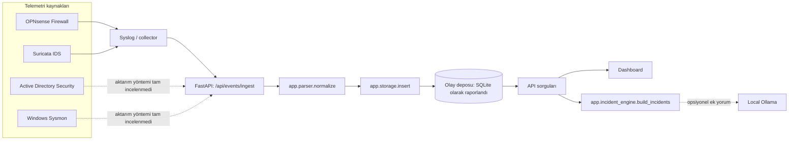
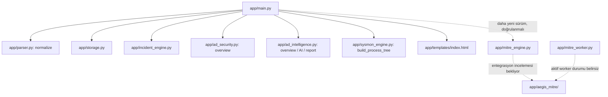
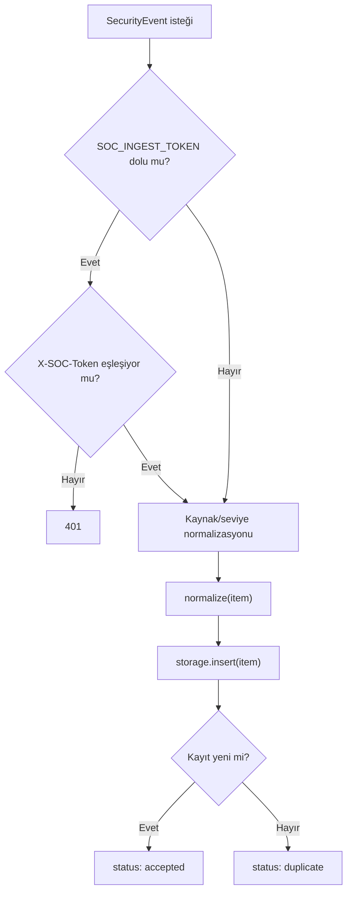
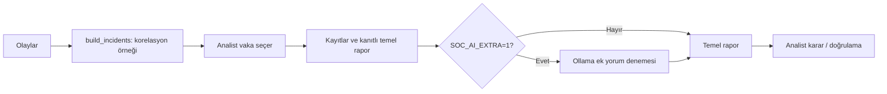
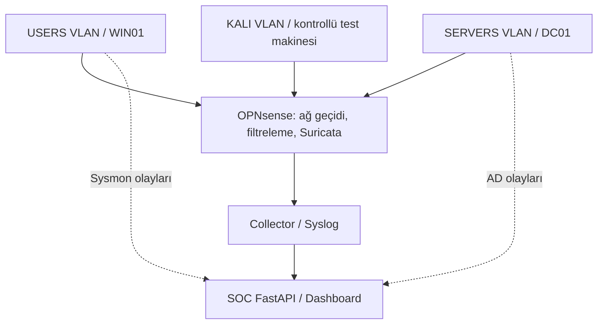
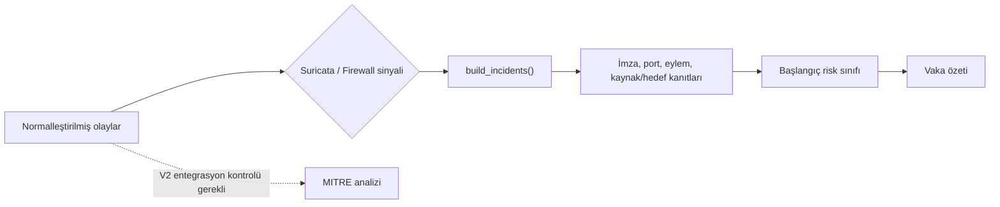

# AEGIS SOC — Mimari

> İşaretler: **Gözlendi (K1/K5)**, **Kodda var (K1/K2)**, **Teyit bekliyor**. Kanıt referansları için [Proje Durumu](PROJE_DURUMU.md).

## 1. Mevcut laboratuvar mimarisinin izlenebilen kısmı

**Açıklama:** Firewall ve Suricata'nın collector yoluyla geldiği laboratuvar testlerinde gözlendi. AD/Sysmon endpoint'e ulaşmış olsa da her iletim ayağının güncel konfigürasyonu burada teyit edilmedi. Depolama motorunun gerçek DDL'i henüz okunamadı.

## 2. Bilinen modül bağımlılıkları

**Açıklama:** Düz çizgiler eski `main.py` içinde görülebilen import/çağrıları, kesikli çizgiler daha sonraki dosya taramalarından raporlanan fakat **bu oturumda dosya içerikleri incelenemeyen** bağlantıları gösterir. `network_detection.py`, `mitre_adapter.py`, `alert_investigation.py` ve `aegis_ux_v3.*` için güncel import zinciri belirsiz.

## 3. Olay işleme (kod anlık görüntüsü)

**Açıklama:** Buradaki kimlik doğrulama kapısının token boş olduğunda atlanması **güvenlik değerlendirmesi gerektirir**. Veritabanında dedup anahtarının ne olduğu `storage.py` incelenmeden yazılamaz.

## 4. Olay inceleme

**Açıklama:** AI sonucunun temel rapordan ayrı tutulması eski `main.py` sürümünde düşünülmüştür. Bu akış, nihai insan onayı veya resmi vaka yönetimi otomasyonunun uygulanmış olduğunu göstermez.

## 5. Laboratuvar ağ görünümü (adresler genelleştirildi)

**Açıklama:** Geçmiş laboratuvar notlarında em2 USERS, em3 SERVERS, em5 KALI olarak geçiyor. IP'ler GitHub belgelerinde isteğe bağlı olarak maskelenmeli. Bağlantılar ayrıntılı paket topolojisi değil, işlevsel veri akışı şemasıdır.

## 6. Tespit ve korelasyon (onaylanan kod parçaları)

**Açıklama:** Kod parçaları `suricata_alerts`, `firewall_blocks`, `ports`, `signatures` alanlarına işaret ediyor. Tam eşikler ve MITRE eşleştirmeleri okunamadığı için diyagramda algoritma ayrıntısı icat edilmedi.

## 7. Bileşen düzeyinde inceleme bekleyenler

| Dosya | Tahmini sorumluluk (adına göre; **kanıt değildir**) | Durum |
|---|---|---|
| `app/parser.py` | Olay normalizasyonu (`normalize` çağrısı kanıtlandı) | KISMEN UYGULANDI |
| `app/storage.py` | Yazma/sorgu/stats (`insert`, `get_events`, `stats` çağrısı kanıtlandı) | KISMEN UYGULANDI |
| `app/incident_engine.py` | Vaka çıkarımı (`build_incidents` çağrısı kanıtlandı) | KISMEN UYGULANDI |
| `app/ad_security.py` | AD overview (route import'u mevcut) | UYGULANDI — TEST EDİLMEDİ |
| `app/ad_intelligence.py` | AD analiz/AI/rapor (route import'ları mevcut) | KISMEN UYGULANDI |
| `app/sysmon_engine.py` | Process Tree (route import'u mevcut) | UYGULANDI — TEST EDİLMEDİ |
| `app/sysmon_detection.py` | Ek Sysmon tespitleri | DURUMU BELİRSİZ |
| `app/network_detection.py` | Ağ tespitleri | DURUMU BELİRSİZ |
| `app/alert_investigation.py` | Alarm inceleme | DURUMU BELİRSİZ |
| `app/mitre_adapter.py` | MITRE bağlayıcı | DURUMU BELİRSİZ |
| `app/mitre_engine.py`, `app/mitre_worker.py`, `app/aegis_mitre/` | MITRE V2 | KISMEN UYGULANDI |
| `aegis_ux_v3.css`, `aegis_ux_v3.js` | Ayrık UI assetleri | DURUMU BELİRSİZ |

Tam fonksiyon/sınıf imza envanteri, gerçek güncel repo üzerinden üretilen `proje_envanteri.py` raporu ile tamamlanmalıdır.
