# Active Directory, Windows Security ve Sysmon kurulumu

> Bu rehber, **DC01 + WIN01** kurulumunun AEGIS SOC'a nasıl bağlandığını anlatır. **[LAB]** laboratuvar kurulumu/test kanıtı, **[KOD]** uygulama kaynak kodunda doğrulanmış davranıştır. Parola, erişim anahtarı, özel SID veya kişisel dosya yolu yayımlanmaz.

## 1. DC01 sanal makinesinin hazırlanması

[LAB] Active Directory, kullanıcı bilgisayarından ayrı bir ağda çalışsın diye DC01, **SERVERS / `10.10.30.0/24`** bölgesine alındı. Sanal makine Windows Server 2019 üzerinde kuruldu; adı `DC01`, IP adresi `10.10.30.10`, ağ geçidi `10.10.30.1`, DNS adresi `10.10.30.10` olacak şekilde yapılandırıldı.

1. Windows Server sanal makinesini oluştur.
2. Sanal adaptörünü doğru SERVERS ağına bağla.
3. Ağ ayarlarını doğrula; başka bir VM'nin IP adresini kullanma.
4. **Active Directory Domain Services (AD DS)** rolünü kur.
5. Sunucuyu yeni orman için domain controller'a yükselt: `corp.local` / `CORP`.
6. AD ile ilişkili DNS servisinin çalıştığını ve sunucu hizmetlerinin ayakta olduğunu kontrol et.

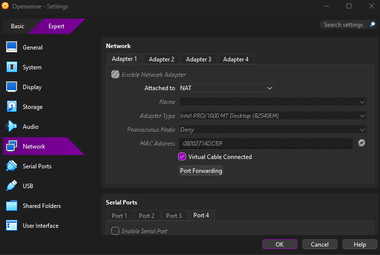

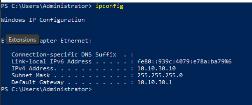

```powershell
# DC01 - sadece okuma
Get-ADDomain | Select-Object DNSRoot,NetBIOSName
Get-ADDomainController -Identity DC01 | Select-Object HostName,IPv4Address,IsGlobalCatalog
Get-Service NTDS,DNS | Select-Object Name,Status
Get-NetIPAddress -AddressFamily IPv4 | Where-Object IPAddress -eq '10.10.30.10'
```

**Beklenen sonuç:** `corp.local` domain'i, DC01 kaydı ve AD/DNS servisleri görünür. Bu komutlar rol kurmaz veya mevcut AD yapılandırmasını değiştirmez.

## 2. WIN01: Windows istemcisinin domain'e alınması

[LAB] Windows 11 istemcisi ayrı **USERS / `10.10.20.0/24`** ağına yerleştirildi. WIN01'in DNS sunucusu DC01 olarak ayarlandı ve `corp.local` alanına katılım işlemi tamamlandı. Eski test kayıtlarında `10.10.20.100` ve `.101` görüldüğü için tek ve değişmez bir istemci IP'si iddia edilmez.

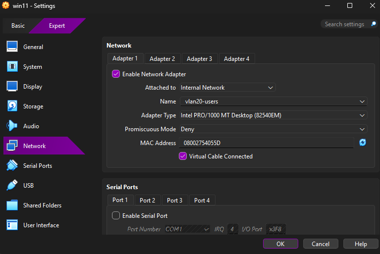

```powershell
# WIN01 - salt-okunur doğrulama
ipconfig /all
(Get-CimInstance Win32_ComputerSystem) | Select-Object Name,Domain,PartOfDomain
Resolve-DnsName corp.local -Server 10.10.30.10
```

[LAB] Domain'e alınma için DNS ve ağ erişimi gerektiğinden OPNsense'te USERS → SERVERS trafiği ihtiyaca göre ele alındı. Bu durum bütün portların serbest bırakıldığı anlamına gelmez.

## 3. OU ve güvenlik gruplarının oluşturulması

[LAB] AD içinde kurumsal yapıyı temsil eden `CORP-Users` bölümü ve **Finance, HR, IT, Management, Sales** birimleri oluşturuldu. Buna bağlı Finance-Users, HR-Users, IT-Users, Management-Users ve Sales-Users gibi güvenlik grupları ekranlarda görülür. Önceki aşamalarda `IT Users` ve `IT Admins` adlandırmaları da kullanıldı; birebir birleşim ilişkileri export olmadan varsayılmaz.

| Üst OU | Finance | HR |
|---|---|---|
|  | 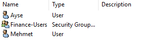 | 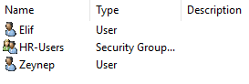 |

| IT | Management | Sales |
|---|---|---|
| 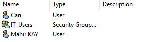 | 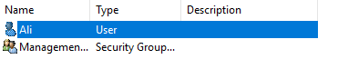 | 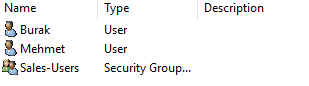 |

```powershell
# DC01 - mevcut yapıyı döker; değiştirmez
Get-ADOrganizationalUnit -Filter * |
  Select-Object Name,DistinguishedName | Sort-Object DistinguishedName
Get-ADGroup -Filter * |
  Select-Object Name,GroupScope,GroupCategory | Sort-Object Name
```

[KOD] Identity katmanı sadece doğrudan kullanıcı üyeliğini değil, birincil grup ve grupların kendi içindeki üyelik bağlarını da analiz eder. Gerçek kullanıcı listesi ve yetki matrisi genel depoda yayınlanmaz.

## 4. Windows Security denetim kayıtlarının etkinleştirilmesi

[LAB] Kullanıcı ve grup yönetimi denetimleri GPO üzerinden ele alındı; olaylar Windows Security günlüğünde ve SOC tarafında kontrol edildi. Bir olay ID'sinin desteklenmesi, her testte oluştuğu anlamına gelmez.

| Event ID | İncelenen olay |
|---|---|
| `4624`, `4625` | Başarılı / başarısız oturum açma |
| `4672` | Özel yetkilerle açılan oturum |
| `4719`, `1102` | Denetim ilkesi değişikliği / Security günlüğünün temizlenmesi |
| `4720`, `4724`, `4726`, `4738` | Kullanıcı açma, parola sıfırlama girişimi, silme ve değiştirme |
| `4728`, `4729`, `4732`, `4756` | Güvenlik grubu üyeliği ekleme/çıkarma |
| `4740` | Kullanıcı hesabı kilitlenmesi |
| `4768`, `4769`, `4771`, `4776` | Kerberos / NTLM kimlik doğrulama olayları |
| `5145` | Paylaşılan dosyaya ayrıntılı erişim denetimi; gerçek GPO/SACL kapsamı ayrıca kontrol edilmeli |

```powershell
# DC01 - denetim politikasını ve mevcut olayları okur
auditpol /get /category:*
Get-GPO -All | Select-Object DisplayName,GpoStatus
Get-WinEvent -FilterHashtable @{
  LogName='Security'; Id=4624,4625,4720,4728,4729,4740,4769,4771,1102
  StartTime=(Get-Date).AddDays(-1)
} -MaxEvents 100 -ErrorAction SilentlyContinue |
  Group-Object Id | Select-Object Name,Count
```

[LAB] Daha önce başarısız oturum, grup üyeliği, parola ve hesap değişikliği testleri yapıldı. **5145** için Audit Detailed File Share ve uygun erişim denetimi ilkeleri kontrol edilmelidir. Olay görünmüyorsa GPO etkinliği ve doğru Windows kayıt kanalı incelenmelidir; rastgele güvenlik koruması kapatılmaz.

## 5. Sysmon kurulumu ve AEGIS'e gönderimi

[LAB] Sysmon, DC01 ve WIN01 üzerine kuruldu. WIN01 tarafında yapılandırma dosyası `C:\Sysmon\sysmon-soc.xml` olarak kullanıldı. Başlangıçta ID 1, 3 ve 22 görülürken daha sonra **ID 11/13** Startup dosyası ve Registry Run testleriyle izlemeye alındı; son aşamada ID 8/10/25 filtresi genişletildi.

[LAB] WIN01 collector son izinli olay listesi: `1,3,8,10,11,13,22,25`. ID 12, uygulamanın daha geniş Sysmon veri desteğinde geçse de bu son collector filtre listesinde değildir.

| Sysmon görünümü | Süreç incelemesi | Olay ayrıntısı |
|---|---|---|
|  | 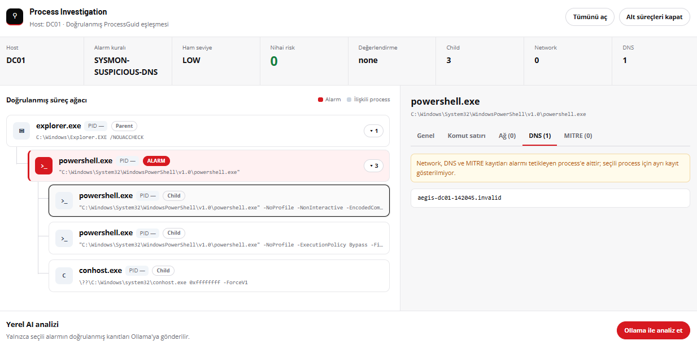 |  |

```powershell
# WIN01 - kurulu Sysmon'u ve collector filtresini okur
Get-Service Sysmon64 -ErrorAction SilentlyContinue
Get-WinEvent -ListLog 'Microsoft-Windows-Sysmon/Operational'
Get-WinEvent -FilterHashtable @{
  LogName='Microsoft-Windows-Sysmon/Operational'; Id=1,3,8,10,11,13,22,25
  StartTime=(Get-Date).AddHours(-4)
} -MaxEvents 100 -ErrorAction SilentlyContinue |
  Group-Object Id | Select-Object Name,Count
Select-String -Path 'C:\SOC\sysmon_collector.ps1' -SimpleMatch '$Event.Id -notin'
```

[LAB] **Sekiz farklı Sysmon kuralı**, WIN01'de gerçekleştirilen gerçek ama kontrollü testlerle SOC ekranında doğrulandı. Bunlar encoded PowerShell, şüpheli PowerShell ifadesi, script host üzerinden shell, Office adındaki test sürecinden shell, `.invalid` DNS, Startup dosyası, Registry Run ve olağandışı dış port bağlantısıydı.

[LAB] ID 8 (LSASS remote thread), ID 10 (yüksek erişimli LSASS) ve ID 25 (process tampering) için izleme kuralı hazırlandı; ancak canlı saldırı davranışıyla alarm doğrulanmadı. LSASS erişimi Windows tarafından `Access Denied` ile engellendi; ID 25 aracı Defender tarafından durduruldu. Koruma devre dışı bırakılmadı.

## 6. Identity · AD Intelligence ve yetki modeli

[KOD] Kimlik envanterinin `aegis.ad_inventory.v2` şemasında içe alınması, `priv_users`, `priv_groups`, `priv_edges` yan veritabanı tabloları ve `user_memberof`, `user_primarygroup`, `group_memberof` ilişki türleri geliştirildi. [LAB] Envanter ve yetki importu; izolasyon, idempotency, rollback ve User 360 testleriyle kontrol edildi.

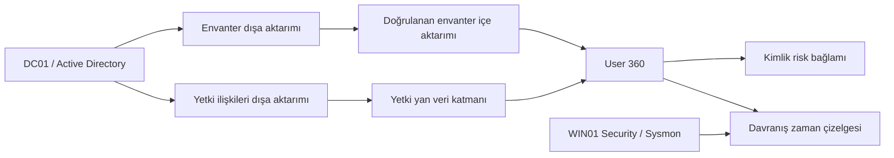

[KOD] Bu akışın yönü **AD → AEGIS** şeklindedir. SOC'un kullanıcı yetkisi değiştirmesi veya AD'ye grup üyeliği yazması söz konusu değildir.

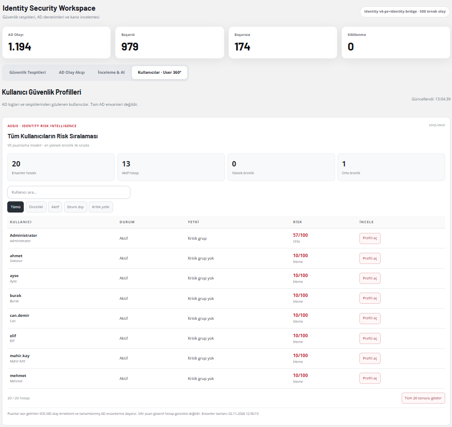

## 7. Kurulum tamam mı? Son doğrulama

1. [LAB] DC01, `corp.local` domain'ini ve `10.10.30.10` IP'sini bildirir.
2. [LAB] WIN01, domain üyesidir ve DNS çözümlemesini DC01 üzerinden yapar.
3. [LAB] Windows Security ve Sysmon günlüklerinde güncel olaylar bulunur.
4. [KOD] Bu olaylar `/api/events?mode=all&source=AD,SYSMON,WIN_SECURITY&limit=100` üzerinden doğru `source`, `host` ve Event ID ile görünür.
5. [KOD] Identity ekranı envanter ve yetki analizini gösterir; olayın kaynak zamanı ile SOC alım zamanı ayrıdır.

<!-- TODO: güncel GPO adları, denetim alt kategorileri ve yetki matrisi -->
<!-- TODO: her Windows makinesindeki son Sysmon XML sürümü ve collector çalıştırma biçimi -->
