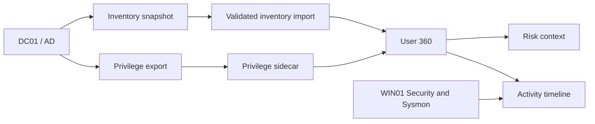

# Active Directory, Windows Security and Sysmon

> This document describes the laboratory's installed directory and the evidence needed to reproduce its security monitoring. `[LAB]` = observed/reported configuration; `[KOD]` = source code evidence. No domain password, token, SID or personal workstation path is published.

## 1. Domain controller and networking

1. **[LAB]** Install Windows Server 2019 in the SERVERS network, assign the host name `DC01`, IPv4 `10.10.30.10/24`, gateway `10.10.30.1`, and DNS `10.10.30.10`.
2. **[LAB]** Promote the server as a new Active Directory DS forest `corp.local` with NetBIOS name `CORP`. AD-integrated DNS and Global Catalog were reported enabled.
3. **[LAB]** Join WIN01 (Windows 11) to `corp.local` from the USERS network. The IP has been seen as `10.10.20.100` and `10.10.20.101` at different times; verify current address rather than assume either is a fixed assignment.
4. **[LAB]** Maintain separate authorized administrative credentials and directory accounts for the lab. **<!-- TODO: provide non-secret account/group permission table; do not publish passwords. -->**

### Verify domain health (DC01)

```powershell
# Non-destructive validation commands
Get-ADDomain | Select-Object DNSRoot,NetBIOSName
Get-ADDomainController -Identity DC01 | Select-Object HostName,IPv4Address,IsGlobalCatalog
Get-NetIPAddress -AddressFamily IPv4 | Where-Object IPAddress -eq '10.10.30.10'
Get-Service NTDS,DNS | Select-Object Name,Status
```

[LAB] The domain existed and WIN01 domain join had been completed. These commands should return current DC01 state; they do not promote, edit or restart the domain controller.

## 2. Organizational units and groups

[LAB] The screenshot evidence shows a `CORP-Users` branch containing `Finance`, `HR`, `IT`, `Management`, and `Sales` categories, with departmental security groups. Earlier lab sessions also referenced `IT Users` / `IT Admins`; the full relationship between older and later OU naming should not be inferred without an AD export.


```powershell
# DC01, AD management tools installed
Get-ADOrganizationalUnit -Filter * |
  Select-Object Name,DistinguishedName | Sort-Object DistinguishedName
Get-ADGroup -Filter * |
  Select-Object Name,GroupScope,GroupCategory | Sort-Object Name
```

[LAB] Exact real membership lists and privileges are intentionally excluded from the public documentation. [KOD] The AEGIS privilege data model uses direct memberships, primary group relationships and group-to-group nesting rather than assuming all AD permissions are direct user memberships.

## 3. Auditing Windows Security

[LAB] Account and group management auditing was enabled through Group Policy in the domain lab. The collector/detection configuration was built around the event IDs below, but this list **does not imply each ID was observed during the same run**.

| Event IDs | Monitoring intent / interpretation |
|---|---|
| 4624 / 4625 | [KOD] Interactive/network logon successes/failures are correlated with user, host and time context. |
| 4672 | [KOD] Special privileges assigned at logon; investigative context, not an attack alone. |
| 4719 / 1102 | [KOD] Audit policy change and Security event-log clearing. |
| 4720 / 4724 / 4726 / 4738 | [KOD] Account creation, reset attempt, deletion and changes. |
| 4728 / 4729 / 4732 / 4756 | [KOD] Membership changes in privileged or sensitive groups. |
| 4740 | [KOD] Account lockouts, related hosts and contexts. |
| 4768 / 4769 / 4771 / 4776 | [KOD] Kerberos tickets, pre-authentication and NTLM credential validation patterns. |
| 5145 | [LAB] Detailed file-share access / access-denied investigation discussed in the lab; actual SACL/GPO coverage should be checked. |

### Read-only GPO and log verification

```powershell
# DC01: policies and recent security event inventory
auditpol /get /category:*
Get-GPO -All | Select-Object DisplayName,GpoStatus
Get-WinEvent -FilterHashtable @{
  LogName='Security'; Id=4624,4625,4720,4728,4729,4740,4769,4771,1102
  StartTime=(Get-Date).AddDays(-1)
} -MaxEvents 100 -ErrorAction SilentlyContinue |
  Group-Object Id | Select-Object Name,Count
```

[LAB] Some tests yielded failed-authentication and account-change events; the original user and computer identities are withheld here. [KOD] Detection names, windows and threshold details are documented in [detections.md](detections.md). For Event 5145, confirm **Audit Detailed File Share** and any required SACL or file audit settings in the actual GPO rather than assuming every denial is recorded.

## 4. Sysmon installation and configuration

1. **[LAB]** Sysmon was installed on DC01 and WIN01; WIN01 uses `C:\Sysmon\sysmon-soc.xml`, and DC01 used a server-specific XML configuration in its own lab setup.
2. **[LAB]** WIN01 test configuration monitors process creation (ID 1), network connections (ID 3), remote thread (ID 8), process access (ID 10), Startup file creation (ID 11), registry autorun value setting (ID 13), DNS query (ID 22), and process tampering (ID 25). [KOD] Application parsing also recognizes other event data, but enabled collector IDs are deployment-specific.
3. **[LAB]** Windows collector sends Sysmon data to the SOC ingest endpoint; the last confirmed WIN01 allow-list was `1,3,8,10,11,13,22,25`.
4. **[LAB]** The Sysmon ID 25 XML section was reported with `onmatch="exclude"`. That is a filter mode, not proof that actual process-tampering data were recorded; verify the complete config before changing it.

### Read-only Sysmon checks

```powershell
Get-Service Sysmon64 -ErrorAction SilentlyContinue
Get-WinEvent -ListLog 'Microsoft-Windows-Sysmon/Operational'
Get-WinEvent -FilterHashtable @{
  LogName='Microsoft-Windows-Sysmon/Operational'; Id=1,3,8,10,11,13,22,25
  StartTime=(Get-Date).AddHours(-4)
} -MaxEvents 100 -ErrorAction SilentlyContinue |
  Group-Object Id | Select-Object Name,Count

# Check the collector's ID filter (without editing it)
Select-String -Path 'C:\SOC\sysmon_collector.ps1' -SimpleMatch '$Event.Id -notin'
```

[LAB] Eight different real lab rules generated WIN01-to-SOC dashboard alerts: encoded/dynamic PowerShell, script-host and Office-named parent process, invalid DNS, Startup file, autorun registry, and unusual outbound port. [LAB] Live ID 8/10/25 malicious-behavior tests were not completed because access to LSASS was denied and a third-party test utility was flagged by Defender; the protection was not disabled.


## 5. Identity inventory, privilege sidecar and User 360

[KOD] The identity pipeline imports inventory snapshots conforming to `aegis.ad_inventory.v2` and privilege evidence with `priv_users`, `priv_groups`, and `priv_edges` (typed `user_memberof`, `user_primarygroup`, `group_memberof`). [LAB] Import/idempotency/rollback, shadow comparison, isolation, and regression test stages were reported as passing in the lab. [KOD] Elevated-role context includes both English/Turkish names for Domain/Enterprise/Schema Admins, Administrators, Account Operators and Server Operators.



[LAB] Identity data was exported from AD and exercised with local snapshots. [KOD] The SOC consumes that data for analysis; importing the snapshot does **not** push permissions or group membership back into the domain. This distinction is central to the project's read-only design.


## 6. How to know it works

1. **[LAB]** DC01 reports the `corp.local` domain and expected static network settings; WIN01 reports domain membership.
2. **[LAB]** Security and Sysmon channels contain actual host-generated events after an authorized benign test.
3. **[KOD]** A corresponding source/host/Event ID appears in `/api/events?mode=all&source=AD,SYSMON,WIN_SECURITY&limit=100` with appropriate original evidence.
4. **[KOD]** Event time and SOC reception time can differ; always compare the two before declaring missing telemetry.
5. **[KOD]** Identity views and risk context can be opened without granting the dashboard write permissions to AD.

<!-- TODO: export verified GPO names, delegated rights, group membership purpose and Sysmon XML provenance -->
