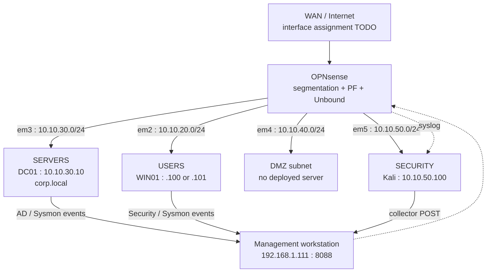
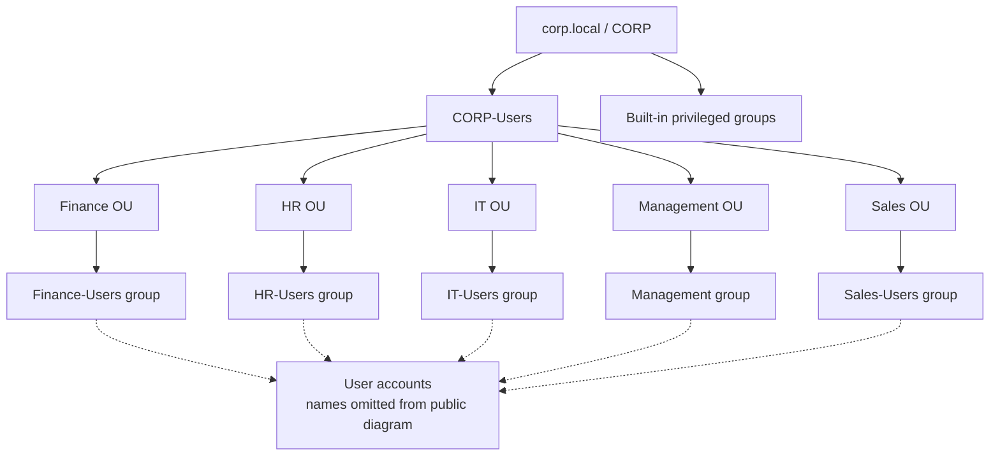
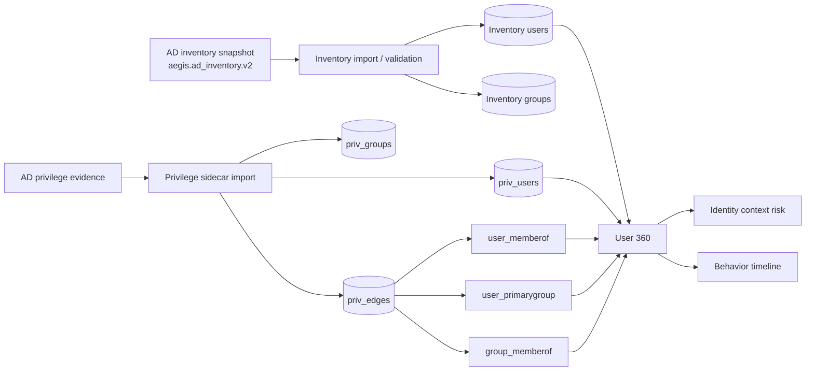

# AEGIS SOC — Architecture and trust boundaries

> **Evidence legend:** `[KOD]` = checked in the supplied application source snapshots; `[LAB]` = lab observation or operator-reported configuration. This is a segmented lab, not a production reference design. [KOD] The SOC performs read-only monitoring and investigation rather than traffic enforcement.

## 1. Design principles

[KOD] The application accepts security telemetry from named sources, normalizes it, preserves relevant original evidence, stores it in bounded SQLite, and exposes separate analytical views for network, endpoint, AD and identity. [KOD] Scoring and MITRE associations are explanatory suggestions; neither establishes that an attack succeeded. [LAB] OPNsense is the enforcement plane, and Windows hosts are protected endpoints in the lab.

### Physical / logical network topology

[LAB] `em2`, `em3`, `em4`, and `em5` were used for USERS, SERVERS, DMZ, and SECURITY respectively; the WAN/em0/em1 physical mapping is intentionally not guessed. [LAB] WIN01 has appeared at both `.100` and `.101` across observations, while `10.10.30.10` (DC01), `10.10.50.100` (Kali) and `192.168.1.111` (SOC) have specific observed roles. [LAB] The DMZ is a configured segment without a separate deployed host.

## 2. Security and telemetry layers

| Layer | Function / boundary |
|---|---|
| Network segmentation | [LAB] OPNsense PF applies firewall policy independently of AEGIS; deny events are emitted via filterlog. |
| Network IDS | [LAB] Suricata inspects selected lab traffic and emits EVE JSON alerts; exact IDS/IPS mode and full rule-set inventory require export. |
| DNS | [LAB] Unbound answers or blocks configured domain queries; Windows DNS forwarding via DC01 changes the apparent resolver-side source IP. |
| Endpoint | [LAB] Windows Security and Sysmon events are collected from WIN01 and DC01; [KOD] Sysmon detections are conservative single-primary-rule classifications. |
| Ingestion | [KOD] `POST /api/events/ingest` accepts structured source/message/severity/host/raw fields with optional token verification. |
| Storage | [KOD] SQLite WAL, SHA-256 event fingerprinting and bounded default retention of 50,000 records. |
| Correlation | [KOD] Network scan candidates, incident construction, AD intelligence, Sysmon enrichment and MITRE mapping. |
| User interface | [KOD] FastAPI serves the single-page dashboard from `app/templates/index.html`. |
| AI | [KOD] Ollama is optional, local and constrained by the evidence in the request; AI output is not authoritative. |
| Identity data | [KOD] Inventory and privilege sidecars; [LAB] Phase 1 shadow comparison and later loopback isolation were validated in the lab. |

## 3. AD logical structure

[LAB] The OU categories and departmental group labels are visible in the supplied AD screenshots. [LAB] The diagram intentionally omits individual user names and does not imply that each arrow is a verified membership relationship. [KOD] AEGIS separately models direct, primary and nested group relationships from exported evidence.

## 4. Identity and privilege relationships

[KOD] The privilege sidecar describes user and group nodes and typed direct, primary-group and group nesting edges. [LAB] Previously reported import/regression checks included 20 users, 57 groups, 15 direct membership links, 20 primary groups and 11 nested memberships in one lab export; these are **snapshot figures**, not universal live counts. [KOD] User 360 and behavior views are derived analytical representations, not Active Directory modification operations.

## 5. Components and control boundaries

- **[KOD]** API routes include `/api/events`, `/api/incidents`, `/api/network/detections`, `/api/ad/intelligence`, `/api/sysmon/investigation`, `/api/source-health`, `/api/status`, plus modular MITRE and identity routes.
- **[KOD]** Optional `SOC_DASHBOARD_USER` and `SOC_DASHBOARD_PASSWORD` enforce HTTP Basic authentication for analyst views; `SOC_INGEST_TOKEN` optionally validates `X-SOC-Token` on the ingest endpoint.
- **[KOD]** The HTTP middleware adds `X-Content-Type-Options: nosniff`, `X-Frame-Options: DENY`, `Referrer-Policy: no-referrer`, and no-store for API endpoints.
- **[KOD]** Loopback-limited identity/privilege endpoints are isolated from the broad dashboard network exposure. **[LAB]** Identity shadow and import isolation tests were completed before promoting experimental views.
- **[KOD]** Environment configuration includes `SOC_MONITORED_NETWORKS` (defaults to `10.10.0.0/16`), `SOC_MAX_EVENTS` (defaults to `50000`), `SOC_DB_PATH`, and `AEGIS_MITRE_V2`.
- **[LAB]** Management LAN binding `192.168.1.111:8088` was used only inside the authorized test network. Do not create a public NAT forward to the SOC API.

## 6. Architectural constraints

[KOD] The application's passive logic cannot confirm the real-world effectiveness of firewall policy or source sensor coverage without the original logs. [KOD] A single `BLOCK` event is not automatically a threat-intelligence block; a single `NXDOMAIN` is not a verified DNS blacklist decision; a possible port scan is not proof of intrusion. [LAB] Sysmon events 8/10/25 have configured collection paths, but the lab intentionally did not produce live malicious-behavior confirmations for those three rules.

### Reproduction TODOs

<!-- TODO: OPNsense version, WAN adapter mapping, exact em5 netmask and VM hypervisor release -->
<!-- TODO: approved PF rule UUID register and full ordered firewall export -->
<!-- TODO: latest identity snapshot schema and installed MITRE technique counts -->
