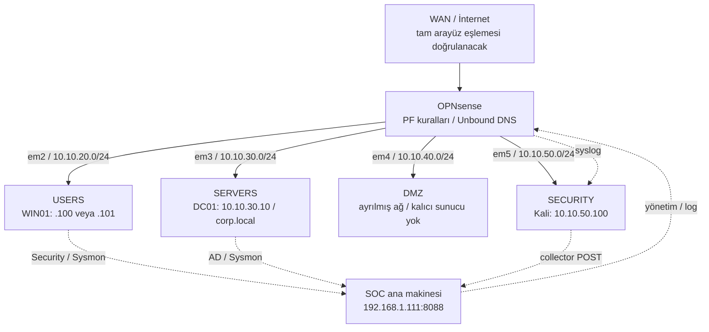
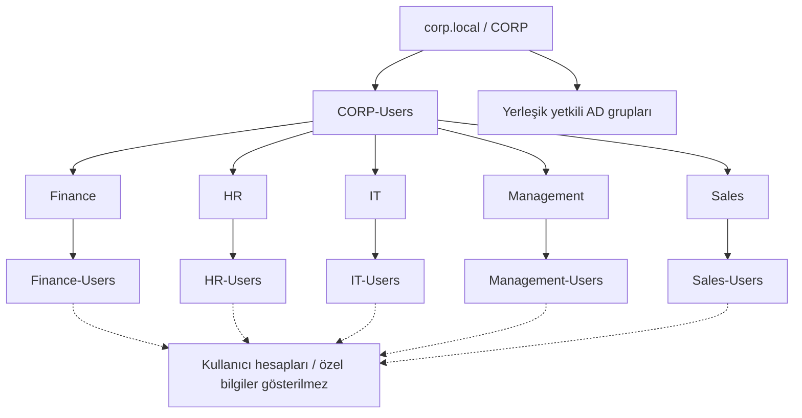
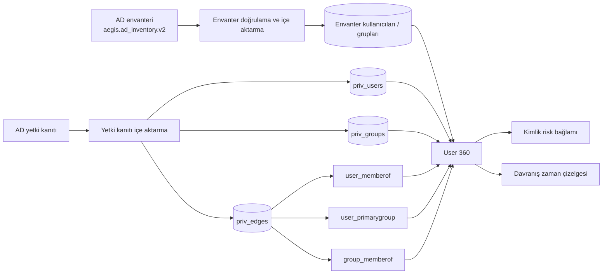
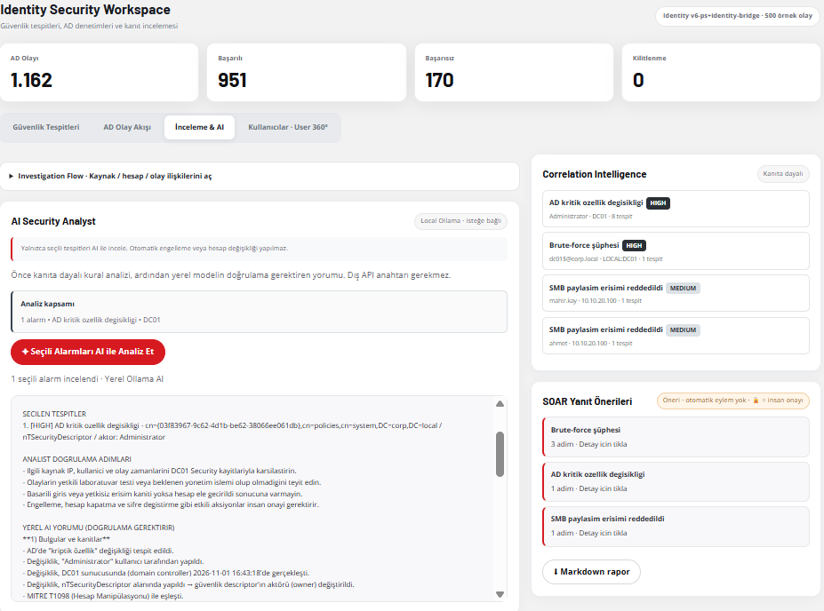

# AEGIS SOC — Sistem mimarisi ve güven sınırları

> **Kanıt işaretleri:** **[KOD]** kaynak kodunda incelenen davranış, **[LAB]** laboratuvar kurulumu, ekran görüntüsü veya çalıştırılmış testle desteklenen bilgi. Bu yapı bir üretim ortamı şablonu değil, segmentlere ayrılmış bir öğrenme laboratuvarıdır. **AEGIS olayları izler ve analiz eder; engellemeyi OPNsense ve Windows güvenlik ilkeleri yapar.**

## 1. Tasarım yaklaşımı

[LAB] Proje, tek ağda çalışan bağımsız makineler yerine, sınırları güvenlik duvarı tarafından denetlenen birkaç bölüm üzerine kuruldu. Kullanıcı bilgisayarı, etki alanı sunucusu ve güvenlik test makinesi farklı ağlarda tutuldu. Bu sayede izin verilen ve engellenen trafik; hangi arayüzden geldiği, hangi kurala takıldığı ve hangi log kaynağında göründüğüyle birlikte incelenebildi.

[KOD] AEGIS, collector üzerinden alınan olayları kaynağa göre ayrıştırır, zaman bilgilerini işler, özgün kaydı korur, SQLite'a yazar ve ağ/AD/Sysmon/Identity analizine sunar. MITRE ATT&CK ilişkisi ve risk puanı **inceleme bağlamıdır**; olayın saldırı olarak kesinleştiği anlamına gelmez.

## 2. Fiziksel ve mantıksal ağ topolojisi

[LAB] OPNsense; USERS, SERVERS, DMZ ve SECURITY arayüzlerinin ortak geçiş noktasıdır. Diyagramdaki oklar veri ve log yönlerini gösterir; her subnet'in diğerine koşulsuz erişimi olduğunu göstermez. Tam WAN eşlemesi ve son arayüz maskeleri güncel yapılandırma yedeğinden kontrol edilmelidir.

### Adres planı

| Bölge | Arayüz | Ağ | İlişkili makine / görev |
|---|---|---|---|
| USERS | `em2` | `10.10.20.0/24` | [LAB] WIN01; eski testlerde `.100`, başka bir kayıtta `.101` |
| SERVERS | `em3` | `10.10.30.0/24` | [LAB] DC01 `10.10.30.10` / etki alanı DNS |
| DMZ | `em4` | `10.10.40.0/24` | [LAB] Ayrılmış ağ, son durumda ayrı iş yükü yok |
| SECURITY | `em5` | `10.10.50.0/24` | [LAB] Kali `10.10.50.100`, ağ geçidi `10.10.50.1` |
| Yönetim | Ayrı ağ | `192.168.1.x` | [LAB] SOC API ve arayüz `192.168.1.111:8088` |

## 3. Güvenlik katmanları

| Katman | Uygulamadaki sorumluluğu |
|---|---|
| Ağ segmentasyonu | [LAB] OPNsense PF, bölgeler arası geçişi ve engelleme kurallarını uygular. |
| IDS | [LAB] Suricata, izlenen trafikten EVE JSON ve imza alarmları üretir; nihai IDS/IPS çalışma modu dışa aktarımla kesinleştirilmelidir. |
| DNS | [LAB] Unbound sorguları işler ve yapılandırılmış listeleri uygular. Windows istemcisinin DC01 üzerinden DNS kullanması görünür kaynak adresini etkileyebilir. |
| Uç nokta | [LAB] DC01 ve WIN01 üzerindeki Windows Security ve Sysmon günlükleri collector'larla toplanır. |
| API | [KOD] `POST /api/events/ingest` ile olay alımı; isteğe bağlı `X-SOC-Token` kontrolü. |
| Saklama | [KOD] SQLite WAL, SHA-256 olay parmak izi, varsayılan 50.000 olay sınırı. |
| Tespit | [KOD] Ağ tarama korelasyonu, AD kuralları, Sysmon sınıflandırması, MITRE ve Identity bağlamı. |
| Görselleştirme | [KOD] `app/templates/index.html` üzerinden sunulan tek sayfalık SOC arayüzü. |
| AI | [KOD] Opsiyonel yerel Ollama; kanıtın yerini almaz, karar yetkisi yoktur. |
| Identity | [KOD] AD envanteri ve yetki ilişkileri için ayrı veri katmanları; AD'ye yetki değişikliği yazılmaz. |

## 4. Active Directory organizasyon şeması

[LAB] Bölümlere ayrılmış OU/grup yapısı AD ekran görüntülerinde görülür. Kesik çizgiler örnek üyelik ilişkilerini açıklamak içindir; her kullanıcı için gerçek üyelik listesi anlamına gelmez. Yetkinin değerlendirilmesinde doğrudan, birincil ve iç içe grup ilişkileri ayrı ele alınır.

## 5. Identity ve yetki ilişki modeli

[KOD] `priv_edges`, doğrudan üyelik, birincil grup ve grup iç içeliğini farklı ilişki türleri olarak saklar. [LAB] Bir yetki dışa aktarımında 20 kullanıcı, 57 grup, 15 doğrudan üyelik, 20 birincil grup ve 11 iç içe üyelik raporlanmıştı; bunlar **o anki envanter sayılarıdır**, sabit sistem sınırları değildir.

## 6. API ve erişim güvenliği

[KOD] Uygulamada `/api/events`, `/api/incidents`, `/api/network/detections`, `/api/ad/intelligence`, `/api/sysmon/investigation`, `/api/source-health`, `/api/status` ve Identity/MITRE alt uçları bulunur. İsteğe bağlı HTTP Basic Auth, `SOC_DASHBOARD_USER` / `SOC_DASHBOARD_PASSWORD` ile; ingest token ise `SOC_INGEST_TOKEN` ile yapılandırılır.

[KOD] Güvenlik başlıkları arasında `X-Content-Type-Options`, `X-Frame-Options`, `Referrer-Policy` ve API önbelleklemesini önleyici başlıklar yer alır. Identity/privilege uçları için yerel erişim kısıtları uygulanmıştır. [LAB] SOC, özel yönetim ağı için yayınlandı; internete açık bir port yönlendirmesi bu kurulumun parçası değildir.

## 7. Kısıtlar ve doğrulama notları

[LAB] WIN01 Sysmon tarafında sekiz farklı kural gerçek olaylarla doğrulandı; LSASS odaklı ID 8/10 ile process tampering ID 25 için canlı saldırı temelli tespit testi tamamlanmadı. [KOD] Tek bir `BLOCK` kaydı otomatik olarak kara liste eşleşmesi sayılmaz ve tek bir `NXDOMAIN`, DNS blocklist kararı olarak yorumlanmaz.

<!-- TODO: OPNsense sürümü, WAN/em0/em1 eşlemesi ve em5 ağ maskesinin güncel ekran görüntüsü -->
<!-- TODO: tüm PF kural UUID'lerini içeren maskelenmiş kural dökümü -->
<!-- TODO: kullanılan en son MITRE modülünün kesin teknik sayısı ve son envanter tarihi -->
