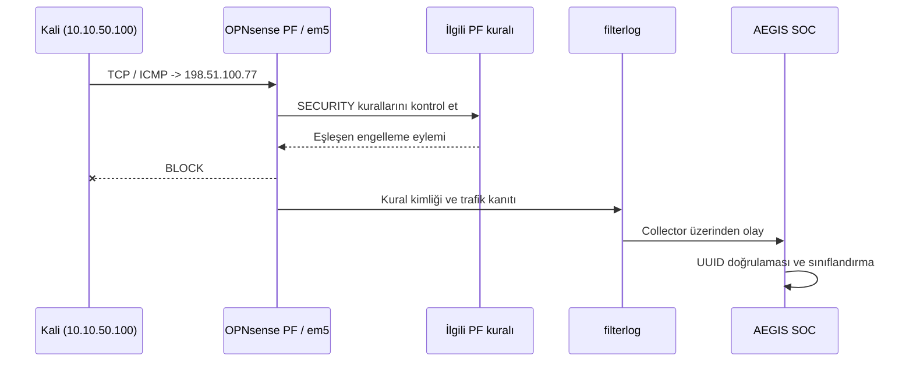
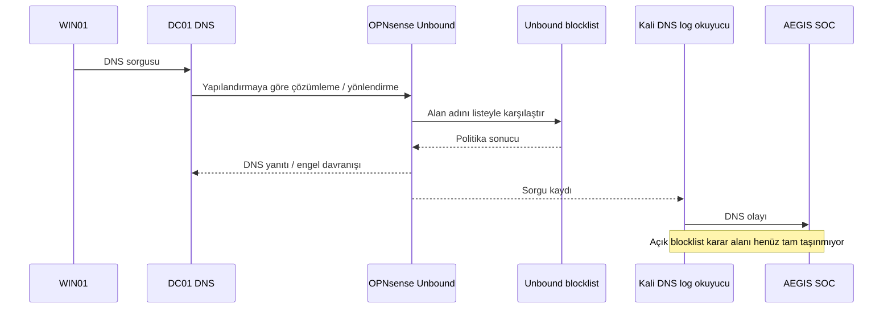

# IP ve DNS kara listeleri — OPNsense engelleme kanıtları

> **En önemli ayrım:** Trafik **OPNsense tarafından engellenir**. AEGIS yalnızca logları okur ve olayların hangi politikaya ait olduğunu incelemeye çalışır. [KOD] Kaynak kodunda doğrulanan, [LAB] laboratuvarda gözlenen veya açıklanan davranışı gösterir.

## 1. Bölgelere göre IP engelleme kuralları

[LAB] OPNsense'te her ağ için ayrı PF kuralı kullanıldı. Kullanıcı, DC01 ve Kali tarafından oluşturulan trafik aynı "genel BLOCK" kuralı üzerinden değerlendirilmedi.

| Bölge | PF kuralı | Eşleşme alanı |
|---|---|---|
| USERS / `em2` | `AEGIS TI - Malicious IP Block` | USERS arayüzünde gelen trafik |
| SERVERS / `em3` | `AEGIS TI - DC01 Malicious IP Block` | DC01/SERVERS tarafı |
| SECURITY / `em5` | `AEGIS TI - Kali Malicious IP Block` | Kali/SECURITY tarafı |

[KOD] `BLOCK` tek başına bir **tehdit istihbaratı listesi** nedeniyle engelleme yapıldığını göstermez. AEGIS, filterlog içinde gelen PF kural UUID bilgisini onaylı kural kayıtlarıyla eşleştirir. Bu eşleşme yoksa olayı yalnızca firewall engeli olarak değerlendirir.

## 2. IP engelleme — kanıt akışı



[LAB] `198.51.100.77`, **RFC 5737 TEST-NET-2** alanından ayrılmış bir belgelendirme adresidir. Testte "zararlı IP" olarak temsil edildi; gerçekte zararlı bir sunucu olduğu iddia edilmez. [KOD] SOC'un verdiği "TI" etiketi ancak engellenen gerçek paket ile onaylı PF kuralı arasındaki ilişki doğrulanınca anlam kazanır.

| Firewall canlı kayıt | Tekil log ayrıntısı |
|---|---|
|  |  |

**Doğrulama adımları:**

1. [LAB] OPNsense **Firewall → Log Files → Live View** ekranında `10.10.50.100` ve `198.51.100.77` filtrelerini kullan.
2. [LAB] Arayüz `SECURITY/em5`, yön ingress, eylem `BLOCK` ve ilgili protokol/portu kontrol et.
3. [LAB] Kural adını/UUID'sini OPNsense yapılandırmasıyla eşleştir.
4. [KOD] AEGIS'te aynı kaydı `source=FIREWALL` üzerinden incele; `PASS`, `BLOCK` ve `REJECT` ayrımının korunduğunu doğrula.

```powershell
# SOC ana makinesinde salt-okunur olay sorgusu
Invoke-RestMethod 'http://127.0.0.1:8088/api/events?mode=all&source=FIREWALL&limit=100'
```

## 3. IP blok listeleri ve gerçek test bağlamı

[LAB] Test görüşmelerinde ayrıca aşağıdaki ağ bloklarının OPNsense üzerinde engelli olduğu bildirildi: `5.252.153.0/24`, `14.128.32.0/20`, `14.128.48.0/21`, `14.152.94.0/24`, `19.200.0.0/16`.

Bu ağların "tüm adresleri kötü amaçlıdır" sonucu çıkarılmaz. Burada yalnızca **laboratuvarda engel adayı olarak tanımlandıkları** belgelenir. DC01'den bu blokların içindeki hedef IP'lere yapılan bağlantı denemeleri için güncel firewall logundan `BLOCK` eşleşmesi ayrıca aranmalıdır; komutun çalıştırılması tek başına ağ engelini kanıtlamaz.

<!-- TODO: blokların oluşturulduğu alias/feed kaynağı, kullanım izni ve güncelleme sıklığı -->

## 4. Unbound DNS engelleme ve log görünürlüğü

[LAB] Windows 11 istemcisinin DNS trafiği DC01 üzerinden yönlendirildiği için resolver tarafında kaynak olarak DC01 görünebilir. Unbound DNS'in blok kararı **Reporting → Unbound DNS → Details** bölümünde incelendi.



[LAB] DNS zinciri, sorgunun ilk kimden çıktığı ile Unbound'un hangi IP'yi kaynak olarak gördüğü arasında fark yaratabilir. [KOD] Mevcut collector, Unbound'un kesin kara liste karar alanını SOC'a taşımadığı için Dashboard'da **doğrulanmış DNS blok sayacı** güvenilir biçimde gösterilmiyor. NXDOMAIN artışı bu eksik verinin yerine konmaz.

| Unbound izleme | Unbound ayrıntılar |
|---|---|
|  |  |

## 5. NXDOMAIN ve blocklist aynı şey değildir

- [KOD] **NXDOMAIN:** Sorgulanan adın DNS çözümlemesinde bulunamadığını gösterir; yazım hatası veya test alan adı da aynı sonucu üretebilir.
- [KOD] **Doğrulanmış DNS block:** Unbound tarafından açıkça raporlanan liste/politika engeli olmalıdır.
- [LAB] Laboratuvarda `.invalid` benzeri alan adları ve kısa aralıklı birden çok DNS isteğiyle davranış test edildi.
- [KOD] SOC bu iki sinyali ayrı ele alacak şekilde tasarlandı; ancak collector'ın nihai block kararını taşıma sınırı korunuyor.

## 6. Kanıt kaydı ve açıklanması gerekenler

| Kanıt | Neden önemli? |
|---|---|
| PF kural UUID'si | [KOD] Gerçek TI block ile sıradan BLOCK'u ayırmak için |
| Trafik kaynağı/hedefi/protokolü | [LAB] Paket hangi ağ sınırında engellendiğini anlamak için |
| IP alias ve feed kaynağı | [LAB] Blok listesinin nereden geldiğini ve hangi aralıkları kapsadığını açıklamak için |
| Unbound karar alanı | [KOD] Doğrulanmış DNS block saymak için |
| Olay zamanı ve alım zamanı | [KOD] Aynı olayı farklı log kaynakları arasında eşleştirmek için |

<!-- TODO: onaylı PF UUID kayıt defterinin gizli bilgiler çıkarılmış sürümü -->
<!-- TODO: IP/DNS feed URL'leri, sürümleri ve yenileme periyotları -->
<!-- TODO: Unbound collector'a açık policy decision / blocklist alanı eklenmesi -->
