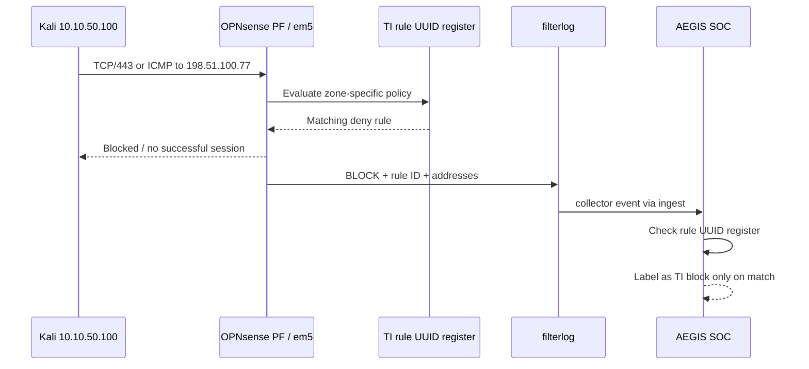

# OPNsense IP and DNS blocklists — evidence and limits

> **Critical distinction:** [LAB] OPNsense enforces traffic policy. [KOD] AEGIS merely reads the resulting logs; it never issues firewall block commands. `[KOD]` = checked in the provided application snapshot; `[LAB]` = lab observation.

## 1. IP threat-intelligence policy

[LAB] Separate OPNsense PF rules were created by ingress zone:

| Network | Observed PF rule label | Enforcement location |
|---|---|---|
| USERS | [LAB] `AEGIS TI - Malicious IP Block` | [LAB] `em2`, USERS ingress |
| SERVERS/DC01 | [LAB] `AEGIS TI - DC01 Malicious IP Block` | [LAB] `em3`, SERVERS ingress |
| SECURITY/Kali | [LAB] `AEGIS TI - Kali Malicious IP Block` | [LAB] `em5`, SECURITY ingress |

[KOD] In the SOC, action `BLOCK` is **not sufficient** to attribute an event to a threat-intelligence alias. A filterlog rule UUID must match a curated set of known TI policy identities. [LAB] The exact UUID strings were not included here; they must be extracted from the deployed firewall and verified in Live View.

### IP blacklist sequence



[LAB] The observed positive example is SECURITY/em5 inbound, `10.10.50.100 → 198.51.100.77`, both TCP and ICMP, with OPNsense `BLOCK` evidence. [KOD] The SOC's UUID check prevents generic routing or policy denials from being counted as threat-intelligence hits. The IP `198.51.100.77` is from RFC 5737 TEST-NET-2 and is **deliberately not a real threat indicator**.

### Additional operator-supplied IP networks

[LAB] In a later lab check the operator identified the following ranges as **configured block targets**. These are policy inputs for local testing, **not claims that any network is malicious**:

```text
5.252.153.0/24
14.128.32.0/20
14.128.48.0/21
14.152.94.0/24
19.200.0.0/16
```

[LAB] DC01 TCP/443 request attempts were proposed for representative IPs in those ranges. A timeout cannot establish PF enforcement; only contemporaneous filterlog entries with rule identity do so. [LAB] The actual alias source, provenance, refresh schedule and route-specific results for those networks are not independently available for this document.

### Reproduce the safe validation

1. **[LAB]** Verify that the test IP alias is present and bound to the intended zone-specific PF rule in **Firewall → Aliases** and **Firewall → Rules**.
2. **[LAB]** Send one short request to the reserved TEST-NET-2 destination from the authorized Kali segment. Avoid broad or high-rate scans of external hosts.
3. **[LAB]** Check **Firewall → Log Files → Live View** for `BLOCK`, correct ingress interface, source/destination, protocol and rule identifier.
4. **[KOD]** In AEGIS, filter source `FIREWALL` and inspect the same evidence rather than relying on an alert card alone.


## 2. DNS blocklist and Unbound

[LAB] Windows workstation DNS queries were routed via DC01 before reaching the resolver. OPNsense Unbound DNS was configured with blocklist capabilities and a verification view at **Reporting → Unbound DNS → Details**. [KOD] The SOC parses DNS query/response fields but **the current collector does not propagate Unbound's definitive blocklist decision field**.

### DNS blacklist sequence

```mermaid
sequenceDiagram
  participant WIN as WIN01
  participant DC as DC01 / AD DNS
  participant UB as OPNsense Unbound
  participant BL as Unbound local blocklist
  participant COL as DNS log collector
  participant SOC as AEGIS SOC
  WIN->>DC: DNS query (client)
  DC->>UB: Forwarded resolution
  UB->>BL: Check local policy
  BL-->>UB: Allow or block outcome
  UB-->>DC: DNS reply (rcode varies)
  DC-->>WIN: DNS response
  UB->>COL: Query/reply log
  COL->>SOC: DNS event without block-decision field
  Note over SOC: NXDOMAIN can be tracked; confirmed block decision unavailable
```

[LAB] Because DC01 can forward workstation queries, the Unbound-side requester may appear as `10.10.30.10`, not the original WIN01 client. [KOD] `NXDOMAIN` may arise from typos, nonexistent names or a blacklist configuration; it is therefore monitored separately and **never presented as confirmed blocklist evidence** without an explicit decision record. This is a known limitation, not a hidden feature.

### DNS checks

```bash
# Kali, low-volume queries in the authorized lab
dig @10.10.50.1 example.invalid A +tries=1 +time=2 +noall +comments
dig @10.10.30.10 corp.local A +tries=1 +time=2 +noall +comments
```

[LAB] Confirm the resolver's real decision in **Reporting → Unbound DNS → Details**. [KOD] Compare `DNS` source events in `/api/events?mode=all&source=DNS`; the dashboard should distinguish **resolver response / NXDOMAIN** from **confirmed blacklist block**. A working DNS feed may coexist with zero confirmed blocks in the SOC.


## 3. Rule register and data provenance

| Evidence item | Requirement |
|---|---|
| PF rule UUID | [KOD] Required to attribute TI-labelled BLOCK events accurately. |
| Alias/feed provenance | [LAB] **<!-- TODO: include exact configured name, authenticated source URL if public, and update interval -->** |
| Network policy scope | [LAB] Record interface, ingress/egress and selected source/destination. |
| DNS decision | [KOD] Collector must forward explicit Unbound blocklist outcome to support a verified block counter. |
| Security audit | [LAB] Do not commit internal passwords, tokens, full config backups or personally identifiable endpoint paths. |

## 4. Known limitations

- **[KOD]** A generic firewall `BLOCK` and a TI-specific `BLOCK` are different data classifications.
- **[KOD]** DNS `NXDOMAIN` and an Unbound policy `BLOCK` are different outcomes; the current SOC collector cannot confirm the latter.
- **[LAB]** Exact feed names/URLs, aliases, country/region provenance, polling schedules and complete PF UUID register are not present in the supplied reproducible evidence.
- **[LAB]** IP ranges supplied by an operator are not malicious by definition; the documentation asserts only their status as lab-configured block candidates.
