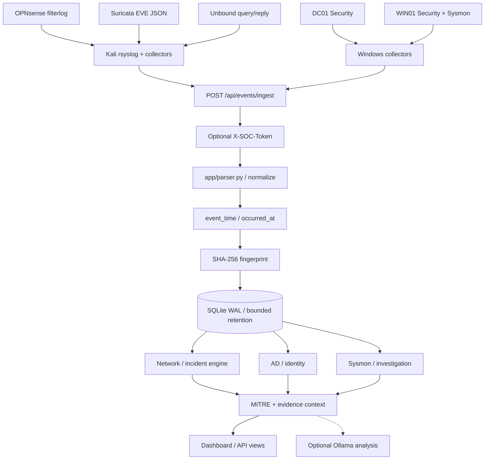
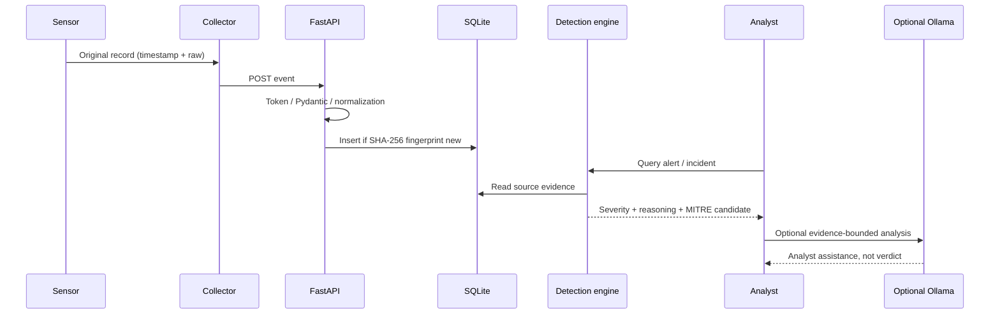

# AEGIS SOC — Data flow, storage and evidentiary integrity

> Read-only SOC telemetry pipeline. `[KOD]` = source code evidence from provided application snapshots; `[LAB]` = lab-observed environment.

## 1. End-to-end flow



[LAB] The network collector was run on Kali, and Windows collectors ran on the individual Windows VMs. [KOD] The API performs normalization and preserves a payload containing the original raw event before writing it to SQLite. [KOD] Detection and display query the stored event evidence; local LLM use is optional.

## 2. Ingestion contract

[KOD] `POST /api/events/ingest` accepts JSON with `source`, `message`, `severity`, `host`, and `raw`. [KOD] Valid fields are constrained by the Pydantic input model: `source` 1–40 chars, `message` up to 8,000 chars, `severity` up to 16 chars, `host` up to 255 chars, `raw` up to 20,000 chars. [KOD] An optional shared secret requires `X-SOC-Token` when `SOC_INGEST_TOKEN` is configured.

```json
{
  "source": "SYSMON",
  "message": "Example Sysmon event in an authorized lab",
  "severity": "info",
  "host": "LAB-WIN01",
  "raw": "{\"event_id\":1,\"note\":\"example-only\"}"
}
```

[KOD] The JSON above is **illustrative input**, not a guarantee that it triggers any detection. [KOD] Successful inserts return `{"status":"accepted"}` while fingerprints already in the store return `{"status":"duplicate"}`. Ingest acceptance does not prove a threat; collectors must send real source evidence for operational validation.

## 3. Source-specific normalization

| `source` | Representative fields / behavior |
|---|---|
| `FIREWALL` | [KOD] Parses OPNsense `filterlog` action, protocol, source/destination and ports when present. |
| `SURICATA` | [KOD] Parses EVE JSON including `alert.signature`, severity, event type, flow metadata, interface and direction. |
| `DNS` | [KOD] Extracts Unbound query client, domain, record type and certain response codes; **not the definitive blocklist decision**. |
| `AD` / `WIN_SECURITY` | [KOD] Security event IDs, account/host/source details, Windows authentication and authorization context. |
| `SYSMON` | [KOD] Event ID, process and parent GUID, image, parent image, command line, user and raw EventData fields. |

## 4. Time handling, deduplication and limits

- **[KOD]** AEGIS records a SOC reception timestamp and derives an optional **event occurrence timestamp** from source evidence. Delayed collectors may legitimately produce historical event times.
- **[KOD]** Deduplication SHA-256 input is formed from source, host and raw payload (falling back to message). SHA-256 fingerprints avoid repeated inserts of identical delivered records.
- **[KOD]** The SQLite database enables WAL and a write lock. It contains a unique fingerprint field and indexes for alert status, source and receipt time.
- **[KOD]** Default `SOC_MAX_EVENTS=50000`, lower-bounded at 1,000; retention trimming is performed periodically after inserts. **This is not immutable archive storage.**
- **[KOD]** `/api/events` defaults to alert mode, supports `all` and `blocks`, caps individual `limit` at 5,000, and allows `source`, `offset` and timezone-aware `since` / `until` filters. [KOD] Time-range filters operate on **receipt timestamps**, not source event occurrence time.

## 5. Investigation APIs

| Endpoint | Purpose |
|---|---|
| `GET /` | [KOD] HTML dashboard (single-page template). |
| `POST /api/events/ingest` | [KOD] Event input, optional token and normalization. |
| `GET /api/events` | [KOD] Filtered event listing and pagination. |
| `GET /api/status` | [KOD] Per-source freshness and overall service status. |
| `GET /api/source-health` | [KOD] Extended source-health signals. |
| `GET /api/incidents` | [KOD] Incident analysis from network alerts with AD context when available. |
| `GET /api/network/detections` | [KOD] Network scan and sweep candidates. |
| `GET /api/ad/intelligence` | [KOD] AD detection and analysis summary. |
| `GET /api/sysmon/investigation` | [KOD] Endpoint investigation view. |
| `/api/mitre/*`, `/api/identity/*` | [KOD] Dedicated technique and identity modules (exact route list depends on installed feature modules). |

### Read-only dashboard checks

```powershell
$base = 'http://127.0.0.1:8088'
Invoke-RestMethod "$base/api/status"
Invoke-RestMethod "$base/api/source-health"
Invoke-RestMethod "$base/api/events?mode=all&source=FIREWALL,SURICATA,DNS&limit=25"
Invoke-RestMethod "$base/api/events?mode=all&source=AD,SYSMON,WIN_SECURITY&limit=25"
```

[KOD] HTTP 200 means a route answered; **freshness and expected sensor content** must still be examined. [LAB] The deployed API was accessed from a Windows management workstation at `192.168.1.111:8088` during lab checks.

## 6. Alert lifecycle and interpretation



[KOD] The same source record remains available for an analyst to inspect the decision path. [KOD] Deduplication avoids duplicate storage but does not assert that distinct sensor records represent separate attacks. [KOD] An LLM explanation is downstream of logged evidence and does not authorize blocking or account modification.

## 7. Troubleshooting checklist

1. **[LAB]** Verify a fresh sensor-side event in OPNsense Live View, EVE JSON, Windows Security or Sysmon Operational log.
2. **[LAB]** Confirm the active collector process/service and its configured event IDs, port and reachable API host.
3. **[KOD]** Verify ingest authentication and response (`accepted` vs `duplicate`), then query `/api/events?mode=all` with the correct source and pagination.
4. **[KOD]** Compare original event time and SOC receipt time before using `since` filters.
5. **[KOD]** Check rule conditions, allow/deny semantics and correlation window; a raw event need not become an alarm.
6. **[LAB]** Do not disable Defender, weaken GPO auditing or bypass Windows protections merely to turn a controlled lab check green.

### Open reproducibility items

<!-- TODO: publish redacted collector configuration / rsyslog filter snippets -->
<!-- TODO: publish test fixtures with all secret and user identifiers removed -->
<!-- TODO: verify latest public repo commit and match route docs to that revision -->
