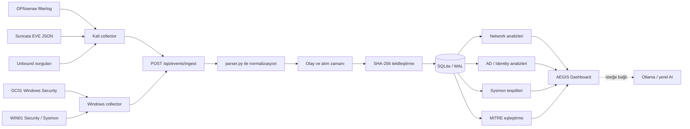
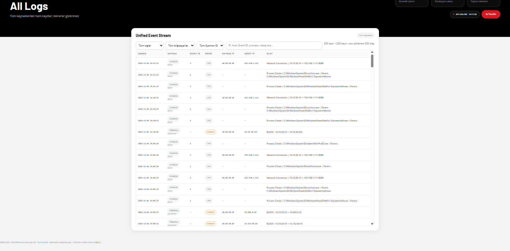
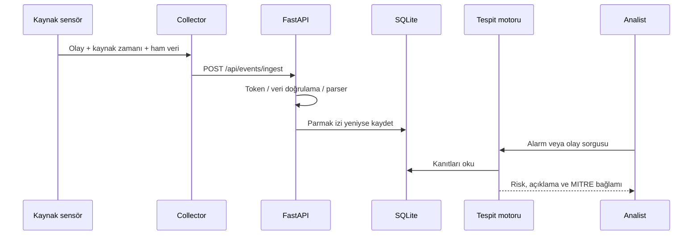
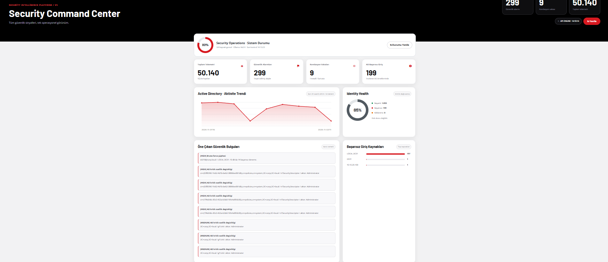

# AEGIS SOC — Log akışı, veri modeli ve API

> Bu belge, olayın üretildiği sistemden analistin ekranına gelene kadar geçtiği aşamaları açıklar. **[KOD]** kaynak kodunda görülen çalışma biçimi; **[LAB]** gerçek laboratuvar bağlantısı ve test kayıtlarıdır.

## 1. Log kaynakları

| Kaynak (`source`) | Üretici | Ham kayıt / örnek |
|---|---|---|
| `FIREWALL` | [LAB] OPNsense PF / filterlog | PASS / BLOCK, kaynak/hedef IP, port, arayüz, kural kimliği |
| `SURICATA` | [LAB] Suricata | EVE JSON, imza, severity, flow, yön |
| `DNS` | [LAB] OPNsense Unbound | DNS sorgusu ve yanıt bağlamı; açık block kararı her kayıtta yok |
| `AD` | [LAB] DC01 Security | Hesap/grup/kimlik doğrulama olayları |
| `WIN_SECURITY` | [LAB] Windows Security | Oturum ve yerel güvenlik olayları |
| `SYSMON` | [LAB] WIN01/DC01 Sysmon | Process, network, dosya, Registry ve DNS olayları |

[LAB] Windows collector ve Kali ağ collector'ı birbirinden ayrıydı. Kali tarafında rsyslog üzerinden ağ logları toplandı; Windows bilgisayarlarında Event Log kanalları gönderildi.

## 2. Uçtan uca kayıt hattı



[KOD] `POST /api/events/ingest` üzerinde yapılandırmaya bağlı token kontrolü, Pydantic veri doğrulaması, kaynak normalizasyonu ve saklama akışı bulunur. [LAB] AEGIS Dashboard'daki farklı modüller aynı fiziksel olayın farklı güvenlik bağlamlarına bakar; ham kanıtı değiştirmez.



## 3. Collector → API veri sözleşmesi

[KOD] Collector, `source`, `severity`, `host`, `message` ve `raw` alanlarını sağlayabilir. Kaynak tipine göre `raw` alanının yapısı değişir: filterlog satırı, EVE JSON veya Windows olay XML'i olabilir.

```json
{
  "source": "SYSMON",
  "severity": "info",
  "host": "WIN01",
  "message": "Sysmon Event ID 11 on WIN01",
  "raw": "<örnek-olay-xml-verisi>"
}
```

Bu JSON yalnızca **şema örneğidir**, gerçek log kaydı veya doğrulanmış bir olay değildir. Yetkili collector'ın gönderdiği özgün kayıt saklanır; gizli tokenlar dokümana eklenmez.

### API sorguları

```powershell
$base = 'http://127.0.0.1:8088'
Invoke-RestMethod "$base/api/status"
Invoke-RestMethod "$base/api/source-health"
Invoke-RestMethod "$base/api/events?mode=all&source=FIREWALL&limit=25"
Invoke-RestMethod "$base/api/events?mode=all&source=SURICATA&limit=25"
Invoke-RestMethod "$base/api/events?mode=all&source=SYSMON&limit=25"
```

[LAB] Bu komutlar SOC'un kurulu olduğu makinede kullanılmak üzere belgelenmiştir. `HTTP 200`, endpoint'in cevap verdiğini gösterir; kaynağın güncel log gönderdiğini ayrıca zaman damgası ve içerikle doğrulamak gerekir.

## 4. Normalizasyon ve veri saklama

[KOD] `parser.py`, gelen kaydı kaynağa göre anlamlandırır; uygun alanlar çıkarılır, özgün `raw` veri korunur. Depolamada SHA-256 temelli olay parmak iziyle tekilleştirme ve SQLite WAL kullanılır. Varsayılan olay tutma sınırı `SOC_MAX_EVENTS=50000` olarak ayarlanabilir.

[KOD] `/api/events` varsayılan olarak alarm görünümüyle çalışır; `mode=all` ve `mode=blocks` seçenekleri vardır. Tek sorguda `limit` en çok 5.000 ile sınırlandırılır; sayfalama için `offset`, kaynak filtreleme için `source`, zaman için `since` ve `until` kullanılabilir. Zaman filtresi veritabanındaki **SOC alım zamanına** uygulanır; olayın Windows'ta gerçekleştiği zamanla farklı olabilir.



[KOD] Çift kaydı elemek ile farklı kaynakların aynı saldırıyı kanıtlaması farklı şeylerdir. Parmak izi, benzer kayıtların tekrar saklanmasını azaltır; her eşleşmenin tek saldırı olduğunu iddia etmez.

## 5. Analiz ekranları ve API uçları

| Uç nokta | Görev |
|---|---|
| `GET /` | [KOD] Ana SOC arayüzü |
| `POST /api/events/ingest` | [KOD] Olay kabulü ve işleme |
| `GET /api/events` | [KOD] Olay listeleme, filtreleme ve sayfalama |
| `GET /api/status` | [KOD] Servis/kaynak durumunu değerlendirme |
| `GET /api/source-health` | [KOD] Veri kaynağı sağlığı |
| `GET /api/incidents` | [KOD] İlişkilendirilmiş olay incelemesi |
| `GET /api/network/detections` | [KOD] Ağ taraması ve benzer örüntü adayları |
| `GET /api/ad/intelligence` | [KOD] AD denetim ve tespit özeti |
| `GET /api/sysmon/investigation` | [KOD] Uç nokta süreç analizi |
| `/api/mitre/*`, `/api/identity/*` | [KOD] İlgili modüllerin etkin sürümdeki uçları |



## 6. Opsiyonel Ollama / yerel AI

[KOD] Yerel AI, kayıt ve kural çıktısına dayanarak analistin incelemesini hızlandırmaya yönelik yardımcı katmandır. [LAB] Ollama `127.0.0.1:11434` ve `qwen3:4b-instruct` modeliyle kullanıldı. Çıktılar kalite kontrolüne tabi tutulur; AI kararına dayanarak kullanıcı kilitleme, firewall kuralı değiştirme veya başka müdahale yapılmaz.

## 7. Collector veya olay görünmüyorsa

1. [LAB] İlk olarak olayın kaynakta oluştuğunu doğrula: OPNsense Live View, Suricata EVE, Windows Security ya da Sysmon Operational.
2. [LAB] Collector'ın gerçekten çalıştığını ve doğru ID'leri alacak biçimde filtrelendiğini doğrula.
3. [LAB] SOC API erişimini ve varsa ingest token yapılandırmasını kontrol et.
4. [KOD] `/api/events?mode=all` sorgusuyla **kaynağa göre** olayları incele; yalnızca alarmları sorgulamak yeterli olmayabilir.
5. [KOD] `since` filtresi kullanmadan önce SOC alım zamanı ile kaynak olay zamanını karşılaştır.
6. [KOD] Kuralın tetik koşullarını kontrol et; ham log kaydı her zaman alarm oluşturmaz.
7. [LAB] Test amacıyla Defender'ı kapatma veya AD denetimini gereksiz şekilde gevşetme.

<!-- TODO: gizli verileri çıkarılmış Kali collector yapılandırması ve Windows zamanlanmış görev exportu -->
<!-- TODO: güncel kurulum sürümündeki tüm API uçlarının dökümü -->
