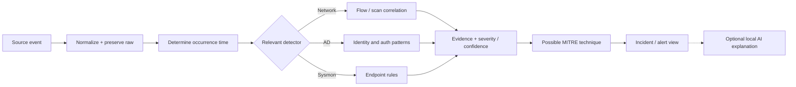
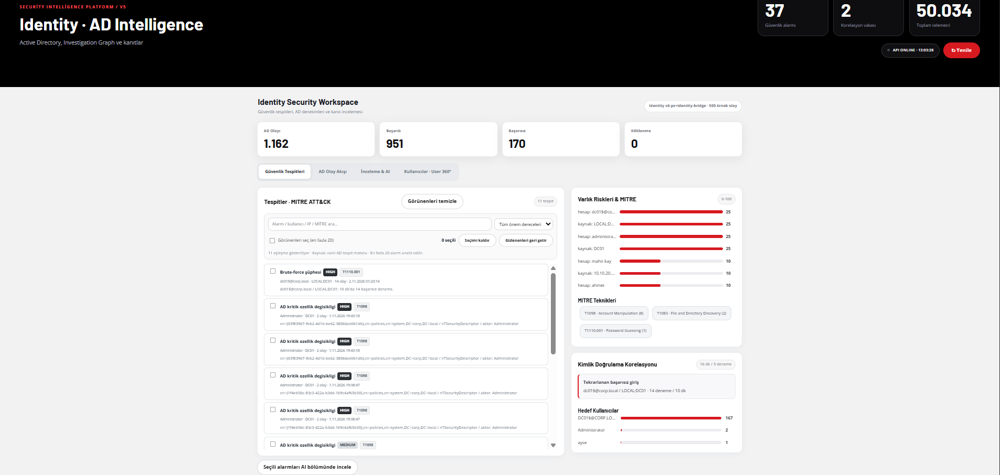

# AEGIS detection engineering — rule catalog and validation

> `[KOD]` describes logic verified in the supplied Python snapshots. `[LAB]` describes recorded lab tests, not independently audited production detection rates. **[KOD] A detection is a review signal, not proof of successful compromise.**

## 1. Detection pipeline



[KOD] Normalization and timestamp handling run before the correlated analysis is presented. [KOD] Network, AD and endpoint detections have distinct semantics; MITRE techniques are investigative context, not a claim that a technique definitively occurred. [KOD] AI may summarize evidence but cannot upgrade ambiguous telemetry into proof.

## 2. Network intelligence

| Name / behavior | Trigger and caveat |
|---|---|
| Vertical scan candidate | [KOD] At least 5 distinct destination ports for one source/destination and protocol in a five-minute occurrence-time bucket. |
| Horizontal sweep candidate | [KOD] At least 5 distinct in-scope destination hosts for one source/protocol/port in a five-minute bucket. |
| Destination scope | [KOD] `SOC_MONITORED_NETWORKS`, default `10.10.0.0/16`; invalid scope fails closed. |
| Noise reductions | [KOD] Skips multicast, loopback, unspecified addresses, `.255` broadcast, obvious service responses, Suricata `to_client` responses and Sysmon `Initiated=false` records. |
| Incident aggregation | [KOD] Firewall and Suricata sources are combined with evidence-aware confidence/risk information; [LAB] prior lab correlation was examined on approximately five-minute windows. |
| Suricata severities | [KOD] EVE alert levels `1 → critical`, `2 → high`, `3 → medium`, unknown → info. |
| Known training signature | [KOD] `KALI SECURITY TEST` is low severity to reduce lab-noise false positives. |
| Firewall policy deny | [KOD] `BLOCK` / `REJECT` may be an alert, but is not automatically a TI blacklist match. |

[LAB] Recorded Kali-to-DC01 Nmap, SMB/LDAP/Kerberos and ICMP activity produced logs and Suricata signatures in earlier test sessions. [LAB] Low-value DC01-to-`.255` NetBIOS broadcast blocks and some UDP/123 traffic were handled conservatively rather than described as attacks.

## 3. Sysmon V3 — complete detection catalog

[KOD] The current V3 module returns **one primary rule per eligible event**. Multiple separate events can still raise the same rule repeatedly. [LAB] WIN01's last reported collector allow-list was `1,3,8,10,11,13,22,25`; Event ID 12 is referenced in broader Sysmon work but was **not** in that final WIN01 forwarding filter.

| Event ID | Rule ID | Trigger | Severity | Validation |
|---|---|---|---|---|
| 1 | `SYSMON-OFFICE-SHELL` | [KOD] Office-named parent process creates `cmd.exe` / PowerShell child | High | [LAB] Dashboard alert from an Office-named **test process**, not a real Office exploit |
| 1 | `SYSMON-SCRIPT-SHELL` | [KOD] `wscript` / `cscript` / `mshta` parent starts a shell | High | [LAB] WIN01 live alert |
| 1 | `SYSMON-ENCODED-POWERSHELL` | [KOD] PowerShell `-enc` / `-EncodedCommand` argument | Medium | [LAB] WIN01 live alert |
| 1 | `SYSMON-POWERSHELL-EXECUTION` | [KOD] Command includes `Invoke-Expression`, `DownloadString` or equivalent IEX expression | Medium | [LAB] WIN01 live alert |
| 3 | `SYSMON-UNUSUAL-OUTBOUND-PORT` | [KOD] **Public/global** destination IP with port 4444, 5555, 6666 or 1337 | Medium | [LAB] WIN01 live port test and SOC alert |
| 22 | `SYSMON-SUSPICIOUS-DNS` | [KOD] `.onion` query → medium; `.invalid` query → low | Medium/Low | [LAB] `.invalid` live alert |
| 8 | `SYSMON-REMOTE-THREAD-LSASS` | [KOD] Non-LSASS source creates a remote thread in `lsass.exe` | High | [LAB] Filter configured, source code/unit tests; no live LSASS injection test |
| 10 | `SYSMON-LSASS-ACCESS` | [KOD] Non-excluded source accesses LSASS with `0x1fffff`, `0x1f3fff` or `0x1f0fff` | High | [LAB] Access denied (`Win32 error 5`) during attempt; no live high-risk alert |
| 11 | `SYSMON-STARTUP-FILE` | [KOD] File created under Windows Startup directory | Medium | [LAB] WIN01 live alert |
| 13 | `SYSMON-AUTORUN-REGISTRY` | [KOD] Registry Run / RunOnce or Policies Explorer Run value set | Medium | [LAB] WIN01 live alert |
| 25 | `SYSMON-PROCESS-TAMPERING` | [KOD] A real Sysmon Event ID 25 | High | [LAB] Monitoring configured; Defender blocked third-party test binary, no live alarm |

[KOD] For ID 10, the process-name exclusions include Task Manager and Process Explorer variants; not every read-only LSASS process query should be high severity. [LAB] Defender protection and LSASS access controls were intentionally left in place when the simulated test failed.


## 4. Active Directory / Windows Security

[KOD] Relevant event IDs include `4624`, `4625`, `4672`, `4719`, `4720`, `4724`, `4726`, `4728`, `4729`, `4732`, `4738`, `4740`, `4756`, `4768`, `4769`, `4771`, `4776`, `1102`, and `5145`. [LAB] Event-ID collection must be confirmed against the active GPO/collector state for each Windows host.

| Detection | Inference and relevant evidence |
|---|---|
| `brute_force` | [KOD] Clustered failures within a ten-minute pattern; inspect source, user and authentication mechanism. |
| `success_after_fail` | [KOD] Successful logon after preceding failures; corroboration required. |
| `password_spray` | [KOD] Spread of authentication failures across users/source context. |
| `user_enum` | [KOD] Authentication behavior suggesting user enumeration; not definitive. |
| `lockout` | [KOD] Event 4740, caller/source context and prior failures. |
| `kerberoast` | [KOD] RC4 `0x17` Kerberos service-ticket / SPN pattern, ATT&CK T1558.003. |
| `asrep_roast` | [KOD] Pre-authentication-related TGT evidence, ATT&CK T1558.004. |
| `log_cleared` | [KOD] Security log clear Event 1102, ATT&CK T1070.001. |
| `priv_group` / member removed | [KOD] Group membership change associated with privilege-sensitive groups, ATT&CK T1098. |
| `new_account` | [KOD] User creation, ATT&CK T1136.001. |

[KOD] MITRE technique identifiers are hypotheses attached to evidence; broader V2 mapping covers approximately 49 techniques in the reported deployment [LAB], but exact counts depend on the installed module snapshot. [LAB] AD inventory and privilege exports were validated independently from the event-driven rule engine.

## 5. Identity and risk context

[KOD] AD inventory is consumed under schema `aegis.ad_inventory.v2` and permission evidence through `priv_users`, `priv_groups`, and typed `priv_edges` links (`user_memberof`, `user_primarygroup`, `group_memberof`). [KOD] User 360 and behavior timeline add investigation context; they do not edit AD. [KOD] Critical-privilege context covers Domain, Enterprise and Schema Admins, Administrators, Account Operators and Server Operators with English/Turkish naming variants.



## 6. What has actually been verified?

| Validation level | Examples |
|---|---|
| **Code-level** | [KOD] 11 Sysmon rule paths; SHA-256 deduplication; scan-candidate thresholds; AD and MITRE rule functions. |
| **Live endpoint → SOC** | [LAB] Eight Sysmon rules with actual WIN01 logs, collector transmission and dashboard detections. |
| **Live network → SOC** | [LAB] Kali/DC01 tests with Suricata/filterlog data and TI block against reserved test address. |
| **Not live-proven** | [LAB] LSASS remote-thread, high-access and process-tampering alarms; explicit Unbound block decision in SOC. |

## 7. Test and quality gates

```powershell
# From the repository root with installed dependencies:
.\.venv\Scripts\python.exe -m unittest discover -s tests -p 'test_sysmon_v3.py' -v
Invoke-RestMethod 'http://127.0.0.1:8088/api/events?mode=all&source=SYSMON&limit=50'
Invoke-RestMethod 'http://127.0.0.1:8088/api/network/detections'
```

[KOD] A passing unit test checks application logic, not sensor telemetry. [LAB] If no fresh events appear, check Windows Sysmon event channel, collector scheduled task, API ingest and source timestamps **in that order**, without lowering Windows Defender protections.

<!-- TODO: link exact revision of MITRE rule catalog, latest tests output, and active GPO/collector export -->
