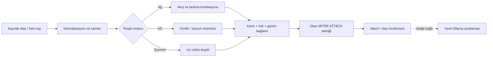

# AEGIS SOC — Tespit kuralları ve doğrulama sonuçları

> **[KOD]** Projenin incelenen Python kaynak kodunda görülen kural; **[LAB]** çalıştırılmış laboratuvar testi veya kaydedilmiş yapılandırma. Bir tespit **inceleme sinyalidir**; tek başına saldırının başarılı olduğunu kanıtlamaz.

## 1. Tespit hattı



[KOD] Network, AD ve Sysmon için ayrı mantık yürütülür. Olay zamanına göre gruplama ve özgün log kanıtı, analistin verdiği kararı açıklamak için korunur. MITRE tekniği eşlemesi ile LLM yorumu kesin saldırı tespiti veya otomatik engelleme komutu değildir.

## 2. Network Intelligence

| Tespit | Koşul / sınır |
|---|---|
| Dikey port tarama adayı | [KOD] Beş dakikada aynı kaynak-hedef/protokol için **en az 5 farklı hedef port** |
| Yatay tarama adayı | [KOD] Aynı kaynak/protokol/port için **en az 5 farklı kapsam içi hedef sistem** |
| İzlenen ağ kapsamı | [KOD] `SOC_MONITORED_NETWORKS`, varsayılan `10.10.0.0/16` |
| Gürültü azaltma | [KOD] Loopback, multicast, belirsiz adresler, `.255` broadcast, bazı yanıt paketleri ve `Initiated=false` kayıtları süzülür |
| Olay birleştirme | [KOD] Firewall / Suricata kanıtları kaynak-hedef bağlamında korelasyonla sunulur |
| Suricata severity | [KOD] Seviye 1=`critical`, 2=`high`, 3=`medium`; bilinmeyen=`info` |
| Lab imzası | [KOD] `KALI SECURITY TEST`, yanıltıcı yüksek risk üretmemek için `low` |
| Firewall engeli | [KOD] `BLOCK` / `REJECT` önemli olabilir; ancak her biri otomatik TI alarmı değildir |

[LAB] Kali'den DC01'e Nmap/SYN, DNS, SMB, LDAP, Kerberos ve ICMP testleri yapıldı. Suricata tarafında Nmap ve GPL ICMP imzaları gözlendi. DC01'in `.255` broadcast trafiği ve UDP/123 gibi olaylar her seferinde saldırı sayılmadı.

| Ağ algılama | Network logları |
|---|---|
|  |  |

## 3. Sysmon V3 — 11 tespit kuralı

[KOD] V3 tespit motoru uygun bir olay için **tek bir birincil kural** döndürür. Ayrı Sysmon olayları aynı kuralı tekrar tetikleyebilir. [LAB] WIN01'in son collector filtresi `1,3,8,10,11,13,22,25` şeklindeydi. ID 12 parser desteği bulunması, son WIN01 collector'ında aktif olduğu anlamına gelmez.

| Event ID | Kural | Olay koşulu | Risk | Canlı test durumu |
|---|---|---|---|---|
| 1 | `SYSMON-OFFICE-SHELL` | [KOD] Office adlı ebeveynden `cmd` / PowerShell açılması | High | [LAB] Office adlı **test süreci** ile doğrulandı; gerçek Office exploit'i değil |
| 1 | `SYSMON-SCRIPT-SHELL` | [KOD] `wscript` / `cscript` / `mshta` üzerinden shell | High | [LAB] Doğrulandı |
| 1 | `SYSMON-ENCODED-POWERSHELL` | [KOD] `-enc` / `-EncodedCommand` | Medium | [LAB] Doğrulandı |
| 1 | `SYSMON-POWERSHELL-EXECUTION` | [KOD] `Invoke-Expression`, `DownloadString` vb. şüpheli ifade | Medium | [LAB] Doğrulandı |
| 3 | `SYSMON-UNUSUAL-OUTBOUND-PORT` | [KOD] Genel IP ve `4444`/`5555`/`6666`/`1337` portları | Medium | [LAB] Gerçek TCP bağlantısıyla doğrulandı |
| 22 | `SYSMON-SUSPICIOUS-DNS` | [KOD] `.onion` veya `.invalid` sorgusu | Medium / Low | [LAB] `.invalid` testiyle doğrulandı |
| 8 | `SYSMON-REMOTE-THREAD-LSASS` | [KOD] LSASS hedefli uzak thread | High | [LAB] İzleme hazır, canlı enjeksiyon yapılmadı |
| 10 | `SYSMON-LSASS-ACCESS` | [KOD] LSASS hedefi ve `0x1fffff` / `0x1f3fff` / `0x1f0fff` erişim maskesi | High | [LAB] Windows erişimi reddetti; canlı alarm yok |
| 11 | `SYSMON-STARTUP-FILE` | [KOD] Başlangıç klasöründe dosya oluşturulması | Medium | [LAB] Doğrulandı |
| 13 | `SYSMON-AUTORUN-REGISTRY` | [KOD] Registry Run / RunOnce / Policies Explorer Run değeri | Medium | [LAB] Doğrulandı |
| 25 | `SYSMON-PROCESS-TAMPERING` | [KOD] Sysmon'un gerçek ID 25 olayı | High | [LAB] İzleme hazır; test aracı Defender tarafından engellendi |

[KOD] ID 10 için Task Manager ve Process Explorer gibi bilinen süreçler dışlama kapsamında olabilir. Salt-okunur LSASS sorgusunun her durumda HIGH alarmı oluşturması beklenmez. [LAB] Testlerde Defender/LSASS korumaları kapatılmadı.

| Sysmon görünümü | Olay incelemesi |
|---|---|
|  |  |

## 4. AD ve Windows Security tespitleri

[KOD] İzlenen olay kapsamı: `4624, 4625, 4672, 4719, 4720, 4724, 4726, 4728, 4729, 4732, 4738, 4740, 4756, 4768, 4769, 4771, 4776, 1102, 5145`. Bunların tamamının her test döneminde üretildiği iddia edilmez.

| Kural | Kısa açıklama |
|---|---|
| `brute_force` | [KOD] 10 dakikalık zaman penceresinde kümelenen başarısız girişler |
| `success_after_fail` | [KOD] Önce başarısız, ardından başarılı giriş örüntüsü |
| `password_spray` | [KOD] Birden çok kullanıcıya yayılan başarısız kimlik doğrulama |
| `user_enum` | [KOD] Kullanıcı adı deneme davranışı adayları |
| `lockout` | [KOD] Event 4740 ile hesap kilitlenmesi |
| `kerberoast` | [KOD] RC4 `0x17` Kerberos servis bileti / SPN ilişkili bulgular; T1558.003 |
| `asrep_roast` | [KOD] Ön kimlik doğrulamasıyla ilgili TGT bulguları; T1558.004 |
| `log_cleared` | [KOD] Security log temizlenmesi, Event 1102; T1070.001 |
| `priv_group` | [KOD] Hassas gruplarda üyelik değişiklikleri; T1098 |
| `new_account` | [KOD] Kullanıcı hesabı oluşturulması; T1136.001 |

[LAB] Hesap oluşturma, grup ekleme/çıkarma, başarısız giriş ve parola akışları önceki AD testlerinde ele alındı. [KOD] MITRE etiketleri tespit adaylarının yorumlanmasını kolaylaştırır; daha geniş V2 motorunda yaklaşık 49 teknik raporlanmış olsa da kesin sayı uygulanan sürümle değişebilir.

## 5. Identity analizi ve risk bağlamı

[KOD] `aegis.ad_inventory.v2` envanter şeması ile `priv_users`, `priv_groups`, `priv_edges` ilişkileri kullanılır. Bu veri, User 360 profiline, kritik grup analizine, risk bağlamına ve davranış zaman çizelgesine eklenir. Yetkili grup bağlamı Domain/Enterprise/Schema Admins, Administrators, Account Operators ve Server Operators adlarını, İngilizce/Türkçe çeşitlerini kapsar.


## 6. Doğrulama düzeyleri

| Düzey | Doğrulanan kapsam |
|---|---|
| Kaynak kodu | [KOD] 11 Sysmon kuralı, olay parmak izi, ağ taraması eşikleri, AD/MITRE mantığı |
| Gerçek uç nokta → SOC | [LAB] WIN01'den gelen **8 farklı** Sysmon alarmı |
| Gerçek ağ → SOC | [LAB] Kali testleriyle Suricata/filterlog ve ayrılmış test adresine engel |
| Tamamlanmamış canlı güvenlik testi | [LAB] ID 8, 10, 25 için LSASS/tampering davranışını gerçekten tetikleyen alarm |
| Veri toplama kısıtı | [KOD] Unbound açık block kararı SOC'ta doğrulanmış DNS block olarak taşınmıyor |

## 7. Son kontroller

```powershell
# Ana SOC bilgisayarında, salt-okunur sorgular
Invoke-RestMethod 'http://127.0.0.1:8088/api/events?mode=all&source=SYSMON&limit=50'
Invoke-RestMethod 'http://127.0.0.1:8088/api/network/detections'

# Kaynak kodu bulunan depoda kural testleri
.\.venv\Scripts\python.exe -m unittest discover -s tests -p 'test_sysmon_v3.py' -v
```

[KOD] Unit testin `ok` dönmesi tespit kodunun belirli senaryoyu işlediğini gösterir; gerçek Sysmon olayının collector'dan geçip Dashboard'a ulaştığını tek başına kanıtlamaz.

<!-- TODO: mevcut GPO/collector exportları, MITRE motorunun kesin sürüm snapshot'ı ve test sonuç rapor bağlantıları -->
