# AEGIS SOC build walkthrough

> This document tells the project story end to end: VM creation, zoning, OPNsense, AD, collectors, telemetry, detections, identity analytics and validation. It intentionally uses the actual lab screenshots that were provided for the GitHub release.

## 1. Build goal

[LAB] The goal was to build a **multi-layer SOC lab** rather than a single dashboard demo. That meant creating infrastructure that could generate evidence at several layers:

- network enforcement (OPNsense)
- IDS signatures (Suricata)
- DNS behavior (Unbound)
- Windows authentication and directory activity
- endpoint process activity (Sysmon)
- identity relationship context

[LAB] Instead of treating the dashboard as the project, the dashboard is the **last stage** of the project. The real work starts with segmented VMs, routing, AD, collectors and carefully validated test events.

## 2. VM deployment and role assignment

[LAB] The lab was split across VirtualBox VMs. The screenshots below are part of the documented evidence.

- OPNsense: gateway / segmentation / DNS / firewall
- DC01: Active Directory domain controller for `corp.local`
- WIN01: domain-joined user workstation
- Kali: network testing and collector node
- Windows SOC host: FastAPI/Uvicorn + SQLite + dashboard

| OPNsense | DC01 | WIN01 | Kali |
|---|---|---|---|
| 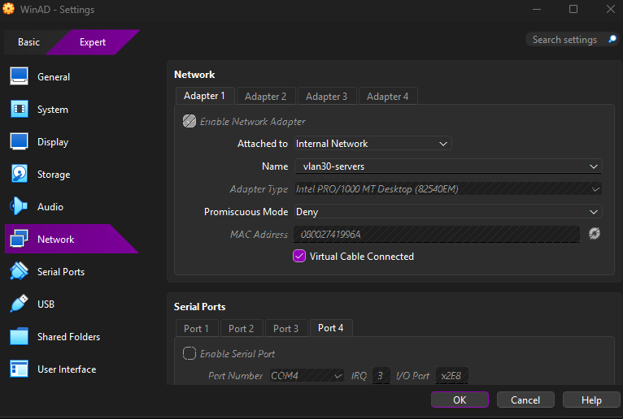 | 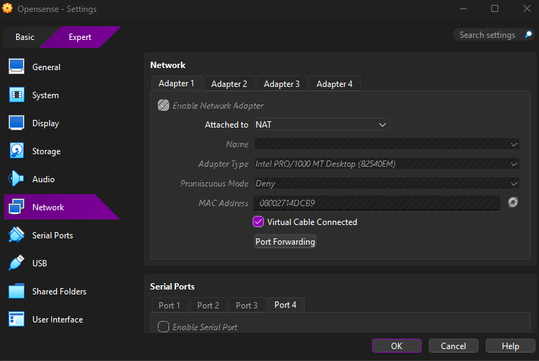 | 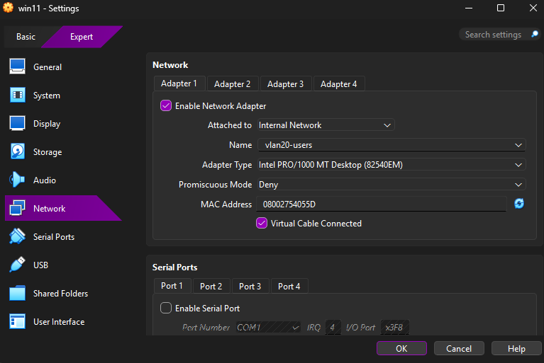 | 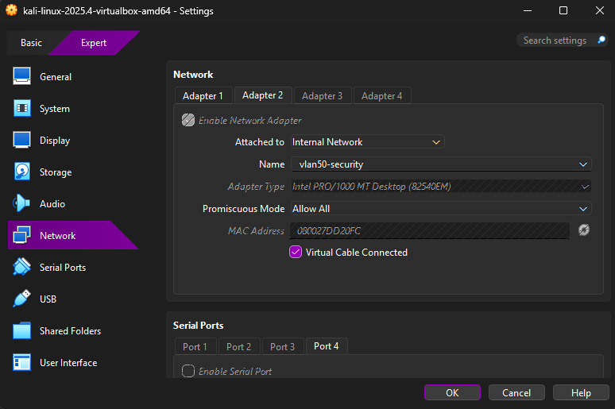 |

## 3. Network design and segmentation

[LAB] Four internal security zones were defined behind OPNsense.

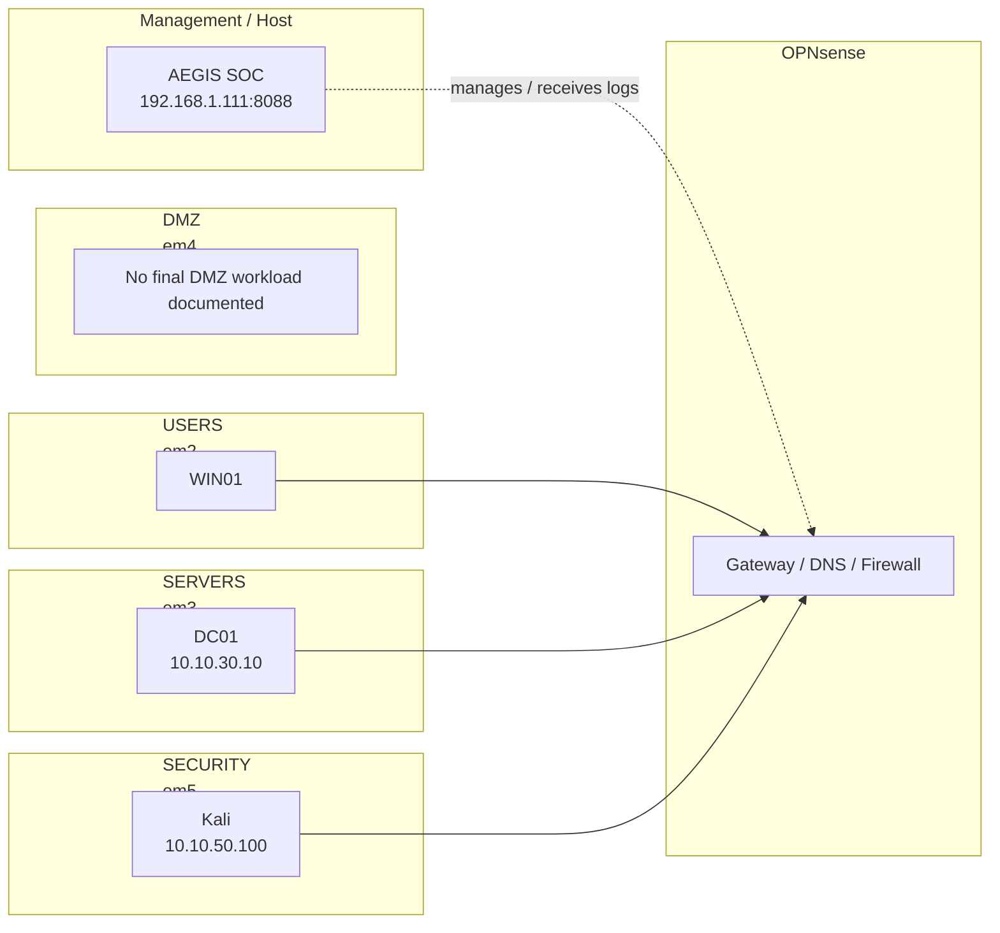

This design matters because it makes the later detection logic meaningful. A blocked packet is not just “a blocked packet”; it belongs to a zone boundary and therefore carries context.

Additional host-side evidence:

- 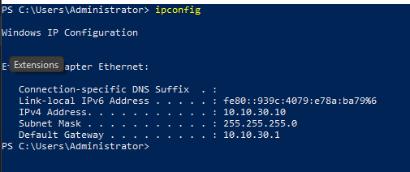
- 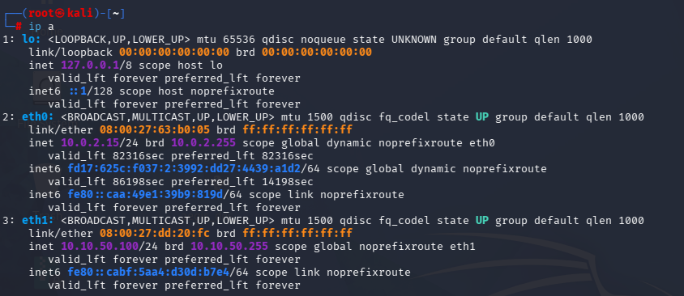

## 4. OPNsense configuration journey

[LAB] OPNsense was configured in several stages:

1. Assign interfaces to zoned networks
2. Set IP addresses/gateways
3. Stabilize DHCP/DNS services
4. Define inter-zone policy
5. Add TI/IP block rules
6. Observe DNS blocklist behavior
7. Forward logs for SOC analysis

| Interfaces | Services | Overview |
|---|---|---|
|  | 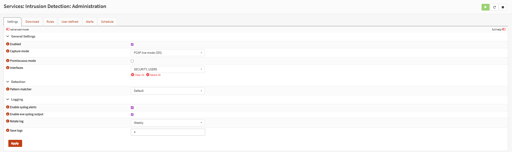 |  |

| Rule configuration | Firewall Live View | Firewall log detail |
|---|---|---|
| 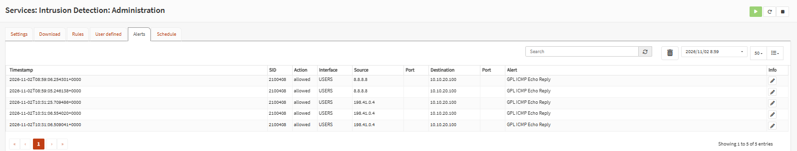 |  |  |

| Unbound monitoring | Unbound details | OPNsense dashboard |
|---|---|---|
|  |  | 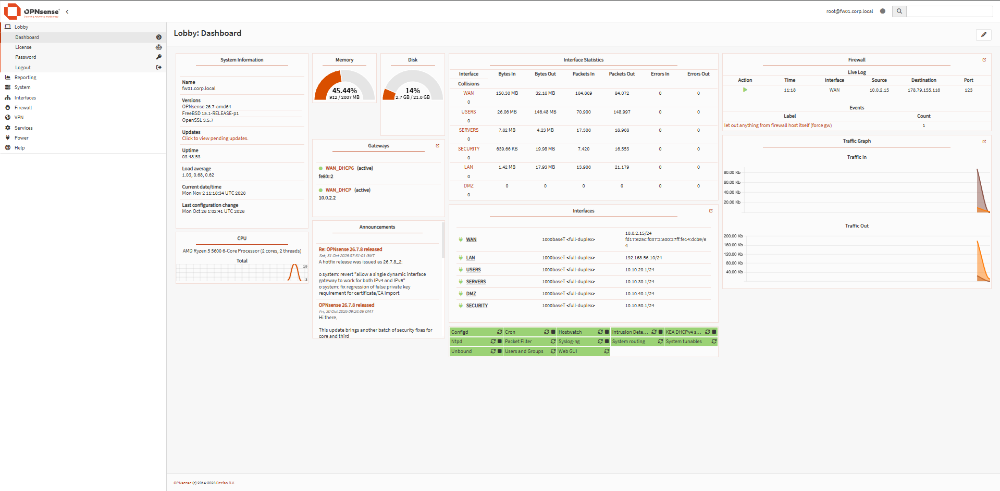 |

[LAB] The rule set enforced segmentation and allowed the lab to create controlled validation traffic. [KOD] On the SOC side, a firewall block only becomes a **verified TI block** when the rule UUID matches an approved mapping, preventing over-claiming.

## 5. Active Directory setup

[LAB] AD was not included just for screenshots. It was used to generate identity-relevant events and to support a later privilege model. Users and groups were arranged in business-style OUs and departmental groups.

| OU structure | Finance | HR |
|---|---|---|
|  | 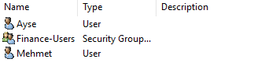 | 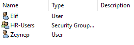 |

| IT | Management | Sales |
|---|---|---|
| 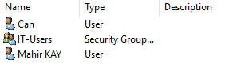 | 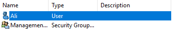 | 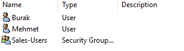 |

[LAB] The documented groups included Finance-Users, HR-Users, IT-Users, Management-Users and Sales-Users, alongside built-in administrative groups. [KOD] The detection layer later consumed AD events such as new account creation, group membership changes, Kerberos activity and authentication failures.

## 6. Collectors and ingest pipeline

[LAB] Telemetry was gathered from both Windows and Kali sides.

- Windows collectors: Windows Security + Sysmon
- Kali collector: OPNsense filterlog + Suricata EVE JSON + supporting network logs
- API ingest: `POST /api/events/ingest`

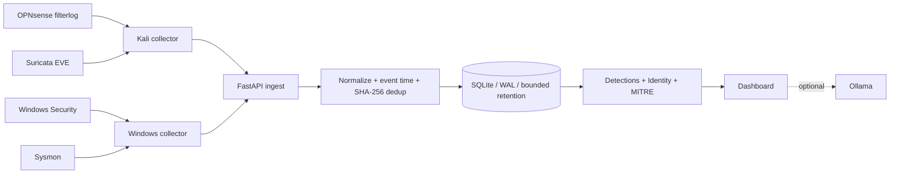

[LAB] Dashboard text historically referenced a “Kali Collector”; the exact collector code was not present in the repository snapshot, so documentation treats that as lab-observed deployment rather than code-proven source.

## 7. Sysmon expansion

[LAB] Sysmon was progressively expanded. Later work explicitly brought Event IDs `11` and `13` into the collector path so startup-file and autorun-registry events would appear in the dashboard. WIN01 validation later produced multiple live detections.

| Overview | Investigation | AI/detail panel |
|---|---|---|
|  | 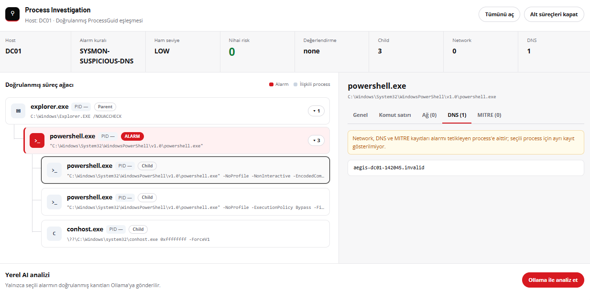 |  |

[KOD] Current Sysmon coverage documented for the project includes Event IDs `1, 3, 8, 10, 11, 12, 13, 22, 25` and rule families such as Office->shell, script->shell, encoded PowerShell, suspicious DNS, autorun and startup artifacts, and LSASS-related behavior.

## 8. Identity feature set

[LAB] A major second phase turned AD evidence into identity-centered analysis. Inventory, privilege evidence, risk context and behavior timeline components were added as read-only sidecars.

| AD Intelligence | Users list | Security workspace |
|---|---|---|
| 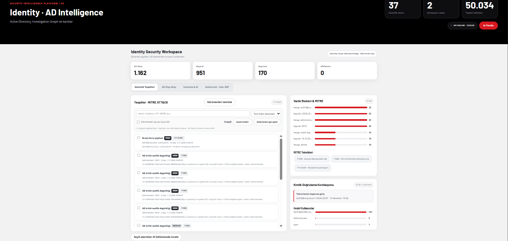 | 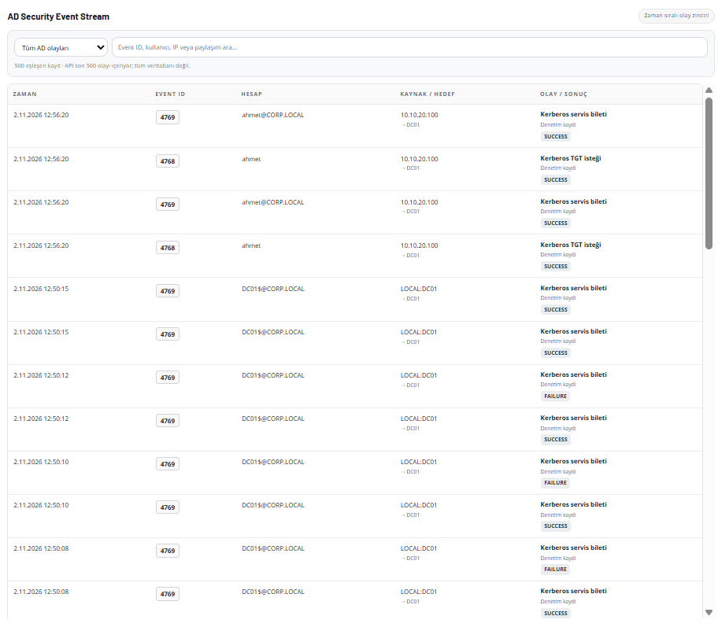 | 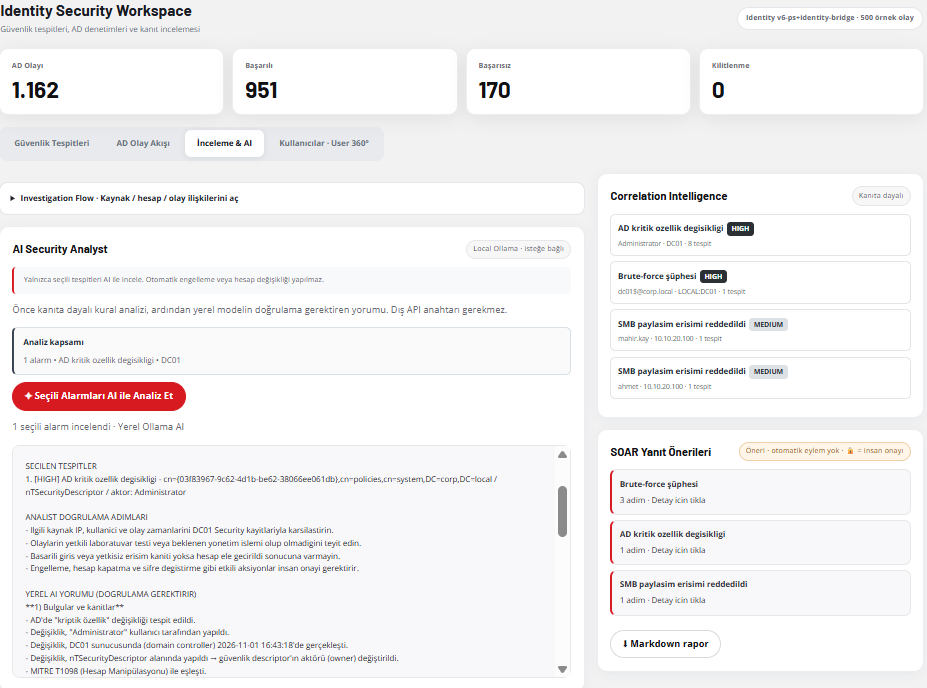 |

| Privilege memberships | User360 profile | Risk analysis |
|---|---|---|
| 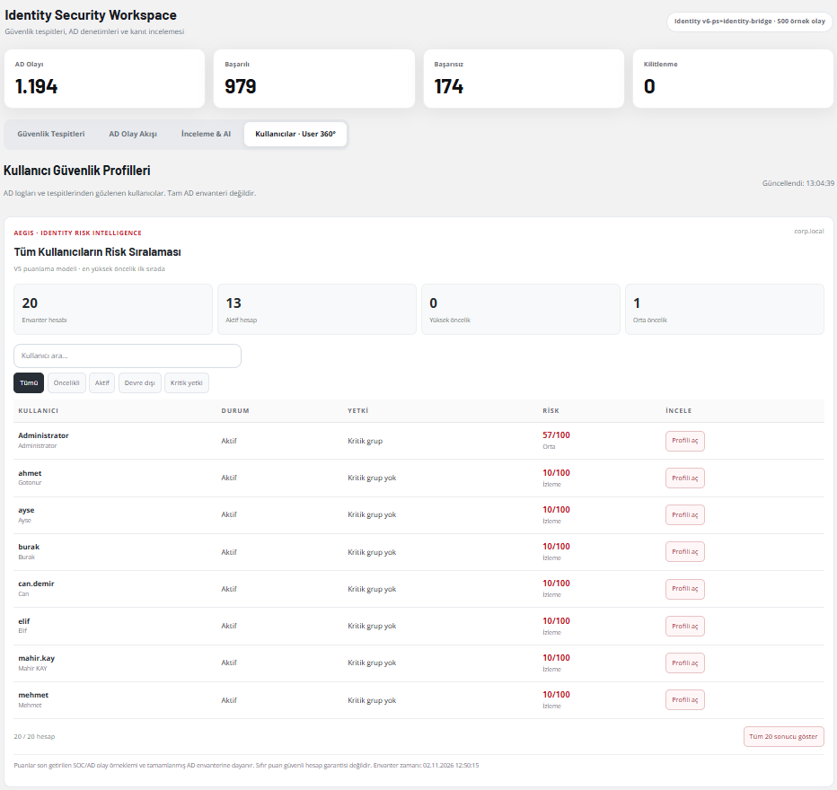 | 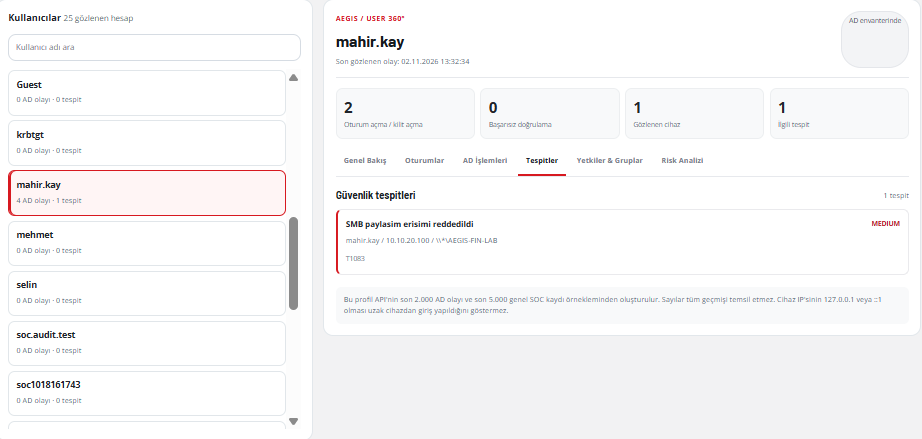 | 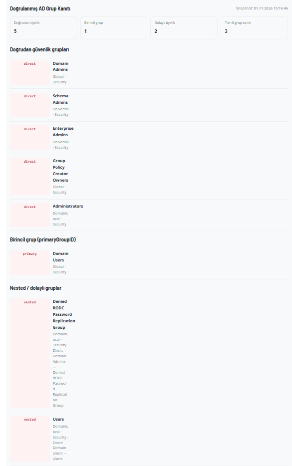 |

| User360 summary | Detailed identity view |
|---|---|
| 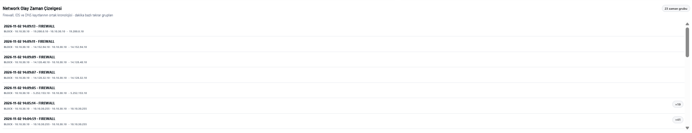 | 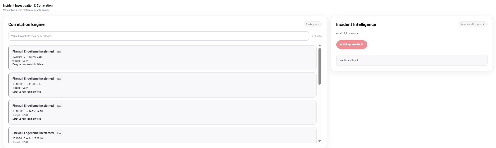 |

[KOD] This part now models inventory (`aegis.ad_inventory.v2`), privilege edges, nested memberships, critical-group context, authenticated privilege API controls, user risk context and short behavior timelines.

## 9. Analyst-facing dashboard

[LAB] The final dashboard is not a generic front end: it reflects the end result of the full build.

| Security command center | All logs |
|---|---|
| 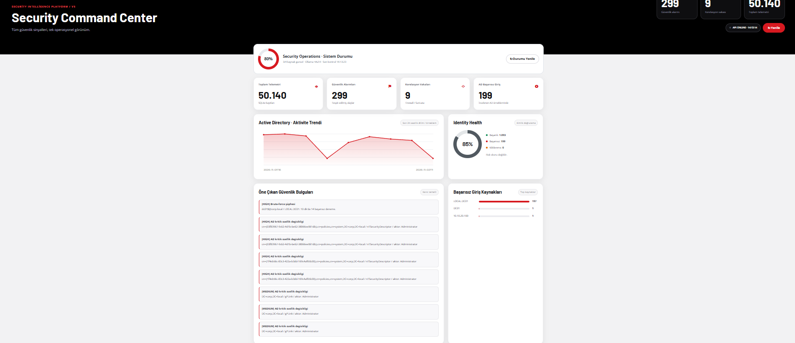 | 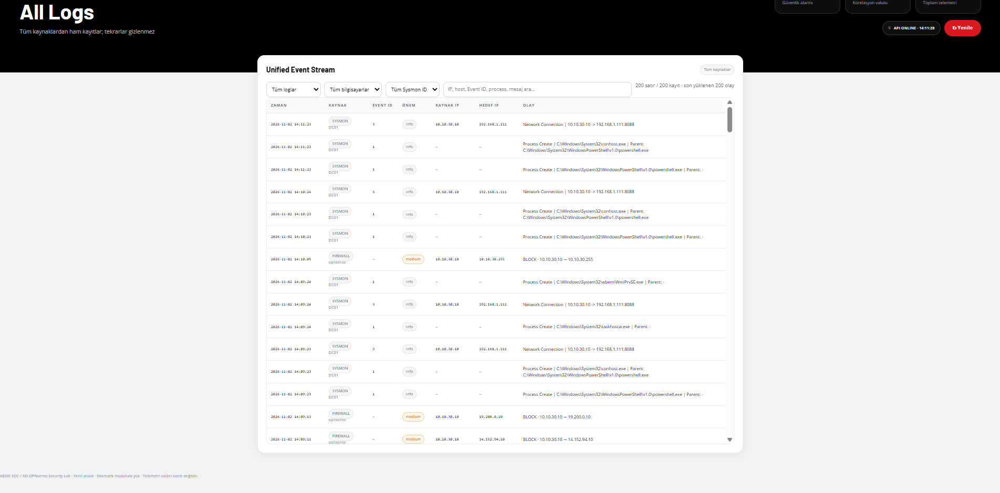 |

| Network detail | Network logs | Network summary |
|---|---|---|
|  | 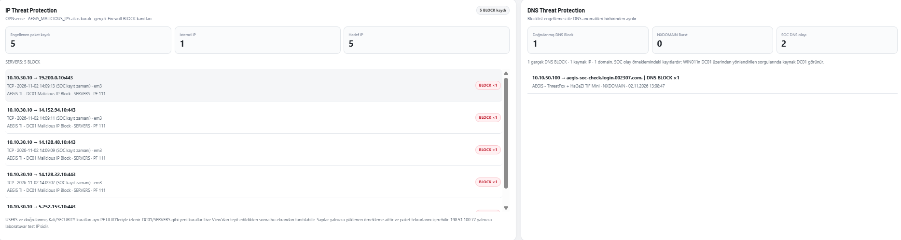 | 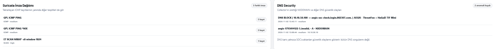 |

| CLI validation output |
|---|
| 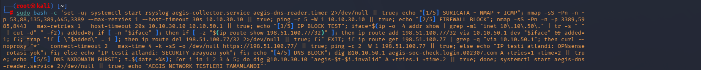 |

## 10. Validation examples

[LAB] Examples of validated project behavior included:

- firewall block evidence from SECURITY -> test IP traffic
- AD group add/remove events reflected in identity timeline and detections
- Sysmon PowerShell / DNS / startup / autorun detections on WIN01
- identity User360 and privilege evidence summaries
- differentiated handling of blocklist evidence vs NXDOMAIN bursts

## 11. What the project currently detects

See also `detections.md`, but in short:

- **Network**: vertical scan, horizontal scan, same-pair correlation, Suricata severity mapping, known-lab signature suppression
- **AD/Windows Security**: brute-force, spray, lockout, success-after-fail, Kerberoast / AS-REP roast indicators, log clear, new account, privileged group membership changes
- **Sysmon**: PowerShell, script host, Office shelling, suspicious DNS, startup/autorun, process access and tampering–related coverage
- **Identity**: group membership evidence, critical group presence, user-centric risk context, short behavior timelines

## 12. Scope and limitations

[LAB] AEGIS was designed to be honest about what it knows.

- It **monitors and analyzes**; it does not enforce policy itself.
- DNS blocklist decisions are not yet fully promoted by the collector into first-class “verified DNS block” counters.
- Dashboard findings should be read as analyst review evidence, not absolute proof of compromise.

## 13. Related documents

- `README.md`
- `README.tr.md`
- `architecture.md`
- `opnsense-setup.md`
- `active-directory-setup.md`
- `blocklists.md`
- `detections.md`
- `data-flow.md`
- `screenshots/README.md`
