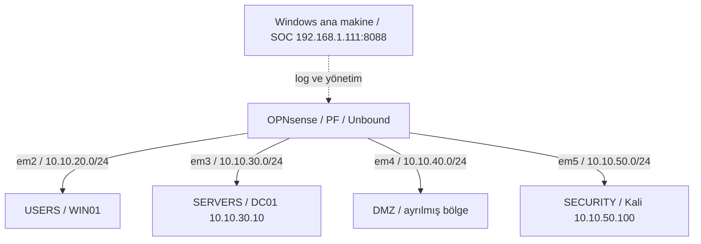
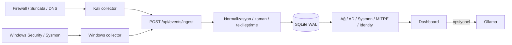

# AEGIS SOC — Laboratuvarın sıfırdan kurulması ve geliştirme süreci

> **Bu belge projenin kurulum sırasını anlatır.** Sanal makinelerden başlayan çalışma; ağ segmentasyonu, Active Directory, güvenlik politikaları, collector'lar, korelasyon kuralları ve SOC ekranıyla tamamlandı. **[LAB]** laboratuvarda uygulanan/gözlenen, **[KOD]** kaynak kodunda doğrulanan bilgiyi gösterir.

## 1. İlk karar: Tek makine yerine ayrı güvenlik bölgeleri

[LAB] Amaç yalnızca bir web arayüzü oluşturmak değildi. Farklı kaynaklardan gelen olaylar arasında ilişki kurabilmek için **gerçek log üreten bir sanal şirket ağı** kuruldu. Bir kullanıcı PC'sindeki süreç, DC01'deki hesap işlemi, firewall engeli ve Suricata imzası farklı kaynaklar olarak korunacaktı.

Bu nedenle laboratuvar şu rollere ayrıldı:

| Sistem | Rol | Yerleşim |
|---|---|---|
| OPNsense | Güvenlik duvarı, yönlendirme, Unbound | Bölge geçitleri |
| DC01 | Active Directory, domain DNS | SERVERS |
| WIN01 | Domain'e alınmış Windows 11 istemci | USERS |
| Kali | Kontrollü ağ/saldırı testleri ve network collector | SECURITY |
| Windows ana makine | AEGIS SOC API ve Dashboard | Yönetim ağı |

## 2. VirtualBox: Sanal makineler ve adaptörler

[LAB] OPNsense, Windows Server, Windows 11 ve Kali ayrı sanal makineler olarak hazırlandı. Her makinenin sanal ağ adaptörü görevine uygun ağa bağlandı. WAN/yönetim ve güvenlik bölgesi bağlantıları birbirinden ayrıldı.

| OPNsense adaptör ayarı | DC01 adaptör ayarı |
|---|---|
|  |  |

| WIN01 adaptör ayarı | Kali adaptör ayarı |
|---|---|
|  |  |

[LAB] Ekran görüntüleri, sanal ağların birbirine karışmadan ayarlandığını göstermek için eklendi. Eksik sürüm veya donanım kaynak bilgileri tahmin edilmedi; bu laboratuvarda DMZ için ayrı bir uygulama sunucusu son durumda kurulmadı.

## 3. Subnet, güvenlik bölgesi ve IP planı

[LAB] Bir şirket ağını taklit etmek için her işlev farklı subnet'e ayrıldı. Bu ayrımın amacı makineleri tamamen iletişimsiz bırakmak değil, **hangi hizmetler için bağlantı kurulabileceğini firewall kurallarıyla belirlemekti**.



[LAB] Kullanıcı bilgisayarı AD sunucusuna erişebilirken, Kali'nin test trafiğinin ayrıntıları SECURITY arayüzünde denetlenebildi. Her subnet için kural, yön, izin/engel ayrımı ve kaynak/hedef bilgilerinin anlaşılır olması projenin temel gereksinimlerindendi.


| Bölge | Ağ | Arayüz | Makine |
|---|---|---|---|
| USERS | `10.10.20.0/24` | `em2` | WIN01 (`.100`/`.101` geçmiş kayıtlarda) |
| SERVERS | `10.10.30.0/24` | `em3` | DC01 `10.10.30.10` |
| DMZ | `10.10.40.0/24` | `em4` | Ayrılmış ağ; kalıcı sunucu yok |
| SECURITY | `10.10.50.0/24` | `em5` | Kali `10.10.50.100`, gateway `.1` |
| Yönetim | `192.168.1.x` | Ayrı | SOC ana makine `.111:8088` |

## 4. OPNsense arayüzlerinin tanımlanması

[LAB] OPNsense üzerinde önce arayüzler eşleştirildi. USERS, SERVERS, DMZ ve SECURITY bölge adları, trafiğin hangi tarafta olduğunu anlaşılır hâle getirdi. Sonraki kurallar bu adlandırma üzerinden yönetildi.

| OPNsense arayüz menüsü | Kurulum / servis ekranı |
|---|---|
|  |  |


[LAB] Herhangi bir sistem internete veya farklı bir segmente ulaşamadığında önce gateway ve yönlendirme tablosuna, sonra ilgili PF kuralına bakıldı. Bu sıranın korunması, hatanın DNS mi, rota mı yoksa politika mı olduğunu ayırmayı sağladı.

## 5. DHCP/DNS çakışmasının giderilmesi

[LAB] KEA DHCP ilk kurulumda bazı arayüzlerde dinleme/bind hatası verdi. `10.10.30.1:67` ve `10.10.40.1:67` için görülen çakışma düzeltilirken `dnsmasq` kapatıldı, KEA etkinleştirildi. Sonrasında IP atama ve ağ erişimi yeniden kontrol edildi.

[LAB] Domain istemcileri için DNS seçiminde DC01 (`10.10.30.10`) esas alındı. Böylece WIN01, `corp.local` çözümlemesini doğru AD altyapısı üzerinden yapabildi. Daha sonra DNS olaylarında kaynak olarak DC01 görünmesinin nedeni de bu yönlendirme ilişkisiyle değerlendirildi.

```powershell
# DC01'de ağ doğrulama
ipconfig /all
Get-Service DNS,NTDS
```

```bash
# Kali'de yönlendirme ve DNS doğrulama
ip route
dig @10.10.30.10 corp.local A +noall +answer
```

| DC01 IP çıktısı | Kali yönlendirme bilgisi |
|---|---|
|  |  |

## 6. Active Directory: Domain ve OU yapısı

[LAB] Windows Server 2019'a AD DS kuruldu, sunucu domain controller olarak yükseltildi ve `corp.local` oluşturuldu. WIN01, USERS ağında olmasına karşın gerekli DNS/AD erişimiyle domain'e katıldı.

[LAB] Kurumsal bir örneğe yakın olması için kullanıcılar Finance, HR, IT, Management ve Sales altında gruplandırıldı. Kayıtlarda Domain Admins, Enterprise Admins ve benzeri hassas yönetici grupları da ayrıca değerlendirildi.

| OU ağacı | Finance | HR |
|---|---|---|
|  |  |  |

| IT | Management | Sales |
|---|---|---|
|  |  |  |

[LAB] Bu yapı yalnızca kullanıcıları ayırmak için değil; sonradan **hesap açma/silme, üyelik ekleme/çıkarma, parola sıfırlama ve yetki denetimini** SOC'a gerçek AD kayıtları olarak taşıyabilmek için kullanıldı.

## 7. Bölgesel firewall kuralları

[LAB] OPNsense'te servisler çalışır duruma geldikten sonra segmentler arasındaki erişim kuralları yazıldı. İstemci → AD trafiği, Kali → sunucu testleri ve internet yönlü trafik farklı amaçlara sahip olduğundan ayrı ele alındı.

| Kural ekranı | Canlı filterlog | Bloklanan olay ayrıntısı |
|---|---|---|
|  |  |  |

[LAB] IP kara listesi politikalarında `AEGIS TI - Malicious IP Block`, `AEGIS TI - DC01 Malicious IP Block`, `AEGIS TI - Kali Malicious IP Block` etiketleri kullanıldı. [KOD] SOC, bir olayın TI engeli olduğunu söylemeden önce kural UUID'sinin onaylı eşlemeye uymasını arar.

[LAB] Somut doğrulama örneği: Kali `10.10.50.100` → `198.51.100.77` (ayrılmış TEST-NET-2 adresi) TCP ve ICMP trafiğinin OPNsense tarafından engellenmesi. Böylece yalnızca soket hatası değil, **gerçek firewall BLOCK kanıtı** incelendi.

## 8. Suricata IDS'in eklenmesi

[LAB] OPNsense üzerinde Suricata ile ağ katmanına ikinci bir görüş açısı eklendi. Kali'den DC01'e Nmap/SYN, ICMP, SMB, Kerberos ve LDAP testleri yapıldı. Firewall PASS/BLOCK sonucuna ek olarak Suricata EVE JSON imzalarının SOC'ta görünüp görünmediği kontrol edildi.

[LAB] Önceki oturumlarda GPL ICMP PING, Nmap ve `KALI SECURITY TEST` gibi imzalar gözlendi. [KOD] Bilinen laboratuvar imzası low risk sınıflandırılır; tüm IDS alarmları otomatik saldırı doğrulaması sayılmaz.

```bash
# İzinli laboratuvar hedefinde örnek kontrol
nmap -sS -Pn -n -p 53,88,135,389,445 --max-retries 1 10.10.30.10
```


## 9. Unbound ve DNS kara listeleri

[LAB] Unbound istatistikleri ve sorgu ayrıntıları OPNsense ekranından izlendi. DNS testlerinde NXDOMAIN davranışı ile politika engeli birbirinden ayrıldı. WIN01 sorgularının DC01 üzerinden gelmesi, kaynak IP yorumunda dikkate alındı.

| Unbound izleme | Unbound ayrıntılar |
|---|---|
|  |  |

[KOD] Mevcut DNS collector'ının açık Unbound block karar alanını SOC'a tam taşımaması bilinen veri kısıtıdır; bu nedenle Dashboard'da her NXDOMAIN "kara liste block" diye gösterilmez.

## 10. Kali: Network collector kurulumu

[LAB] OPNsense loglarını doğrudan uygulamadan okumak yerine Kali üzerinde rsyslog ile karşılayan bir collector katmanı kuruldu. Geçmiş kurulumda UDP `514`, `/var/log/opnsense/firewall.log`, `/var/log/opnsense/dns.log`, `/var/log/opnsense/suricata.log` ve `/opt/ad-opnsense-soc/collector.py` kullanıldı.

[LAB] Collector'ın görevi logları almak, kaynağa uygun hâle getirmek ve SOC'un HTTP ingest endpoint'ine göndermekti. Sonraki çalışmalarda `aegis-collector.service` ve `aegis-dns-reader.timer` hizmetleri kullanılarak elle terminal açık bırakma ihtiyacı azaltıldı.

```bash
systemctl is-active rsyslog aegis-collector.service aegis-dns-reader.timer
sudo journalctl -u aegis-collector.service -n 20 --no-pager
```

[LAB] Bazı eski testlerde ağ logları ulaşıyor görünmesine rağmen Dashboard'da yalnızca düşük değerli UDP/123 ve broadcast olayları çıkıyordu. Firewall `pass`/`block` ayrımı ve severity eşlemeleri iyileştirilerek anlamlı olayların görünmesi sağlandı.

## 11. DC01 ve WIN01 için Windows collector

[LAB] Windows Security olayları ile Sysmon Operational logu ayrı Windows collector mekanizmalarıyla SOC'a iletildi. WIN01 Sysmon tarafında ilk olarak `1,3,22`; ilerleyen aşamada Startup `11`, Registry `13`, sonra da LSASS/tampering türleri `8,10,25` izleme kapsamına alındı.

[KOD] AEGIS, özgün XML verisinden görüntü, süreç komutu, hedef dosya, Registry hedefi ve DNS sorgu alanlarını çıkarıp ilgili kurallarla karşılaştırır.

| Sysmon genel ekran | Süreç analizi | Olay ayrıntısı |
|---|---|---|
|  |  |  |

[LAB] WIN01 üzerinde **sekiz ayrı tespit kuralı** gerçek sistem olaylarıyla AEGIS'e ulaştı: Office adlı test süreci üzerinden CMD, script shell, encoded PowerShell, şüpheli PowerShell ifadesi, `.invalid` DNS, Startup dosyası, Registry autorun ve olağandışı dış port. ID 8/10/25 için izleme ve kod testleri yapıldı; gerçek zararlı müdahale denemeleriyle alarm doğrulanmadı.

## 12. FastAPI, SQLite ve SOC arayüzü

[KOD] Python uygulaması `POST /api/events/ingest` üzerinden olay kabul eder, `parser.py` ile normalize eder, olay zamanını ve SHA-256 parmak izini değerlendirir, SQLite WAL içine saklar. Ağ, AD, Sysmon, MITRE ve Identity görünümleri aynı kanıtların farklı analiz katmanlarını sağlar.



[KOD] AEGIS güvenlik sistemlerine müdahale etmez. Algılanan olayları kaydeder, ilişkileri hesaplar ve analistin incelemesini sağlar. [LAB] Ana Windows makinesindeki servis `192.168.1.111:8088` üzerinden kullanıldı.

## 13. Identity · AD Intelligence geliştirmeleri

[LAB] Sonraki geliştirme aşamasında yalnızca olay listesi değil, **kimlik odaklı inceleme** öne çıkarıldı. AD envanteri, yetki ilişkileri, iç içe grup üyelikleri, kritik gruplar, User 360, risk bağlamı ve davranış zaman çizelgesi geliştirildi.

| AD Intelligence | Kullanıcı listesi | Identity güvenlik görünümü |
|---|---|---|
|  |  |  |

| Yetki üyelikleri | User 360 | Risk analizi |
|---|---|---|
|  |  |  |

| Kullanıcı 360 özeti | Kimlik olay ayrıntısı |
|---|---|
|  |  |

[KOD] Envanter şeması `aegis.ad_inventory.v2`, yetki yan katmanı `priv_users/priv_groups/priv_edges` ile tanımlandı. [LAB] Laboratuvar testi için 20 kullanıcı ve 57 grup içeren bir yetki envanteri incelendi; bu sayılar sistemde sabit sınır değildir.

## 14. Son Dashboard ve gerçek olay doğrulaması

| SOC komuta merkezi | Tüm loglar |
|---|---|
|  |  |

| Network analizi | Network logları | Ağ tespit özeti |
|---|---|---|
|  |  |  |

| Terminal doğrulama kaydı |
|---|
|  |

[LAB] Son doğrulamada firewall engelleri, Suricata olayları, Windows Security/AD hareketleri ve Sysmon uyarıları ayrı ayrı incelendi. [KOD] Sistem, saldırı adayı ile doğrulanmış kötü amaçlı etkinlik kavramlarını birbirine eşitlemez.

## 15. Sonuç ve belgeleme sınırı

[LAB] Kurulumu tamamlanan bu laboratuvar; **sanal ağ → güvenlik duvarı → AD/domain → test makinesi → collector'lar → SOC tespitleri → analist ekranı** zincirini çalıştırdı. [KOD] Uygulama salt-okunur izleme/analiz yapar; bloke işlemleri OPNsense ve mevcut Windows güvenlik ilkelerine aittir.

**Açıkça ayrılmış doğrulama sınırları:** Unbound'un kesin block karar alanı collector'da tam taşınmıyor; Sysmon ID 8/10/25 için zararlı davranışı gerçekten üreten canlı alarm testi yapılmadı. Bunlar laboratuvarın kurulmadığı anlamına gelmez; veri/tetikleme kanıtının kapsamını tanımlar.

<!-- TODO: OPNsense kesin sürümü, etkin Suricata IPS/IDS modu, tüm firewall UUID listesi -->
<!-- TODO: kullanılacaksa resmi lisans dosyası ve güncel servis exportları -->
