# AEGIS SOC — Ekran görüntüleri ve görsel kanıt kataloğu

Bu katalog, GitHub deposuna eklenen **39 gerçek laboratuvar ekran görüntüsünün tamamını** listeler. Görseller sadece Dashboard'a ait değildir: VirtualBox adaptörleri, OPNsense arayüzleri, firewall kural ve logları, Unbound, Active Directory, Identity ve Sysmon da yer alır.

**[LAB]** Bu dosyalar kullanıcı tarafından sağlanan laboratuvar görüntüleridir. Ekrandaki olay veya IP'nin görünmesi, ayrıca doğrulanmadıkça o olayın kötü amaçlı olduğunu kanıtlamaz. Orijinal yazılım arayüzlerindeki İngilizce teknik etiketler görüntü üzerinde korunmuş, belge açıklamaları Türkçe yazılmıştır.

## 1. Sanal makine ve ağ kurulum kanıtları

| Görsel | Açıklama |
|---|---|
| [`virtualbox-opnsense-network.png`](virtualbox-opnsense-network.png) | [LAB] OPNsense sanal makinesinin ağ adaptörleri |
| [`virtualbox-dc01-network.png`](virtualbox-dc01-network.png) | [LAB] DC01 sanal makinesinin ağ adaptörü |
| [`virtualbox-win01-network.png`](virtualbox-win01-network.png) | [LAB] WIN01 sanal makinesinin ağ adaptörü |
| [`virtualbox-kali-network.png`](virtualbox-kali-network.png) | [LAB] Kali sanal makinesinin ağ adaptörü |
| [`network-lab-topology.png`](network-lab-topology.png) | [LAB] AEGIS laboratuvarının ağ topolojisi |
| [`dc01-ipconfig.png`](dc01-ipconfig.png) | [LAB] DC01 üzerinden IP yapılandırması doğrulaması |
| [`kali-routing-table.png`](kali-routing-table.png) | [LAB] Kali yönlendirme tablosu |

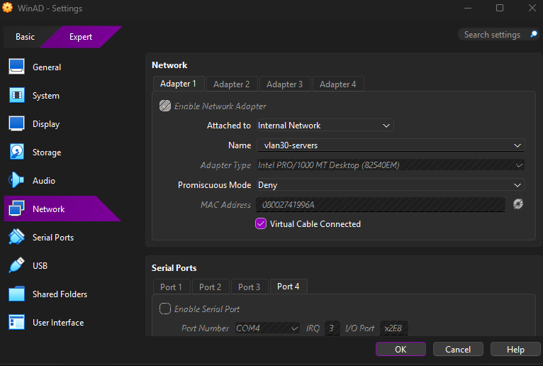

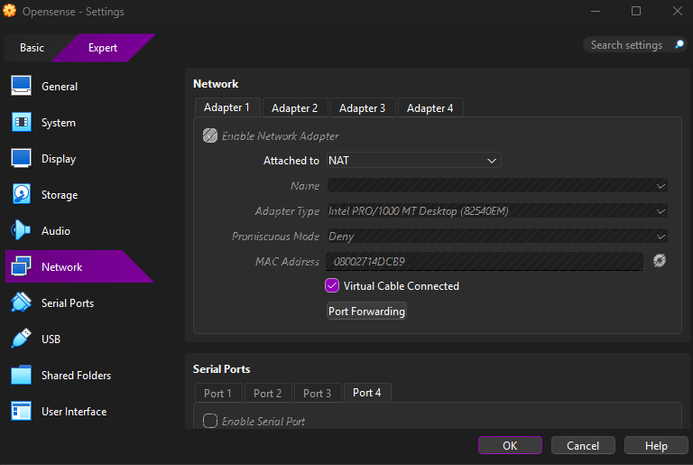

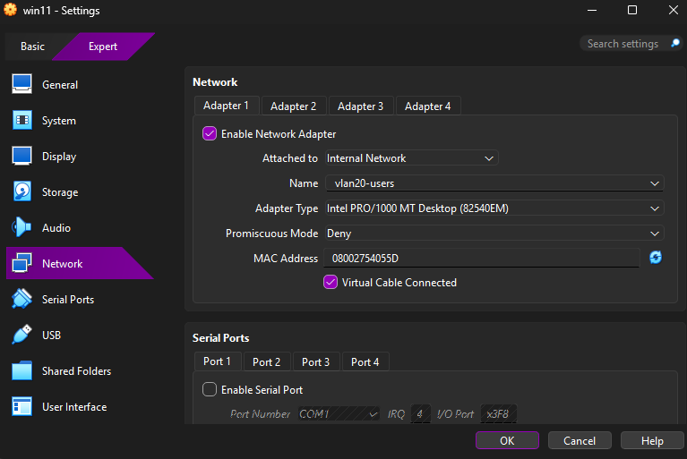

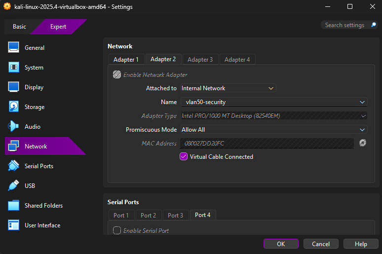

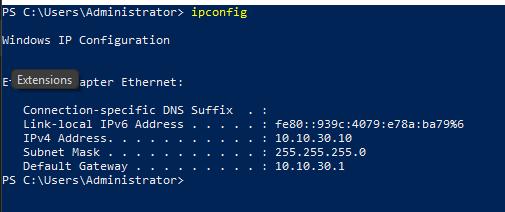

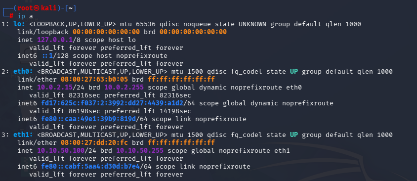

## 2. OPNsense yapılandırması, firewall ve DNS

| Görsel | Açıklama |
|---|---|
| [`opnsense-interface-assignments.png`](opnsense-interface-assignments.png) | [LAB] OPNsense arayüz/bölge atamaları |
| [`opnsense-services-status.png`](opnsense-services-status.png) | [LAB] OPNsense servis ve çalışma durumu |
| [`opnsense-overview.png`](opnsense-overview.png) | [LAB] OPNsense sistem genel görünümü |
| [`opnsense-rule-config.png`](opnsense-rule-config.png) | [LAB] Firewall kural yapılandırma ekranı |
| [`opnsense-firewall-liveview.png`](opnsense-firewall-liveview.png) | [LAB] Canlı firewall olay kayıtları |
| [`opnsense-firewall-log-detail.png`](opnsense-firewall-log-detail.png) | [LAB] Tekil firewall olayının ayrıntısı |
| [`opnsense-unbound-monitoring.png`](opnsense-unbound-monitoring.png) | [LAB] Unbound DNS izleme ve istatistikleri |
| [`opnsense-unbound-details.png`](opnsense-unbound-details.png) | [LAB] Unbound sorgu / engel inceleme ekranı |
| [`opnsense-dashboard-final.png`](opnsense-dashboard-final.png) | [LAB] Son OPNsense Dashboard görünümü |

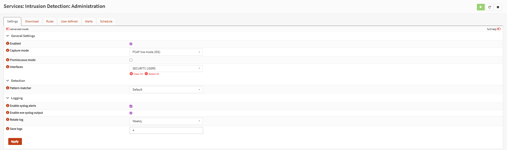

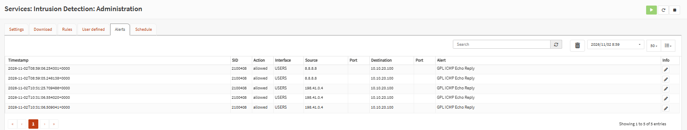

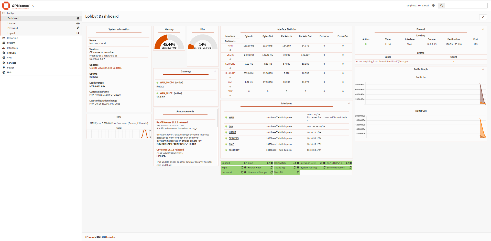

## 3. Active Directory organizasyon birimleri

| Görsel | Açıklama |
|---|---|
| [`ad-ou-structure.png`](ad-ou-structure.png) | [LAB] CORP-Users OU yapısı |
| [`ad-finance-ou.png`](ad-finance-ou.png) | [LAB] Finance birimi ve grup görünümü |
| [`ad-hr-ou.png`](ad-hr-ou.png) | [LAB] HR birimi ve grup görünümü |
| [`ad-it-ou.png`](ad-it-ou.png) | [LAB] IT birimi ve grup görünümü |
| [`ad-management-ou.png`](ad-management-ou.png) | [LAB] Management birimi ve grup görünümü |
| [`ad-sales-ou.png`](ad-sales-ou.png) | [LAB] Sales birimi ve grup görünümü |

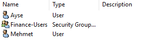

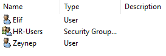

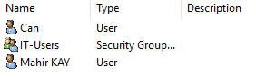

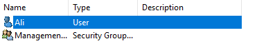

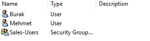

## 4. Identity ve yetki incelemesi

| Görsel | Açıklama |
|---|---|
| [`identity-ad-intelligence.png`](identity-ad-intelligence.png) | [LAB] Identity · AD Intelligence ana ekranı |
| [`identity-users-list.png`](identity-users-list.png) | [LAB] AD kullanıcı listesi |
| [`identity-security-intelligence.png`](identity-security-intelligence.png) | [LAB] Identity güvenlik inceleme görünümü |
| [`identity-privilege-memberships.png`](identity-privilege-memberships.png) | [LAB] Doğrudan ve iç içe yetki üyelikleri |
| [`identity-user360-profile.png`](identity-user360-profile.png) | [LAB] User 360 profil görünümü |
| [`identity-user360-risk-analysis.png`](identity-user360-risk-analysis.png) | [LAB] Kimlik risk bağlamı incelemesi |
| [`soc-identity-user360-summary.png`](soc-identity-user360-summary.png) | [LAB] Kullanıcı 360 özet görünümü |
| [`soc-identity-details.png`](soc-identity-details.png) | [LAB] SOC kimlik olay ayrıntısı |

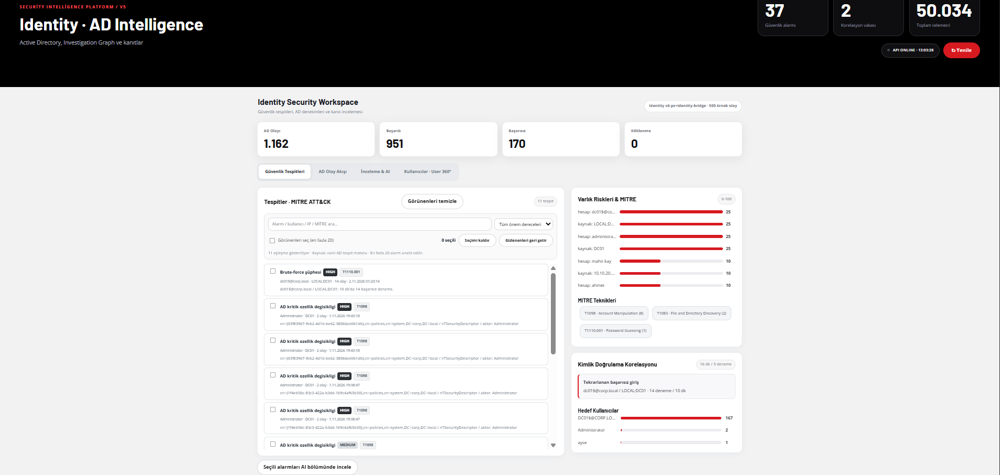

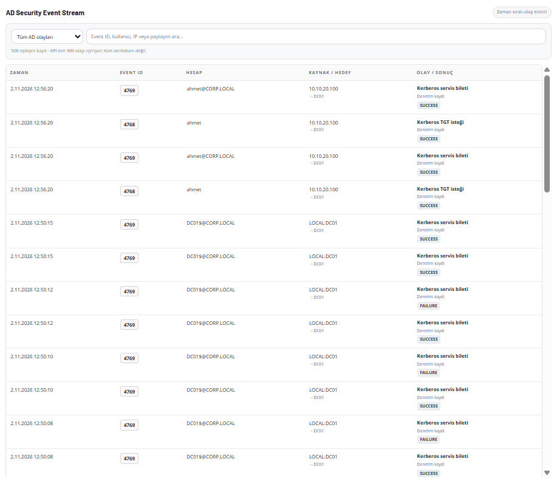

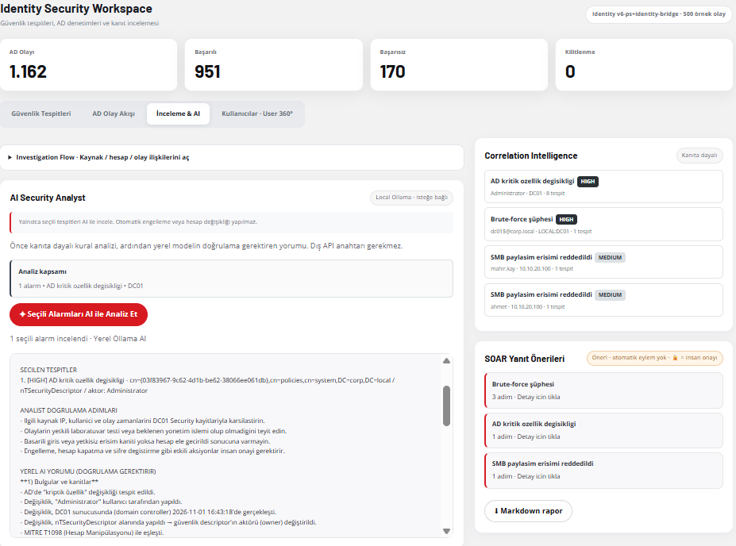

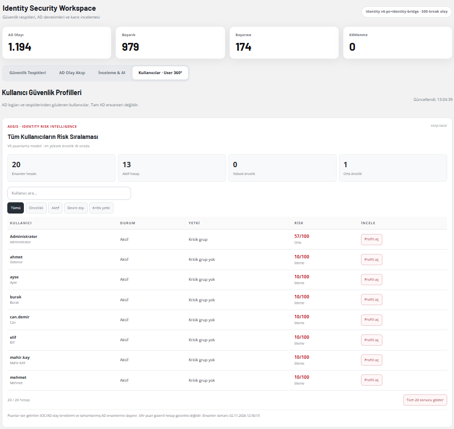

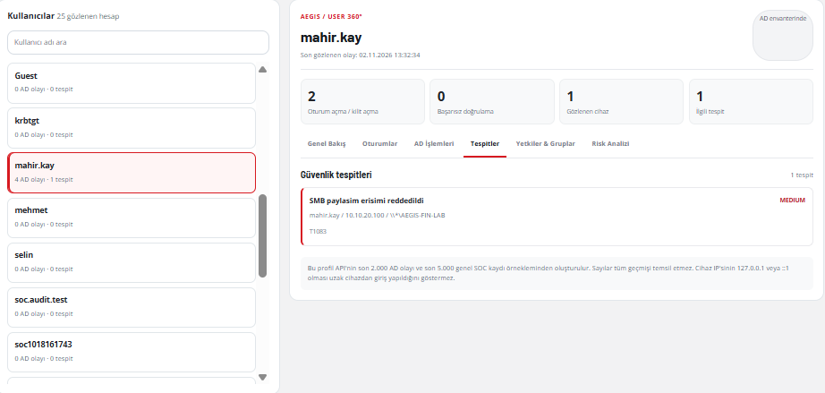

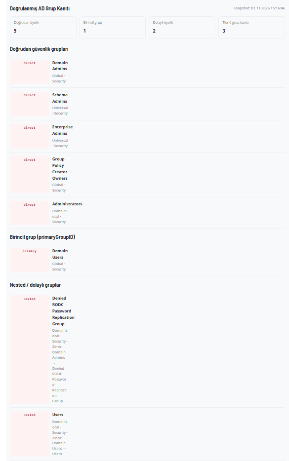

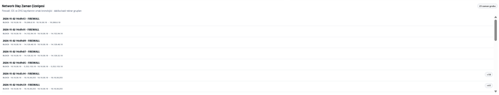

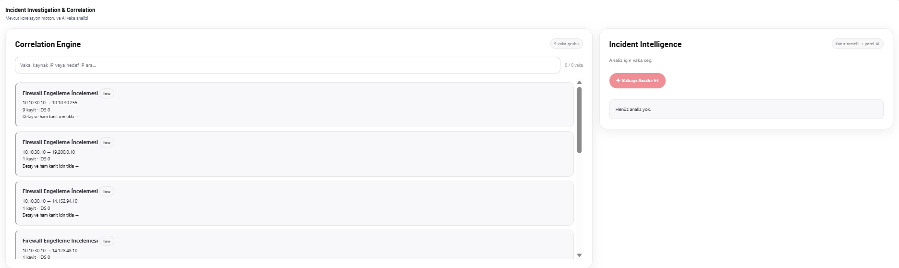

## 5. Sysmon ve uç nokta incelemesi

| Görsel | Açıklama |
|---|---|
| [`sysmon-endpoint-overview.png`](sysmon-endpoint-overview.png) | [LAB] Sysmon uç nokta genel görünümü |
| [`sysmon-process-investigation.png`](sysmon-process-investigation.png) | [LAB] Süreç inceleme ağacı ve kanıtlar |
| [`sysmon-analysis-detail.png`](sysmon-analysis-detail.png) | [LAB] Sysmon olay inceleme ayrıntısı |

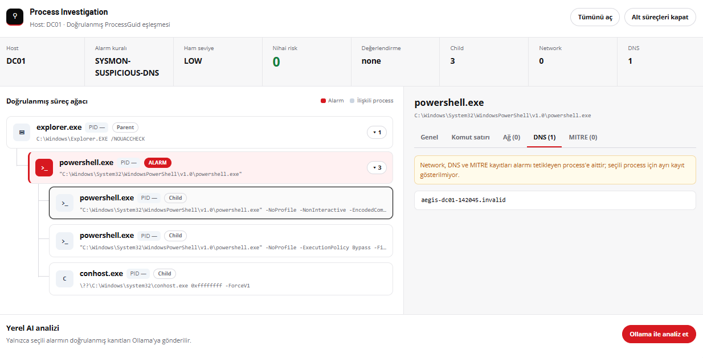

## 6. SOC Dashboard ve test kayıtları

| Görsel | Açıklama |
|---|---|
| [`soc-security-command-center.png`](soc-security-command-center.png) | [LAB] AEGIS Güvenlik Komuta Merkezi |
| [`soc-all-logs.png`](soc-all-logs.png) | [LAB] Tüm log kayıtları ekranı |
| [`soc-network-detail.png`](soc-network-detail.png) | [LAB] Network tespit olay ayrıntısı |
| [`soc-network-logs.png`](soc-network-logs.png) | [LAB] Network log listesi |
| [`soc-network-detection-summary.png`](soc-network-detection-summary.png) | [LAB] Ağ tespitleri özeti |
| [`soc-cli-validation-output.png`](soc-cli-validation-output.png) | [LAB] Terminalde gerçekleştirilen test doğrulaması |

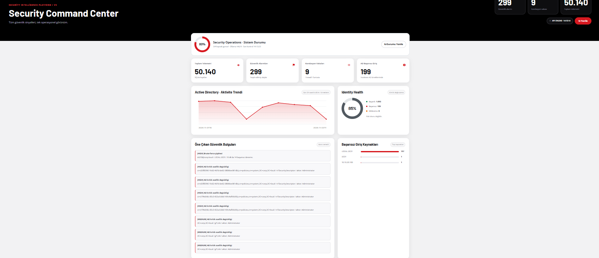

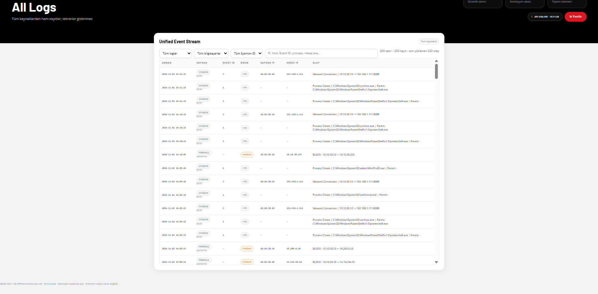

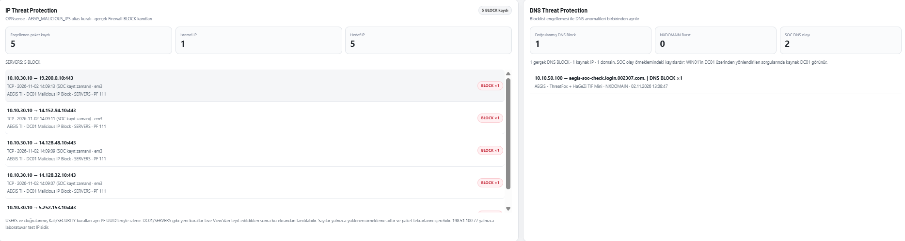

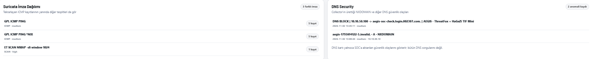

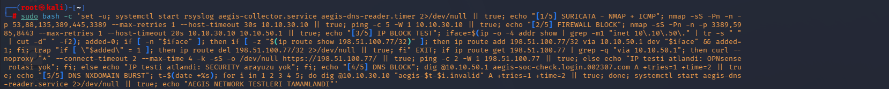

## Görselleri yayınlarken

[LAB] Ekran görüntülerini herkese açık depoda kullanmadan önce kullanıcı adları, SID, IP adresleri ve diğer hassas ayrıntılar bakımından ayrıca incelemek gerekir. Dosyaların adlarını değiştirmeden kullanmak, README ve teknik dökümanlardaki bağlantıların çalışmasını sağlar.
